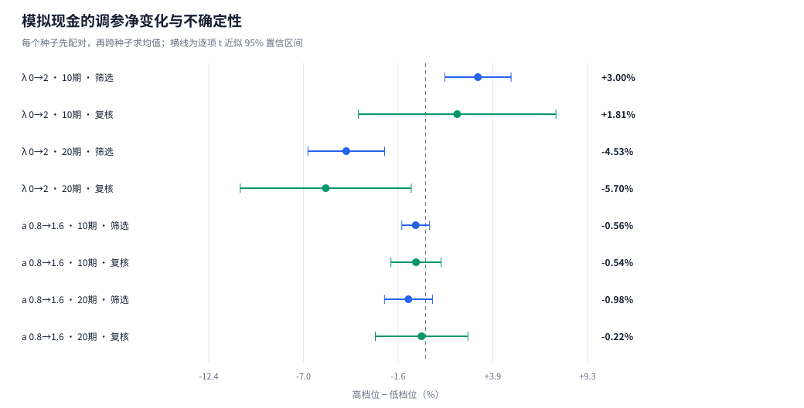
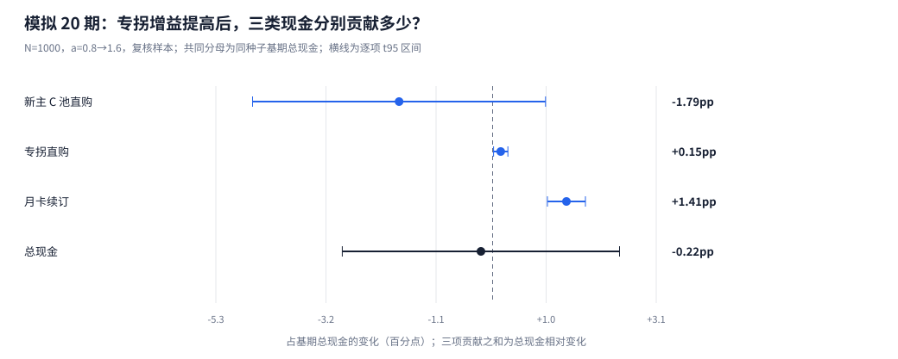
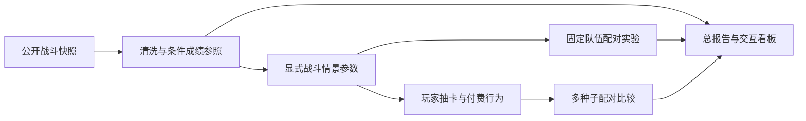

# 绝区零：机制锁、售后支援与玩家生态

**在抽卡动作游戏里，用机制锁推动换代，还是用专属支援延长老角色寿命，对囤抽、付费、长期现金与留存分别意味着什么？**

项目把公开通关样本、固定队伍战斗实验和玩家行为情景连接起来，构建受耐用品垄断理论启发的反事实分析工具。技术栈为 **Python · NumPy · SQLite · pytest · HTML/SVG**。

[总报告](outputs/final_release/report/REPORT.md) · [交互看板](outputs/final_release/dashboard/index.html) · [审核入口](docs/review/REVIEW_GUIDE.md) · [实验目录索引](outputs/README.md)

## 当前结果

当前主实验使用 **1000 名初始玩家、25 个候选、5 组筛选与 3 组独立复核种子**，共 200 次 20 期物理运行。每期 42 天，10 期结果读取同一次运行的前缀。候选之间使用事件索引公共随机数，比较先在种子内配对，再跨种子汇总。

| 20 期独立复核对照 | 核心层留存变化 | 累计现金相对变化及逐项 95% 区间 |
| --- | ---: | ---: |
| 机制锁 λ：0 → 2，平均五档支援 | **−21.30 个百分点** | **−5.70% [−10.60%, −0.81%]** |
| 支援净增益 a：0.8 → 1.6，平均五档机制 | **+3.15 个百分点** | **−0.22% [−2.87%, +2.42%]** |

机制锁在长周期中同时损害留存与现金。提高支援净增益能改善留存，总现金变化尚不可区分；分项点估计表现为月卡续订、专拐直购增加与新主 C 池直购减少的抵消。该抵消的金额和共同分母贡献分别报告，区间不相加。

总现金的筛选—复核排序相关系数在 10/20 期分别为 **0.803 / 0.902**，20 期核心留存的排序相关系数为 **0.967**。预先指定的 `λ=1, a=1.4/1.6` 均为 **0/3** 次复核非支配集合入选；研究没有预设“卖支援必然最优”。

以上是显式行为函数下的模拟，不是官方流水或真实退坑率。三种行为结构的消融显示：λ 降低留存、a 替代部分新主 C 直购的方向跨设定一致；λ 的长期现金负号与 a 的留存收益只在玩家主要因强度缺口抽新主 C 时成立。外部校验显示，模拟的保底曲线、小保底与综合出率与 rng.moe 全服统计一致，但模拟现金约七成来自月卡续订，真实头部主 C 池的月卡／常驻地板不超过约四分之一，且模拟缺少耀嘉音、浮波柚叶这类高需求泛用辅助。真实数据一侧，8 名代表性主 C 的危局出场占比多在首发后 3–5 期跌破自身峰值一半，星见雅与叶瞬光分别为 12、17 期；售后插件上线后，固定第三人分层的 0+1 条件成绩比为 1.08–1.42。

| 研究模块 | 证据等级 |
| --- | --- |
| 配队流派、机制演替、主核—插件共现 | L1 强实证（描述统计） |
| 专拐与通关成绩的条件关系 | L1.5 中强实证（条件关联，P25/P50/P75 与 n） |
| 角色保值寿命与售后恢复 | L2 双轨对照（真实主C轨迹＋受控代理） |
| 囤抽、付费、停氪、退坑与长期现金 | L3 反事实推演（情景模拟＋结构消融＋外部流水量级参照） |





## 三层架构

| 层次 | 数据与方法 | 回答的问题 |
| --- | --- | --- |
| Layer 1：公开样本 | 固定 Hugging Face 快照；401 万条战斗记录，287.6 万条合格记录，其中 286.7 万条为合法完整三人队伍；覆盖 56 个战斗赛季、60 名角色 | 样本内的流派、机制适配与支援条件成绩如何演变？ |
| Layer 2：固定队伍 | 参考 ZSim 防御区结构的参数化代理；防御、输出窗口、机制壁垒三通道；同条件配对 | 控制投资、养成与机制环境后，首次失效与支援恢复分别怎样变化？ |
| Layer 3：固定玩家队列 | 逐抽双池保底、四类抽数来源、动态付费意愿、库存与流失；25 点多种子搜索 | 机制锁与售后支援怎样改变囤抽、停氪、现金结构和留存？ |



行为模拟执行“资源发放 → 抽前评估 → 购买与逐抽 → 部分成果入库 → 抽后评估 → 疲劳与流失”。初始预算能力、当期付费意愿和活跃状态分别记录，允许停氪但继续游玩。

## 修改与复现

当前研究的参数入口是 [config/research_v2/experiment.json](config/research_v2/experiment.json)，模型接口见 [V2 设计](docs/design/research_v2.md)，实验口径见 [多种子协议](docs/development/research_v2_stability_protocol.md)。根目录的 `config/experiment.json` 保留 V1 基线；CLI 中需要配置的命令应显式指定研究入口。

在项目根目录使用 PowerShell，Python 3.10 及以上：

```powershell
python -m venv .venv
.\.venv\Scripts\python.exe -m pip install -e ".[dev]"
.\.venv\Scripts\python.exe -m pytest -q
```

刷新分为三种依赖不同的操作：

| 操作 | 读取 | 不需要 |
| --- | --- | --- |
| 静态看板／报告视图重绘 | 只读 `outputs/final_release/` 中已发布的汇总 CSV、`publication_manifest.json` 登记的表与外部来源清单、配置快照、Layer 1 清洗维表和 SVG | SQLite 运行库、观测库、原始快照 |
| 素材收集／汇总导出 | 本地观测库（真实主C轨迹、条件成绩表），各源实验目录的导出表与清单，千人基准运行库中的科学配置 | 原始快照；不重新模拟 |
| 重新模拟 | 研究配置与实验入口 | 观测库与原始快照 |

**视图重绘。**

```powershell
.\.venv\Scripts\python.exe -m zzz_research report --dir outputs/final_release
.\.venv\Scripts\python.exe -m zzz_research app --dir outputs/final_release
```

浏览器打开 `outputs/final_release/dashboard/index.html`。HTML 看板可离线阅读，图表与表格使用已发布的汇总数据。

**素材收集与汇总导出。** 真实主C轨迹与售后事件窗口单次只读扫描 `observations/observations.sqlite`；`rebuild_final_release.py` 收集 `research_v2/`、`research_v2_stability/`、`research_v2_stability_n1000/`、`research_v2_behavior_ablation/` 的导出表、实验清单与图表，打开千人基准运行库提取科学配置，并登记实证表与外部参照表后重绘视图。

```powershell
.\.venv\Scripts\python.exe tools\build_empirical_longevity.py --dir outputs\final_release
.\.venv\Scripts\python.exe tools\build_external_benchmarks.py --dir outputs\final_release
.\.venv\Scripts\python.exe tools\build_support_archetypes.py --dir outputs\final_release
.\.venv\Scripts\python.exe tools\rebuild_final_release.py
```

完整重算千人主网格则使用研究配置与独立实验入口，生成运行数据库；已有且配置匹配的运行会直接复用：

```powershell
.\.venv\Scripts\python.exe tools\run_research_v2_stability.py --config config\research_v2\experiment.json --players 1000 --workers 8 --out outputs\research_v2_stability_n1000
```

行为函数结构消融复用 N=200 实验中的 M0 运行，新增 M1／M2：

```powershell
.\.venv\Scripts\python.exe tools\run_behavior_ablation.py --workers 6
```

体系化合成世界的虚拟实验（售后类型 × 环境 × λ，以及新体系换代）：

```powershell
.\.venv\Scripts\python.exe tools\run_archetype_experiment.py --workers 6
.\.venv\Scripts\python.exe tools\analyze_archetype_experiment.py
```

`--plan-only` 可查看计划。只有重新导入 Layer 1 原始战斗记录时才需要 `data/raw/shiyu_hf/` 快照，可用 `tools/fetch_shiyu_snapshot.py` 按固定修订下载（先 `--inspect-only`，再 `--download`；需要 `huggingface_hub`）。

## 仓库内容

仓库收录代码、配置、设计文档、测试，以及可直接阅读和重绘的发布产物：`outputs/final_release/` 的报告、看板、汇总表与清单，三个源实验目录的报告、图表、汇总表与实验清单。以下大文件只在本机保留，按上文命令可重新生成：

| 本机资产 | 规模 | 生成方式 |
| --- | ---: | --- |
| `data/raw/shiyu_hf/` 原始快照 | 约 1 GB | `tools/fetch_shiyu_snapshot.py` |
| `outputs/final_release/observations/observations.sqlite` 等观测库与 V1 基线运行库 | 约 13 GB | Layer 1 导入与 V1 基线流水线 |
| `outputs/research_v2*/runs/` 运行数据库与全日志 | 约 60 GB | 各实验入口；配置匹配的运行会复用 |
| `outputs/research_v2/tables/l2_reference_panel.csv` | 40 MB | `tools/run_research_v2.py` |

清单中的运行路径相对项目根记录。视图重绘只读仓库内的汇总表；素材收集与重新模拟需要先在本机生成上表资产。

## 工程目录

```text
游戏项目/
├─ README.md                    当前研究入口
├─ prompt_spec.md               设计总入口
├─ config/
│  ├─ research_v2/              当前科学配置
│  └─ modules/                  V1 基线参数
├─ src/zzz_research/            战斗、经济、行为、统计与展示
├─ tests/                      自动化测试
├─ docs/
│  ├─ design/                  模块契约与 V2 公式
│  ├─ development/             实验协议与实施资料
│  └─ review/                  审核路径与数据地图
├─ tools/                      数据清洗、研究运行与发布工具
├─ data/
│  ├─ external/                外部参照快照（Gacha Revenue Tracker、rng.moe）
│  └─ raw/                     固定修订的源元数据；原始战斗快照 shiyu_hf/ 在本机
└─ outputs/
   ├─ final_release/           总报告、看板与发布汇总
   ├─ research_v2/             固定队伍、模块消融与首轮实验
   ├─ research_v2_stability/   N=200 多种子对照
   ├─ research_v2_stability_n1000/  当前 N=1000 主网格
   ├─ research_v2_behavior_ablation/  M0/M1/M2 行为结构消融（本机，汇总见 final_release/research/ablation）
   └─ research_v2_archetype/     体系化合成世界的虚拟实验（本机，汇总见 final_release/research/archetype）
```

最终发布目录中的 `publication_manifest.json` 指向本次采用的汇总与配置快照。V1 报告和看板保留为明确命名的基线对照，不作为当前主结论。

## 局限与来源

公开数据来自社区主动提交的通关记录，条件成绩关联不等于因果识别；无可验证的跨赛季玩家身份，也没有真实充值或流失标签。战斗映射、付费意愿、预算与商品排期均包含显式情景假设。模拟现金是固定初始队列的收入，不含获客、回流、运营成本，不是官方流水预测。

独立复核仅三组种子，逐项 t95 区间不具有整组同时覆盖保证；人口扩样不能消除参数不确定性。当前规划器评估当期卡池，未求解预知未来排期的跨期最优囤抽。完整口径见[总报告](outputs/final_release/report/REPORT.md)。

- [ShiyuStats](https://github.com/LvlUrArti/ShiyuStats)：样本处理口径与元数据，固定修订 `d930cec50bfde460d1a6ebd9acef8b240a676000`。
- [ShiyuData](https://huggingface.co/datasets/LvlUrArti/ShiyuData)：原始数据快照，固定修订 `324c95d5fb05961fa8926168de8768acc8500c1b`，数据集声明 MIT 许可。
- [ZSim](https://github.com/ZSim-Dev/ZSim)：防御区结构公式参考；项目战斗层为参数化代理模型。
- [外部依据与情景假设](docs/design/modules/provenance.md)：来源及许可边界。
