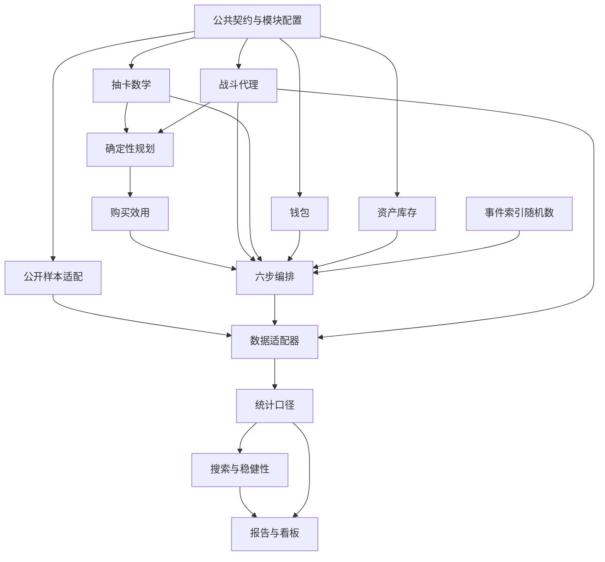

# 模块地图与接口边界

> V2 已实现并完成千人跨种子复核；现行代码、发布清单（publication_manifest.json）与结果表已对齐。公共契约与模块边界沿用设计1.1.0；当前研究增量见[V2设计](research_v2.md)，当前数据与千人主网格见[发布清单](../../outputs/final_release/publication_manifest.json)和[总报告](../../outputs/final_release/report/REPORT.md)。

## 三种边界

1. **公共契约**定义时间、单位、状态和事件含义。
2. **计算模块**接收只读输入，返回结果/变更意图，互不修改内部状态。
3. **编排与适配器**负责顺序、提交、持久化和展示。



箭头表示输入/输出依赖，不要求计算模块import配置加载器或数据库实现。UI触发重跑通过组合入口发命令，不反向修改科学模块。

## 单抽与阶段编排

```text
runtime.execute_target
  ├─ wallet.prepare_payment       → 支付草案（不提交）
  ├─ gacha.resolve_one_pull       → PullOutcome / 新PityState
  ├─ roster.apply_asset_delta     → 库存草案
  └─ commit(EventBundle)          → 同时提交并由writer持久化
```

gacha不调用wallet；wallet不判断出货；roster不重新掷骰；storage不补算价格。任何步骤失败，不能留下“扣钱但没有抽取结果”的半提交。

## 规划与实际执行分离

- planner只依赖概率内核、只读库存/预算与战斗评估。
- forecast_target输出每阶段概率/CI/期望成本；behavior计算平滑效用。
- 实际抽取才读取CRN；规划永远不能读取同一玩家的未来实际槽位。
- planner和runtime共用TargetPlan，改变目标顺序时必须同步检查两者。

## 缓存按科学依赖拆分

| 缓存 | 必含输入 | 不应导致它失效的改动 |
| --- | --- | --- |
| 下一UP成本分布 | gacha算法/曲线、池、pity/保证状态 | 支援倍率、报告样式 |
| 目标阶段CDF | 上项、TargetPlan、预算截断 | 报告样式 |
| 固定战斗结果 | combat版本、队伍/build、场景、实际G | 价格、界面布局 |
| 阶段CI | 潜在阶段库存、战斗键 | 仅概率曲线变化且阶段资产不变 |
| 购买效用 | Forecast、行为权重、玩家状态、预算 | 图表配色 |
| 统计/图表 | 输入run摘要、口径/呈现版本 | 与其无关的原始文件路径改名 |

全run的config_id包含完整科学输入；缓存可以用完整、已声明的依赖投影复用。缓存格式/压缩版本与科学算法版本分开；不能用旧缓存代替算法变更后的计算。

## 替换外部来源或引擎

- 新的公开数据源实现同一个规范化观测输出，原始字段只在adapter内转换。
- 完整ZSim实现CombatRequest/Result适配；不满足代理假设时独立记录engine_kind，不把不同引擎的指标冒充相同口径。
- SQLite writer通过持久化端口消费EventBundle。替换存储时保持科学事件和ID不变。
- 报告/看板只消费通过验证的结果；不在UI层复制公式。

## 模块清单与机器登记

[模块索引](README.md)给出职责与入口。机器清单在[module_manifest.json](module_manifest.json)，分别记录设计依赖dependencies和数据流consumes_outputs_of；影响分析使用两者，依赖环检查仅针对单向设计依赖。

当前已实现观测适配、战斗三通道、动态付费意愿、跨种子主网格、统计与报告模块。发布层读取已完成汇总，按[发布清单](../../outputs/final_release/publication_manifest.json)连接观测与实验。配置解析复用M-RNG的参数校验，实际科学版本由共享versions.py登记，不从simulation导入整个运行链路来计算配置身份。

