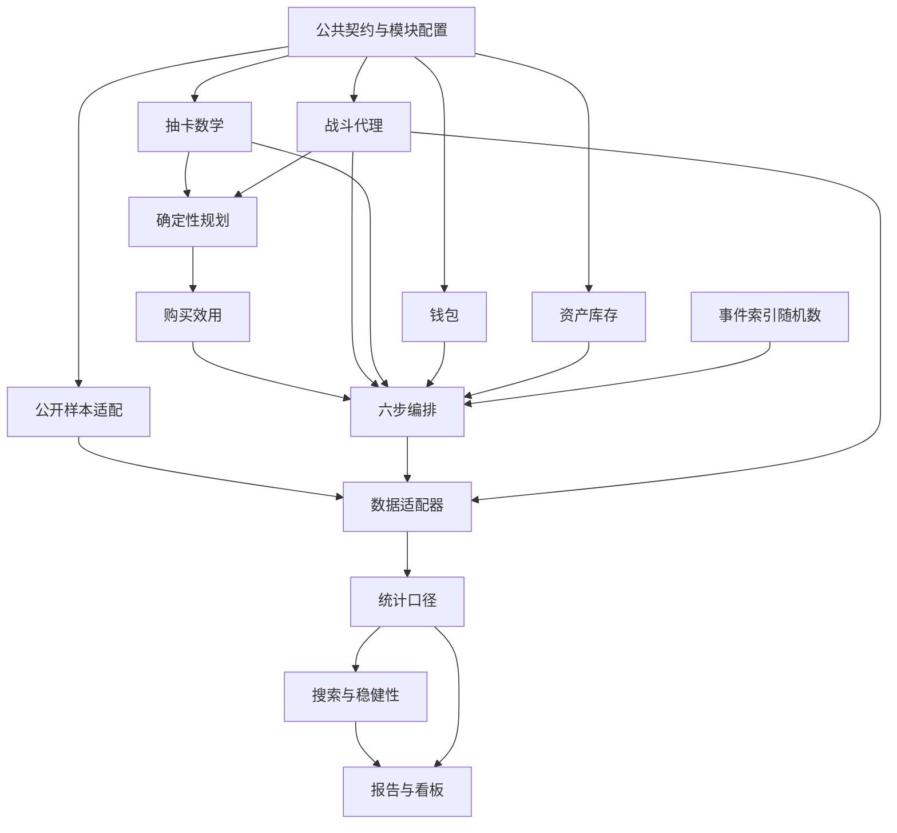

# 完整设计阅读版（自动生成）

> V2 已实现并完成实证接入与跨种子复核。本文件汇总模块公共设计与V1基线参数；V2增量见[V2设计](../research_v2.md)，当前结果见[总报告](../../../outputs/final_release/report/REPORT.md)。请修改模块文档和JSON，不直接修改本文件。


---

# 模块地图与接口边界

> V2 已实现并完成千人跨种子复核；现行代码、发布清单（publication_manifest.json）与结果表已对齐。公共契约与模块边界沿用设计1.1.0；当前研究增量见[V2设计](../research_v2.md)，当前数据与千人主网格见[发布清单](../../../outputs/final_release/publication_manifest.json)和[总报告](../../../outputs/final_release/report/REPORT.md)。

## 三种边界

1. **公共契约**定义时间、单位、状态和事件含义。
2. **计算模块**接收只读输入，返回结果/变更意图，互不修改内部状态。
3. **编排与适配器**负责顺序、提交、持久化和展示。



箭头表示输入/输出依赖，不要求计算模块import配置加载器或数据库实现。UI触发重跑通过组合入口发命令，不反向修改科学模块。

## 单抽与阶段编排

```text
runtime.execute_target
  ├─ wallet.prepare_payment       → 支付草案（不提交）
  ├─ gacha.resolve_one_pull       → PullOutcome / 新PityState
  ├─ roster.apply_asset_delta     → 库存草案
  └─ commit(EventBundle)          → 同时提交并由writer持久化
```

gacha不调用wallet；wallet不判断出货；roster不重新掷骰；storage不补算价格。任何步骤失败，不能留下“扣钱但没有抽取结果”的半提交。

## 规划与实际执行分离

- planner只依赖概率内核、只读库存/预算与战斗评估。
- forecast_target输出每阶段概率/CI/期望成本；behavior计算平滑效用。
- 实际抽取才读取CRN；规划永远不能读取同一玩家的未来实际槽位。
- planner和runtime共用TargetPlan，改变目标顺序时必须同步检查两者。

## 缓存按科学依赖拆分

| 缓存 | 必含输入 | 不应导致它失效的改动 |
| --- | --- | --- |
| 下一UP成本分布 | gacha算法/曲线、池、pity/保证状态 | 支援倍率、报告样式 |
| 目标阶段CDF | 上项、TargetPlan、预算截断 | 报告样式 |
| 固定战斗结果 | combat版本、队伍/build、场景、实际G | 价格、界面布局 |
| 阶段CI | 潜在阶段库存、战斗键 | 仅概率曲线变化且阶段资产不变 |
| 购买效用 | Forecast、行为权重、玩家状态、预算 | 图表配色 |
| 统计/图表 | 输入run摘要、口径/呈现版本 | 与其无关的原始文件路径改名 |

全run的config_id包含完整科学输入；缓存可以用完整、已声明的依赖投影复用。缓存格式/压缩版本与科学算法版本分开；不能用旧缓存代替算法变更后的计算。

## 替换外部来源或引擎

- 新的公开数据源实现同一个规范化观测输出，原始字段只在adapter内转换。
- 完整ZSim实现CombatRequest/Result适配；不满足代理假设时独立记录engine_kind，不把不同引擎的指标冒充相同口径。
- SQLite writer通过持久化端口消费EventBundle。替换存储时保持科学事件和ID不变。
- 报告/看板只消费通过验证的结果；不在UI层复制公式。

## 模块清单与机器登记

[模块索引](../README.md)给出职责与入口。机器清单在[../module_manifest.json](../module_manifest.json)，分别记录设计依赖dependencies和数据流consumes_outputs_of；影响分析使用两者，依赖环检查仅针对单向设计依赖。

当前已实现观测适配、战斗三通道、动态付费意愿、跨种子主网格、统计与报告模块。发布层读取已完成汇总，按[发布清单](../../../outputs/final_release/publication_manifest.json)连接观测与实验。配置解析复用M-RNG的参数校验，实际科学版本由共享versions.py登记，不从simulation导入整个运行链路来计算配置身份。


---

# M-SCOPE｜项目范围与证据边界

> 模块文档版本：1.0.0｜整套设计：1.1.0｜V2 已实现并完成千人跨种子复核；现行代码、发布清单（publication_manifest.json）与结果表已对齐。当前研究差异见[V2设计](../research_v2.md)。

[总入口](../../../prompt_spec.md) · [模块地图](../architecture.md) · [变更指南](../change_guide.md)

## 模块契约

| 项目 | 约定 |
| --- | --- |
| 负责 | 项目定位与措辞；不维护数值公式或数据库字段 |
| 输入 | 研究请求、数据可得性和已确认定位 |
| 输出 | 三层证据、运行模式、范围及结论边界 |
| 单向依赖 | 无模块依赖 |
| 参数维护位置 | 无独立数值配置；引用所属参数模块 |

数值参数以对应JSON为唯一维护源，[默认参数视图](../defaults.md)是自动生成的只读投影。下面保留的v1.0数值校验例用于解释公式，不覆盖配置；不得把示例复制成另一份全局默认值。

## 详细设计

项目基于公开终局战斗样本，描述角色与队伍的跨期表现；建立参考 ZSim 防御区公式的参数化战斗代理模型，在受控配置下比较环境、伤害类型、支援与投资；最后用显式行为假设探索抽取、资源积累、模拟收入和模拟留存。

三层分别交付、分别标识证据，不能相互冒充：

| 层 | 名称 | 输入与主要产物 | 能回答的问题 |
| --- | --- | --- | --- |
| Layer 1 | 公开样本观测 | ShiyuStats 数据快照；覆盖表、出场、配队、成绩与配装统计 | 所取得样本中发生了什么，比较受哪些限制 |
| Layer 2 | 固定参考队伍面板 | 代理模型、预注册队伍和环境；固定基准、配对差值、适用性轨迹 | 给定模型内，改变指定因素有什么影响 |
| Layer 3 | 模拟玩家行为面板 | 战斗表、逐抽状态机、钱包与行为参数；全库存、支付、存续与情景比较 | 给定行为与供给假设时，哪些结果可能出现、何时反转 |

完整 ZSim 引擎是可选的独立验证适配器，不能把引用少量公式的代理模型输出命名为“ZSim 实战结果”。公开样本相关性、模型内受控效应、现实因果效应必须分开。

首个可交付版本按 L1 → L2 → L3 顺序建设。L1 数据不可得时，允许先验证合成 L2/L3，但 L1 标记为 unavailable，报告不得用合成记录补充公开样本。

核心问题是跨期适用性、环境适配与支援收益；耐用品与延迟购买理论仅作行为动机，不求解科斯均衡。允许没有反弹、支援无明显收益、策略排序不稳定、无法区分原因。没有固定半衰期或某策略必胜的验收要求。

### 0.1 运行模式

- `observed_analysis`：只对已下载、通过检查的公开记录做描述统计；范围由文件实际覆盖决定。没有稳定跨期匿名 ID，不建立真实玩家面板。
- `synthetic_scenario`：使用本设计给出的教学配置运行代理与行为模型；时间标签为 P01…P10，禁止映射成“真实 v1.0–v3.3 历史”。
- `historical_scenario`：可选。仅在日期、敌人、天气、角色、配装可用性及事件配置可追溯后启用；无法重建的部分仍标为假设，不能宣称完整历史还原。

### 0.2 明确不涵盖

真实充值、囤抽和留存估计；全体玩家代表性；厂商商业意图判断；完整多队满星优化；全角色全敌人精确还原；跨厂映射；真实利润或全局商业最优。有限期累计模拟支付不命名为完整 LTV。

## 补充协议

- “参考ZSim公式的代理结果”“完整ZSim运行结果”“公开样本观测”三种标签不可互换。
- “模型内受控效应”不升级为真实游戏主因果证据；Cox关联不写因果延寿。
- “固定期累计模拟现金”“模拟期末留存”“25个候选的非支配集合”不升级为真实LTV、真实留存或全局最优。
- 参数来源缺失则标assumed；支持不足则unsupported；必要数据缺失则unavailable。不通过填目标数字、伪造记录或删除不利结果完成交付。
- 本文是实施设计，当前任务仅交付完整文档。后续开发以实际授权范围分阶段开展，不执行旧版内嵌的自动构建指令。

## 更新与验收

修改本模块时先查看[影响矩阵](../change_guide.md)，更新对应配置/契约版本，并执行 `python tools/design_docs.py sync` 和 `python tools/design_docs.py check`。这两条仅维护设计资料；科学验证仍按[验证模块](../modules/validation.md)实施。模块输入输出字段不得在此复制出与[公共契约](../modules/contracts.md)或[数据库契约](../modules/storage.md)相冲突的定义。


---

# M-SOURCE｜外部来源与许可

> 模块文档版本：1.0.0｜整套设计：1.1.0｜V2 已实现并完成千人跨种子复核；现行代码、发布清单（publication_manifest.json）与结果表已对齐。当前研究差异见[V2设计](../research_v2.md)。

[总入口](../../../prompt_spec.md) · [模块地图](../architecture.md) · [变更指南](../change_guide.md)

## 模块契约

| 项目 | 约定 |
| --- | --- |
| 负责 | 来源、快照和数据可用边界；不推定真实消费或跨期身份 |
| 输入 | 仓库/数据快照及其元数据 |
| 输出 | source_manifest、来源检查、可用性与许可记录 |
| 单向依赖 | [M-CONTRACT](../modules/contracts.md) |
| 参数维护位置 | 无独立数值配置；引用所属参数模块 |

数值参数以对应JSON为唯一维护源，[默认参数视图](../defaults.md)是自动生成的只读投影。下面保留的v1.0数值校验例用于解释公式，不覆盖配置；不得把示例复制成另一份全局默认值。

## 详细设计

### 1.1 已检查的固定源码基线

| source_id | 来源 | 固定基线 / 用途 |
| --- | --- | --- |
| SRC_SHIYU | [ShiyuStats](https://github.com/LvlUrArti/ShiyuStats) | `d930cec50bfde460d1a6ebd9acef8b240a676000`；数据口径与公开快照入口 |
| SRC_ZSIM | [ZSim](https://github.com/ZSim-Dev/ZSim) | `e248e9f149a6b889290579d8e673e132be9bde31`；防御公式与可选完整引擎 |
| SRC_SHIELD | [社区机制导论，第 5.3 节](https://news.17173.com/content/07112025/114804086.shtml) | 社区条件推导的来源线索；不是官方参数或独立实测验证 |
| SRC_SURVIVAL | [lifelines 时变模型文档](https://lifelines.readthedocs.io/en/latest/Time%20varying%20survival%20regression.html) | 可选生存分析的数据格式与解释边界 |

代码、数据、公式来源分别登记。`source_manifest` 保存 URL、修订、获取时间、SHA256、文件大小、许可、覆盖、获取状态与验证说明。原始快照只读保存；外部更新建立新快照，不覆盖旧输入。

`parameter_registry` 对每个参数保存：`parameter_name, value_json, unit, source_kind, source_ref, applicability, rationale, sensitivity_set, status`。来源类型为 `source_code / observed / community_derived / scenario_assumed`。来源存在不等于数值在全部场景成立。

ShiyuStats 代码 MIT，保留版权与许可，分析发布时按 README 署名；数据许可按实际数据卡核对。ZSim 为 GPL-3.0，复制、修改与分发按其许可处理；完整引擎使用独立环境。数据准备可下载固定快照，日常计算与展示离线运行，不采集账号凭证。

### 1.2 L3 外部参照：卡池流水与行为文献

以下来源只为 L3 的商品收入结构与状态机设计提供外部锚点，不进入任何参数估计。逐项 URL、读取日期、覆盖与限制登记在[外部来源清单](../../../outputs/final_release/external_source_manifest.json)。

| source_id | 来源 | 用途与边界 |
| --- | --- | --- |
| SRC_REVENUE_TRACKER | [Gacha Revenue Tracker](https://derkein.github.io/gacha-tracker-/) | 读取其数据文件：40 个卡池的 game-i 日本区日元估算、七麦中国 iPhone 逐日流水按卡池窗口加总与中国 iPhone 畅销总榜逐日名次（2026-10-30 更新），快照存于 `data/external/gacha_tracker_zzz_2026-10-31.json` |
| SRC_GAMEI / SRC_QIMAI | [game-i](https://game-i.daa.jp/)、[七麦数据](https://www.qimai.cn/) | 上表两个市场的原始口径；两者独立估算，用于交叉核对专拐池与主C池的相对量级 |
| SRC_SENSORTOWER / SRC_GACHAREVENUE | [Sensor Tower](https://app.sensortower.com/overview/6626a822a9cba85698402d6b/1606356401?country=WW)、[GachaRevenue](https://revenue.ennead.cc/revenue) | 月度汇总，仅作交叉索引 |
| SRC_RNGMOE | [rng.moe 全服调频统计](https://zzz.rng.moe/en/tracker/global) | 公开接口的 26 个限定角色池与 26 个音擎池聚合统计（2024-07 至 2026-01）：人数、总抽数、小保底胜负、逐抽出金率；快照存于 `data/external/rngmoe_zzz_global_2026-10-31.json` |
| SRC_STARDB | [StarDB Signal Tracker](https://stardb.gg/en/zzz/signal-tracker) | 仅展示登录用户自己导入的记录，无全服聚合；已核查、未采用 |
| SRC_LIT_TS_CHURN | [arXiv:2003.10287](https://arxiv.org/abs/2003.10287) | 登录流失与付费流失分为两条序列建模，协变量响应不同；支持停氪／退坑双状态结构 |
| SRC_LIT_F2P_CHURN | [Applied Sciences 12(6):2795](https://www.mdpi.com/2076-3417/12/6/2795) | 免费手游登录流失预测；只涉及退坑一侧 |
| SRC_LIT_GACHA_SPENDING | [Information 14(7):399](https://www.mdpi.com/2078-2489/14/7/399) | 713 名抽卡玩家的付费动机调查：解锁角色／武器 77.7%，更快推进 20.5%，竞争优势 5.8%；用于判断缺口驱动（M0）与追新驱动（M2）哪种结构更贴近自报动机 |
| SRC_KAGGLE_RETENTION / SRC_FIGSHARE_SEARCH | [Kaggle 留存与流失数据集](https://www.kaggle.com/datasets/rajatsurana979/mobile-game-retention-and-churn-analysis)、Figshare 检索 | 已评估、未采用：前者无付费字段与采集来源；后者没有受访者级的抽卡付费动机数据 |

比较结果由 `tools/build_external_benchmarks.py` 生成 `external_sim_benchmarks.csv` 等表，结论见总报告第 6 节。

第三方流水由 App Store／Google Play 畅销榜排名与日度权重反推，不含官方 PC 端与支付中心直充，双 UP 卡池同开期按规则切分；只用于校验卡池品类间的相对量级，不作为单个玩家充值因果的微观真值。

### 1.3 ShiyuStats 的可用边界

当前公开 [hash.py](https://github.com/LvlUrArti/ShiyuStats/blob/d930cec50bfde460d1a6ebd9acef8b240a676000/scripts/hash.py) 按采集期重新编号。公开 UID 仅限同一快照组内关联，不以同号推定跨期同一玩家。

现成 [角色统计](https://github.com/LvlUrArti/ShiyuStats/blob/d930cec50bfde460d1a6ebd9acef8b240a676000/scripts/char_usage.py) 包含有效通关筛选；投资档位分类不等于实际付费身份。展示配装缺失不等于未持有。首版不计算无法证明完整的持有率。

[文件清单](https://github.com/LvlUrArti/ShiyuStats/blob/d930cec50bfde460d1a6ebd9acef8b240a676000/data/repo_files.csv) 在本次检查时列至 3.2.3，这不证明每个战斗赛季均有文件。[采集期—战斗期映射](https://github.com/LvlUrArti/ShiyuStats/blob/d930cec50bfde460d1a6ebd9acef8b240a676000/data/versions/config.json) 和 [评分配置](https://github.com/LvlUrArti/ShiyuStats/blob/d930cec50bfde460d1a6ebd9acef8b240a676000/scripts/comp_rates_config.py) 必须入库：采集期不能直接当战斗版本，时间制与分数制不直接拼接。

## 更新与验收

修改本模块时先查看[影响矩阵](../change_guide.md)，更新对应配置/契约版本，并执行 `python tools/design_docs.py sync` 和 `python tools/design_docs.py check`。这两条仅维护设计资料；科学验证仍按[验证模块](../modules/validation.md)实施。模块输入输出字段不得在此复制出与[公共契约](../modules/contracts.md)或[数据库契约](../modules/storage.md)相冲突的定义。


---

# M-CONTRACT｜公共类型、时间与运行身份

> 模块文档版本：1.1.0｜公共契约：1.1.0｜整套设计：1.1.0｜V2 已实现并完成千人跨种子复核；现行代码、发布清单（publication_manifest.json）与结果表已对齐。当前研究差异见[V2设计](../research_v2.md)。

[总入口](../../../prompt_spec.md) · [模块地图](../architecture.md) · [变更指南](../change_guide.md)

## 模块契约

| 项目 | 约定 |
| --- | --- |
| 负责 | 跨模块字段语义、TargetPlan、事件身份；不实现科学算法 |
| 输入 | 规范化配置、时间轴、事件及状态 |
| 输出 | 公共DTO、身份、单位、缺失与版本约定 |
| 单向依赖 | 无模块依赖 |
| 参数维护位置 | 无独立数值配置；引用所属参数模块 |

数值参数以对应JSON为唯一维护源，[默认参数视图](../defaults.md)是自动生成的只读投影。下面保留的v1.0数值校验例用于解释公式，不覆盖配置；不得把示例复制成另一份全局默认值。

## 详细设计

### 2.1 时间协议

统一保存 `period_start_day, period_end_day, elapsed_days, evaluation_day`；有真实日历时另保存 ISO 日期和来源时区。`delta_span = elapsed_days / 42.0`，`cum_ver_span = (evaluation_day - origin_day) / 42.0`。42 天只是标准展示单位。

合成基线：10 个区间，t=1…10，起点 `42(t-1)`，终点与评估日 `42t`；没有真实日期和实际版本号。角色获取、抽取与 Pre/Post 评估发生在区间末端；订阅购买与权益到账按事件日期记录。疲劳用本区间末表现近似该区间感受，是离散行为假设。

旧角色在评估日前按实际已过天数养成，新获取角色从获取日开始计龄。变间隔实验同步改变资源累计、养成、失败持续量与流失暴露，不能只改横轴。真实时间轴跳过的区间不能被默认为没有抽取或没有资源；缺失供给事件时禁止称完整历史行为回放。

### 2.2 运行身份

- `experiment_id`：固定人群生成协议、时间轴、目标与指标的一组比较。
- `config_id`：规范化科学配置内容的 SHA256，含供给、战斗、行为、价格、概率曲线、输入摘要，以及 proxy/gacha/planner/behavior/rng 和配置规范化算法版本摘要；不含种子、策略显示名称、日志模式、输出目录与运行时间。改变决定结果的算法，必须生成新配置身份并使旧缓存失效。
- `replicate_id`：独立随机重复，绑定 `master_seed`；同一次重复中所有候选共享相同基础随机输入。
- `run_id`：逻辑运行，对应 `(experiment_id, config_id, replicate_id)`。
- `attempt_id`：同一逻辑运行的重跑尝试；重跑不能当成新的独立样本。
- `benchmark_id`：固定战斗模型、场景与队伍清单的摘要，可由多个行为运行引用。

规范化规则 `json_canonical_v1`：展开默认值和派生科学参数、按稳定ID排序清单、JSON键排序、UTF-8、无多余空白、禁止NaN/Infinity；不把相同科学参数的显示别名视为不同策略。浮点序列化与Python版本一起锁定。

一个输出目录只对应一个 run 或一项明确的跨 run 汇总。所有汇总保存输入 run 列表与摘要。

### 2.3 数值与缺失

金额用整数分；钱包用整数 `credit_minor`，160 单位可兑换一次抽取。角色影画为 0…6，武器数量为非负整数；本版不模拟精炼。概率在 [0,1]，支出与库存非负。

本版契约固定standard_span_days=42、credit_minor_per_pull=160、模型达标阈值=1。JSON显式携带这几项用于自描述，检查器要求与契约一致；它们不是普通调参项。改变单位或判定含义须升级契约、迁移相关字段并更新检查器。实际区间天数、订阅周期、舒适偏好阈值仍是各所属模块的可配参数。

数值计算保存双精度、只在展示时四舍五入。NULL 表示未知/不可评估，0 表示已定义的零；不相互替代。缺失场景和空风险集不补 0。比较同值时按稳定 ID 排序，禁止依赖字典遍历或并发完成顺序。

资源来源消耗的“抽数”是 `消耗credit/160`，可为小数；实际抽取总数、直购抽数、pity与资产数量仍为整数。没有可行队伍且原因已知时可定义能力贡献为0并记 `no_feasible_team`；缺失模型、unsupported或计算错误的CI为NULL，默认停止依赖该结果的规划与报告，不把错误当作失败战力。

## 更新与验收

修改本模块时先查看[影响矩阵](../change_guide.md)，更新对应配置/契约版本，并执行 `python tools/design_docs.py sync` 和 `python tools/design_docs.py check`。这两条仅维护设计资料；科学验证仍按[验证模块](../modules/validation.md)实施。模块输入输出字段不得在此复制出与[公共契约](../modules/contracts.md)或[数据库契约](../modules/storage.md)相冲突的定义。


## 公共输入输出类型（唯一语义定义）

M0/M2已实现这些DTO/Protocol的基础类型，后续计算与编排按本契约接入。schema_version、算法版本与契约版本分开；SQLite列投影仍以[../modules/storage.md](../modules/storage.md)为权威。

| 类型 | 核心语义 | 状态权威拥有者 |
| --- | --- | --- |
| ResolvedConfig | 解析后只读科学配置、输入摘要、算法版本、来源元数据 | config装配后不可变 |
| TargetPlan / TargetStage | 目标部件、固定顺序、跳过条件、stage_id、所属池；规划和执行共用 | contracts定义；配置提供路径 |
| PityState | pity_group、连续未出S次数、保证状态；不包含钱包 | gacha |
| WalletState / BudgetView | 来源批次credit、现金事件、本期直购额度与只读整数F/P/B | wallet |
| RosterState / RosterView | 角色/武器数量、非战斗类别计数、首次获取日、实际装备值与冻结标记 | roster |
| CombatRequest | 锚定队伍、投资、实际G、场景、模型版本和缺失状态 | 调用者构造只读快照 |
| CombatResult | CI、达标、伤害分解、eval_status、配置摘要 | combat纯函数产生 |
| Forecast | 阶段达成概率、各阶段潜在库存/CI、期望抽数/直购及planner_version | planner；不含实际未来随机结果 |
| ActionIntent | 是否尝试、TargetPlan、可花预算上限及决策日志 | behavior产生；runtime执行 |
| PullOutcome | 本次是否S/UP、结果资产、下一保底状态及资产变更意图 | gacha纯转移产生 |
| AssetDelta | 获取/初始化资产与数量、事件ID；重复应用可检测 | roster应用 |
| ResourceDelta / CashEvent | 带来源批次的credit变动/现金购买，及本次抽取关联ID | wallet产生 |
| LifecycleState | 活跃期初/期末、h/F、失败持续量、退出时间与原因 | behavior计算，runtime提交 |
| EventBundle | 同一次单抽或时期提交的状态前后与相关事件集合 | runtime原子组装 |
| PeriodResult | 完整一期状态、Pre/Post/冻结评估、统计与持久化事件 | runtime |

同一个字段只能由其权威模块更新。其他模块持有快照或变更意图，不直接修改另一个模块的内部对象。类型里不复制第二份价格/概率/伤害算法。

### M2向后兼容扩展（公共契约1.1.0）

- `CharacterHolding.gear_value=None`保存尚未评估或已经计算的实际装备倍率；`RosterState.categories=()`与`frozen=False`新增非战斗计数和整体冻结状态。`CategoryCount`及`AssetKind.CATEGORY`承载歪S和影画溢出的数量，不生成战斗角色。
- 专武资产ID统一由`signature_weapon_id(unit_id)`生成，规则为`unit_id + "#signature"`。抽取、库存装备标记和目标跳过判断共用同一规则；外部数据适配器须把ID映射到这一命名空间。
- 以上新增能力与带默认值字段属于MINOR升级。当前实现将契约版本纳入科学身份，因此1.0.0升至1.1.0会改变`config_id`；旧记录保留旧ID，不覆盖改写。RNG事件键不含该ID，单独升级契约版本不改变随机映射。

### 接口升级约定

- PATCH：不改变字段含义或科学结果的修正。
- MINOR：向后兼容新增可选字段/能力；旧调用方仍可运行。
- MAJOR：删除字段、变更单位/事件顺序/状态语义，或新增必填字段。
- 科学算法虽可保持API兼容，只要改变结果就升级算法版本并改变config_id；不以API PATCH掩盖科学变化。
- 读写schema升级单独迁移，旧run保留其schema与算法版本，不静默重算覆盖。

M3的规划、编排与情景解析实现版本只在[versions.py](../../../src/zzz_research/versions.py)维护，各实现引用该登记；配置解析在哈希前收集实际版本，Runtime启动时检查一致性。不能仅在运行结束后向清单补写版本。存储实现版本与物理schema版本属于产物协议，分别登记，不代替科学版本。


---

# M-OBS｜公开样本观测

> 模块文档版本：1.0.1｜整套设计：1.1.0｜V2 已实现并完成千人跨种子复核；现行代码、发布清单（publication_manifest.json）与结果表已对齐。当前研究差异见[V2设计](../research_v2.md)。

[总入口](../../../prompt_spec.md) · [模块地图](../architecture.md) · [变更指南](../change_guide.md)

## 模块契约

| 项目 | 约定 |
| --- | --- |
| 负责 | 来源字段映射、筛选与观测分母；不负责行为推演 |
| 输入 | 已登记的公开快照 |
| 输出 | 规范化观测表、覆盖与描述汇总 |
| 单向依赖 | [M-CONTRACT](../modules/contracts.md)、[M-SOURCE](../modules/provenance.md) |
| 参数维护位置 | 无独立数值配置；引用所属参数模块 |

数值参数以对应JSON为唯一维护源，[默认参数视图](../defaults.md)是自动生成的只读投影。下面保留的v1.0数值校验例用于解释公式，不覆盖配置；不得把示例复制成另一份全局默认值。

## 详细设计

### 当前实施与数据入口

研究 V2 使用 `shiyu_adapter_v3`，实现见[公开样本适配器](../../../src/zzz_research/observations/adapter_shiyu.py)。固定快照已经导入；快照修订、导入状态、合格数量与质量问题以[观测清单](../../../outputs/final_release/observations/observations_manifest.json)为准，当前本地观测库为 `outputs/final_release/observations/observations.sqlite`。

观测结果与当前 V2 固定队伍、千人主网格的发布关系登记在[发布清单](../../../outputs/final_release/publication_manifest.json)；样本分母、流派分类与条件成绩比较见[总报告第2章](../../../outputs/final_release/report/REPORT.md)。日常重绘读取已有观测汇总，不重新下载或导入原始战斗记录。

### 已实现的身份与导入保护

适配器`shiyu_adapter_v3`以`base_snapshot_id:collection_period`为UID身份组。同一采集期的SD、DA及角色配装共享身份组，跨采集期即使UID和实际赛季标签相同也不合并玩家或关联配装。空或全空白UID列入`missing_uid`排除；合格记录必须有可用身份。

每次导入写`observations_manifest.json`，明确本次状态、适配器版本、快照修订和`observed_data_available`。同目录回退为metadata_only时清理旧观测派生文件；报告依据当前manifest，不能仅凭旧CSV存在判定已导入。

### 四级分母规则

| 级别 | 记录数 | 定义与用途 |
| --- | ---: | --- |
| 原始导入 | 4,013,856 | 固定快照全部战斗行，含无效通关、缺身份与非法队伍 |
| 合格通关 | 2,876,445 | `is_eligible=1`；含式舆后期评分制下 50,795 条缺成绩记录，出场统计保留、成绩统计剔除 |
| 合法完整三人 | 2,866,763 | 合格且三名角色标识有效、互不重复；流派、主核—插件共现、出场占比与真实主C轨迹的分母 |
| 危局精确机制池 | 1,388,743 | 完整三人危局记录剔除 210 条首领关联未决记录后的已知成绩记录；机制锁对照、0+1 相对分数与售后事件窗口的分母 |

各统计表注明所用级别，不在不同级别之间换算比例。真实主C轨迹与事件窗口由[`build_empirical_longevity.py`](../../../tools/build_empirical_longevity.py)单次只读扫描生成，并核对完整三人总数与分类组合表一致。

仓库元数据可保留已知MIT登记；原始战斗CSV的数据许可须有独立依据，未知时为NULL，或由调用方显式提供`data_license`，不自动继承代码许可。未导入也不能自动解释为网络不可访问。

### 3.1 接入流程

1. 下载固定数据修订并登记源文件；不能从不稳定的网页预览表直接推断全量 schema。
2. 建立字段映射：采集期、快照内匿名 ID、实际赛季、模式、关卡、队伍、角色、成绩、配装和有效通关标记。
3. 验证粒度、重复、同一期关联范围、资料覆盖及评分制度；无法识别的字段留空并记录。
4. 输出覆盖矩阵：每期文件数、原始/可用记录、独立样本人数、配装已知率、缺期及排除原因。
5. 在可比关卡、评分制度与投资档位内汇总；原始记录、排除记录和清洗规则均可追溯。

默认不沿用未经核验的 F2P/Whale 标签；用“无已知限定影画/有已知限定影画”“专武资料已知/未知”等可核对描述。缺失资料不参与零投资组。

### 3.2 核心指标

- `sample_players`：指定采集快照、赛季、模式和关卡范围内，至少有一条合格记录的唯一快照 ID 数。
- `appearance_player_share(u)`：合格样本中至少一次使用 u 的唯一人数 / sample_players；同一人多关出场去重。
- `appearance_per_clear(u)`：含 u 的合格队伍记录数 / 合格队伍记录数。与前项分开命名，不能平均或互换。
- 成绩：分别输出时间或分数的 n、中位数、P25/P75；算术平均为辅助项。样本不足 20 时保留原值并标 small_sample，不作主排名。
- 配队结构：合格队伍中的构成频率；公开重试次数不完整时不称玩家尝试偏好。
- 投资与支援关联：按资料覆盖筛选并披露，称关联比较，不称实际购买或支援因果收益。

已经筛选成功战斗的样本不报告“全部尝试者满星成功率”。评分制度变更两侧分面展示；不创造未经验证的跨制度换算。需要跨期图时，保留样本量和缺期，不将缺期连成连续观测。

### 3.3 Layer 1 与其他层的连接

只有角色 ID、模式、敌人及配置映射有依据时才建立连接。公开样本可以用于选择队伍、描述配装范围和检查代理结果是否明显不合理；不能据此识别支付意愿、疲劳权重或流失概率。校准与检查使用不同的赛季/队伍切片；同一数据拟合后回看一致不称独立验证。

## 更新与验收

修改本模块时先查看[影响矩阵](../change_guide.md)，更新对应配置/契约版本，并执行 `python tools/design_docs.py sync` 和 `python tools/design_docs.py check`。这两条仅维护设计资料；科学验证仍按[验证模块](../modules/validation.md)实施。模块输入输出字段不得在此复制出与[公共契约](../modules/contracts.md)或[数据库契约](../modules/storage.md)相冲突的定义。


---

# M-COMBAT｜战斗代理与固定基准

> 模块文档版本：1.0.1｜整套设计：1.1.0｜V2 已实现并完成千人跨种子复核；现行代码、发布清单（publication_manifest.json）与结果表已对齐。当前研究差异见[V2设计](../research_v2.md)。

[总入口](../../../prompt_spec.md) · [模块地图](../architecture.md) · [变更指南](../change_guide.md)

## 模块契约

| 项目 | 约定 |
| --- | --- |
| 负责 | 防御、盾、对齐、养成计算；不修改资产或钱包 |
| 输入 | CombatRequest、战斗模块配置 |
| 输出 | CombatResult、固定基准与配对结果 |
| 单向依赖 | [M-CONTRACT](../modules/contracts.md) |
| 参数维护位置 | [combat.json](../../../config/modules/combat.json) |

数值参数以对应JSON为唯一维护源，[默认参数视图](../defaults.md)是自动生成的只读投影。下面保留的v1.0数值校验例用于解释公式，不覆盖配置；不得把示例复制成另一份全局默认值。

## 详细设计

### 4.1 公式来源和输出定义

本模型只参考固定 ZSim 提交中的 [防御计算](https://github.com/ZSim-Dev/ZSim/blob/e248e9f149a6b889290579d8e673e132be9bde31/zsim/sim_progress/ScheduledEvent/Calculator.py#L815) 和 [敌人配置](https://github.com/ZSim-Dev/ZSim/blob/e248e9f149a6b889290579d8e673e132be9bde31/zsim/sim_progress/Enemy/__init__.py#L97)。K=794 为 60 级攻击方等级系数；952.8 仅作教学参考敌人的基础防御。贯穿分支跳过防御，不等于免除所有机制。

每个固定队伍模板保存 `B_ref`：在参考无盾敌人和标准时窗下的总伤害指数。它可以来自经登记的引擎基准，或明确的教学赋值，不能仅由 K 推导。参考 HP=100，标准时窗 T_limit=120 秒均为合成场景单位，不冒充真实关卡规则。

令：
- D 为本场景无盾基础防御；盾内防御增加比例 b。
- p 为穿透率，r 为百分比减防，f 为固定减防，z 为固定穿透。
- s∈{0,1} 为无盾/有盾。
- 减防和穿透参数满足已登记的有效域，本版默认均为 0。

\[
D^{eff}_s=\max\{0,\,[D(1+bs)(1-r)-f](1-p)-z\},\quad
m_s=K/(K+D^{eff}_s)
\]

设 m_ref 是该基础 build 在参考敌人上、未新增候选支援时的防御倍率；`pierce_share`=v 表示参考窗口中贯穿伤害占比。当前状态相对参考输出：

\[
Q_s=(1-v)m_s/m_{ref}+v
\]

这是固定伤害构成的代理；不模拟逐段属性与异常积蓄。不同角色可有不同 v；不因“虚狩”叙事标签自动获得固定减罚。

参数有效域：K、HP和m_ref>0，B_ref≥0；r、p、v、θ、d_shield和uptime均在[0,1]；κ>0；b、f、z及支援增益非负。默认κ仅使用三档，网格强度不越出有效域。任何输入为非有限数或引用缺失时验证失败，不在公式内部静默修复。

### 4.2 秽盾、爆发对齐与防止重复折损

以下是固定v1.0校验例（b=0.8、d_shield=0.25），不是另一个可编辑参数源；当前值读取combat.json。由该条件推导：

\[
r_{normal}=
\frac{794/(794+1.8\cdot952.8)}{794/(794+952.8)}(1-0.25)
=0.5221518987
\]

0.5222 是上述条件下的合并相对保留率，包含防御提升；本实现采用分项计算，**不把 0.5222 再乘一次**。贯穿部分仍承受独立减伤；若完全贯穿且没有其他变化，相对保留率为 0.75。存在减防/穿透时按实际分项重算。

θ 是盾的时间覆盖率。κ 表示盾内/盾外未减伤潜在输出速率之比：

\[
q=\frac{\kappa\theta}{1-\theta+\kappa\theta}
\]

κ∈{0.7,1.0,1.3} 对应避盾、均匀、盾内集中。保持未减伤总伤害不变，仅重新分配时序；κ 不直接乘总 DPS。θ=0 时 q=0，θ=1 时 q=1。θ 路径、κ 档位及盾参数均为情景假设，不称引擎已实现的真实排轴。

### 4.3 装备、影画、专武与支援

角色 u 在日 d 的养成倍率：

\[
G_u(d)=1+g_{max}\{1-\exp[-\max(0,d-d_{acquire})/\tau_G]\}
\]

其中g_max与τ_G由combat.json的gear_growth维护，范围为[1,1+g_max]，新角色为1；这些成长参数属于教学假设。此倍率只用于代理模型；完整 ZSim 适配器使用实际装备参数，不叠加该倍率。装备可跨角色预先准备等行为暂不模拟，作为局限披露。

影画倍率C(c)读取investment.cinema_multipliers；对应专武倍率读取signature_weapon_multiplier，未持有为1。支持的影画档位由配置数组和目标路径共同校验，均为代理假设。

队伍为一个锚定主输出、一个固定中性辅助、一个可替换位置。可替换位置为中性角色或一个支援；不叠加两个支援。初始中性角色始终可用。主输出不能被另一个更强主输出“带过关”来伪造自身适用性。

支援伤害增益g读取support.gains；支援缩放a作用于增益：`support_factor=1+a*g`，不是把整体倍率再乘 a。本版支援默认不额外减防；若启用减防支援，必须改变对应参数，并避免在总增伤中重复计算。

### 4.4 有效伤害与通关代理

\[
D_{window}=B_{ref}\,G_u\,C(c)\,W\,support\_factor\,
uptime_t\{(1-q)Q_0+q(1-d_{shield})Q_1\}
\]

`uptime_t` 是独立的可攻击窗口代理，不重复包含盾的防御和减伤。本版不另设失衡增伤；如将失衡锁定近似放入 uptime，必须注明，不再新增同一损失的惩罚。

\[
ClearIndex=D_{window}/HP_t
\]

`CI≥1` 定义为**模型达标**，展示可注明“模拟满星代理”，不能宣称真实多队满星。`0.95` 仅为舒适偏好线；不改变达标判定。没有强制“退环境=0.85”标签，默认输出连续缺口 `gap=max(0,1-CI)`。

公式只定义固定窗口伤害。不得据此假造首杀时间。可选完整 ZSim 运行单独输出 first_kill_seconds 与 time_limit/first_kill_seconds；未击杀保留超时/删失，不用伤害比例反推真实击杀时刻。

### 4.5 固定面板、配对和完整引擎检查

预注册每个锚定输出的 0+0、0+1、1+0、1+1、2+0、2+1 配置；支援 None/S_A/S_B，κ 三档。分别记录固定装备 G=1 与明确给定的养成路径，分组标签在实验开始前固定。

配对时只改变指定项，其余队伍、日期、HP、配装、动作假设和预算定义保持不变。支援本身有获取成本：纯机制对照可只改变支援，但须标“增加支援资产”；等成本比较需配置明确的替代投资，不能冒称已经等成本。

所有基准由 `fact_fixed_benchmark_panel` 保存；低于达标线如实记录。只有少量完全相同模板，没有有效异质性时，不为画平滑曲线复制成成千独立样本。

M2面板身份协议为`fixed_benchmark_panel_v2`：摘要纳入实际展开的投资档位、支援选项和κ清单，以及模型、锚定角色、环境、装备与中性队伍。清单顺序不改变身份，改变选项则建立新身份；拒绝重复选项。配对只在同一个`benchmark_id`内进行，重复行报错，不用字典覆盖后继续配对。此协议更新面板身份与配对校验，不改变伤害公式。

M2的`BenchmarkEnvironment.hp`由调用方传入；参考HP指数仅用于内核校验。按实际天数和情景增长率生成各期HP属于后续情景解析，不能把本次内核通过当作完整HP时间路径已经验收。

可选 ZSim 检查只选已确认支持的队伍，保存提交、角色/敌人数据、APL、完整配置和输出。对不支持的盾机制不假装已验证；比较适用场景中的输出比例及排序差异。可接受误差在运行前登记，超差先查原因，不调到预期结论。

## 更新与验收

修改本模块时先查看[影响矩阵](../change_guide.md)，更新对应配置/契约版本，并执行 `python tools/design_docs.py sync` 和 `python tools/design_docs.py check`。这两条仅维护设计资料；科学验证仍按[验证模块](../modules/validation.md)实施。模块输入输出字段不得在此复制出与[公共契约](../modules/contracts.md)或[数据库契约](../modules/storage.md)相冲突的定义。


---

# M-CONFIG｜配置、商品与情景

> 模块文档版本：1.0.2｜整套设计：1.1.0｜V2 已实现并完成千人跨种子复核；现行代码、发布清单（publication_manifest.json）与结果表已对齐。当前研究差异见[V2设计](../research_v2.md)。

[总入口](../../../prompt_spec.md) · [模块地图](../architecture.md) · [变更指南](../change_guide.md)

## 模块契约

| 项目 | 约定 |
| --- | --- |
| 负责 | 配置装配和默认人群/时间/商品；不重复维护其他模块参数 |
| 输入 | 模块配置、实验选择和覆盖值 |
| 输出 | 只读ResolvedConfig、供给事件、有效科学参数 |
| 单向依赖 | [M-CONTRACT](../modules/contracts.md)、[M-RNG参数校验](../modules/randomness.md) |
| 参数维护位置 | [experiment.json](../../../config/experiment.json)、[population.json](../../../config/modules/population.json)、[scenarios.json](../../../config/modules/scenarios.json) |

数值参数以对应JSON为唯一维护源，[默认参数视图](../defaults.md)是自动生成的只读投影。下面保留的v1.0数值校验例用于解释公式，不覆盖配置；不得把示例复制成另一份全局默认值。

## 详细设计

### 配置入口与权威关系

当前参数入口是 [config/experiment.json](../../../config/experiment.json)，其中模块路径相对于该入口所在目录解析。完整默认值由 [默认参数视图](../defaults.md) 自动生成；**修改JSON，不手工修改该视图**。

- 人群、初始预算层与核心留存层：[population.json](../../../config/modules/population.json)。
- 时间轴、初始资产、商品强度、供给及三参照情景：[scenarios.json](../../../config/modules/scenarios.json)。
- 战斗、概率、钱包、行为与随机参数分别由对应模块JSON维护。
- 搜索点、种子和扰动协议由 experiments.json 维护。

所有教学默认值的含义与来源边界不变。商品强度仍独立于各策略HP；新主输出使用配置的首期强度与共同供给成长率，不按当前环境反推。角色类型不自动获得当期免罚。

### 配置解析顺序

1. 读取入口及所有模块，验证schema_version和依赖契约。
2. 展开默认值并建立只读基线；source、路径、标签等元数据单独登记。
3. 应用命名情景；HP、θ路径/常量及支援增益缩放都解析成实际有效输入。
4. 应用候选网格的λ/a，再应用已登记的痛感参数扰动。
5. 可选用户覆盖必须显式列出字段；与候选轴冲突时默认报错，不能悄悄覆盖后仍沿用原candidate_id。
6. 计算规范化科学配置摘要。显示名称、文件路径、日志模式不进入科学身份；算法版本和决定结果的实际输入必须进入。

配置引用不能越出项目配置根；重复键、未知字段、NaN、非法概率、缺失Tier策略或缺失商品引用应失败。后续应用的实际resolver遵守本协议；当前维护工具只校验设计资料，不宣称已实现仿真resolver。

### M3确认的三条显式情景假设

当前`scenario_resolve_v1_assumed`仅实现合成相对时间轴、区间末评估。以下是项目假设，不是从ZSim或公开样本估计出的规律：

1. `HP_t = reference.hp_index * (1 + hp_growth) ** (t - 1)`，首期使用参考HP。这里`hp_growth`表示每个情景区间更新的增幅；默认区间为42天。它不是自动按天连续增长的参数，变更区间天数会改变单位日的内容更新速度。若实验要求保持每42天相同增长率，调用方须显式换算区间增幅并登记覆盖，不能默认为物理时间等价。
2. 将事件按`(t,event_order,banner_id)`排序；仅对首次推出的主输出计数k，`B_ref_k = B_ref_first * (1 + growth_per_debut_step) ** (k - 1)`。支援推出不增加k，同期多名新主输出按稳定顺序逐个计数；商品强度仍独立于当期HP。
3. `role=normal`映射`pierce_share=0`，`role=piercing`映射`pierce_share=1`，表示两个理想类型。初始主输出使用其显式配置值；支援不生成独立主输出伤害。真实混合贯穿占比须扩展输入并升级解析版本，不把0/1假定冒充角色实测。

规划、编排和解析的实际科学版本由[versions.py](../../../src/zzz_research/versions.py)统一登记，在`resolve_config`计算`config_id`前纳入摘要；运行清单记录相同版本。存储实现与物理schema版本单独记录。该登记会使M3默认身份不同于早期M2记录，但不会改变公共随机键。

### 参数归属规则

每个科学参数只有一个模块JSON作为维护位置。其他模块拿到只读配置切片，不能import全局可变字典或在运行中原地覆盖。派生量只保存来源参数与推导版本，不再增加一个可独立编辑的重复输入。例如0.5222是条件校验结果，不作为额外减伤参数。

新增Tier需同时提供预算/订阅设定和行为策略；新增卡池必须声明稳定banner_id、pity_group及商品。修改这些内容的影响范围见 [变更指南](../change_guide.md)。

### 情景标定记录（2026-10-28）

`growth_per_debut_step` 由 0.12 调至 0.19：原值按首发计数增长而 HP 按区间增长，合成时间轴 10 期仅 8 个主输出首发，后期新角色出道即低于达标线。新值按 L2 参考轨迹目标（0+0/0+1 无支援出道当期与第 1 期 CI≥1、第 2–3 期跌破）选取，公式与解析版本不变；属情景假设，不是由真实商品强度估计。

`B_ref_first` 由 125 调至 126.875（+1.5%）：原值下 DPS_09 的 0+0 无支援出道 CI 为 0.9903，是 L2 目标的唯一例外；调整后全部主输出 0+0 出道 CI≥1（最低 1.0052），其余 L2 目标仍满足。同属情景假设。

## 更新与验收

修改本模块时先查看[影响矩阵](../change_guide.md)，更新对应配置/契约版本，并执行 `python tools/design_docs.py sync` 和 `python tools/design_docs.py check`。这两条仅维护设计资料；科学验证仍按[验证模块](../modules/validation.md)实施。模块输入输出字段不得在此复制出与[公共契约](../modules/contracts.md)或[数据库契约](../modules/storage.md)相冲突的定义。


---

# M-GACHA｜概率与单抽状态机

> 模块文档版本：1.0.0｜整套设计：1.1.0｜V2 已实现并完成千人跨种子复核；现行代码、发布清单（publication_manifest.json）与结果表已对齐。当前研究差异见[V2设计](../research_v2.md)。

[总入口](../../../prompt_spec.md) · [模块地图](../architecture.md) · [变更指南](../change_guide.md)

## 模块契约

| 项目 | 约定 |
| --- | --- |
| 负责 | 逐抽概率及保底；不扣钱包、不直接入库 |
| 输入 | PityState、TargetStage和显式随机值 |
| 输出 | PullOutcome、新PityState及资产变更意图 |
| 单向依赖 | [M-CONTRACT](../modules/contracts.md) |
| 参数维护位置 | [gacha.json](../../../config/modules/gacha.json) |

数值参数以对应JSON为唯一维护源，[默认参数视图](../defaults.md)是自动生成的只读投影。下面保留的v1.0数值校验例用于解释公式，不覆盖配置；不得把示例复制成另一份全局默认值。

## 详细设计

### 6.1 概率曲线及参数维护

当前完整数值读取 [gacha.json](../../../config/modules/gacha.json)，而非从本文复制。对每个池j定义基础概率b_j、软保底起点s_j、硬保底H_j、每抽增量a_j：

\[
p_j(n)=
\begin{cases}
b_j,&1\le n<s_j\\
\min(1,b_j+a_j(n-s_j+1)),&s_j\le n<H_j\\
1,&n=H_j
\end{cases}
\]

pity是已连续未出S次数，n=pity+1。两池分别配置参数与UP条件概率；保证状态为真时下一S为UP的条件概率为1。目标路径由公共TargetPlan解释，planner与实际执行共用，不各写一套顺序。

所有逐抽曲线均标经验情景假设；完整当前值与条件均值见 [默认参数视图](../defaults.md)。改变曲线需要升级模型版本并联动规划、容量、验收，不以旧均值为目标反调。

### 6.2 每次实际抽取的转移

1. runtime先按[钱包模块](../modules/wallet.md)规则构造一抽支付草案；无法支付则停止。gacha接收支付成功的调用，不扣钱包，也不读取未来抽次来决定充值。
2. 按该池 n 对应概率与固定随机槽判断是否出 S。
3. 非 S：pity 加 1，guaranteed 不变。
4. 出 S：pity 重置为 0；若原 guaranteed=true，则获得当前 UP；否则按本池条件概率判断。
5. 获得UP：guaranteed=false；非UP：guaranteed=true。gacha返回资产变更意图，由runtime交roster即时应用并与支付共同提交，本模块不直接修改库存。
6. 检查当前目标阶段是否完成，更新后继续下一阶段，直至目标完成或资源/额外预算耗尽。

不出 S 的极端路径必须在硬保底点终止，因此不会产生pity达到该池hard_pity的非法状态。零抽时两池状态不变化。保证状态不意味着每抽必出 S，只意味着下一次 S 必为目标。

本版非S统一记录为NON_S，不进一步抽样区分A/B，也不模拟A级保底；非UP的S按角色池/音擎池记录为OFFRATE_S_CHAR/OFFRATE_S_WEAPON非战斗库存类别，不展开其战斗与返还收益。类别ID固定并累计实际结果数量。这是有损简化，不能声称完整抽卡经济还原。后续扩展真实歪卡roster时同步修改规划DP与实际抽取，避免两者不一致。

### 6.3 目标顺序与部分获取

执行顺序的唯一来源是gacha.json.target_paths解析后的公共TargetPlan。下面是冻结的v1.0路径示例，仅用于解释部分获取；修改配置后不从这些文字重建旧顺序，planner与runtime必须读取同一个新TargetPlan。

- 0+0：本体。
- 0+1：本体 → 专武。
- 2+1：本体 → 专武 → 1影 → 2影。
- 支援：只抽本体。

无论配置采用什么有效顺序，都逐步检查已持有部件并跳过；不能重复支付已完成目标。预算耗尽前获得的本体、影画、专武全部保留并参与当期PostEval。未完成目标不等于零出货。

从全新保底出发，标准抽象规则下：本体最多180抽、专武最多160抽，0+1最多340抽、2+1最多700抽；实际剩余上界依初始状态和已有部件缩短。这些340/700等数字仅是v1.0参数的校验例；实际容量按当前hard_pity计算。均值由所选曲线计算，不强制为93.5/148/335。

独立DP复算的校验参考：本节经验曲线在零水位、无保证状态下，目标角色均值约93.445998抽、目标专武约62.366232抽；0+1约155.812230抽，2+1约342.704226抽。它们是当前假设曲线的数学结果，不是真实抽卡均值；改变曲线版本后必须重算，而非反向调整曲线迎合这些数。

## 更新与验收

修改本模块时先查看[影响矩阵](../change_guide.md)，更新对应配置/契约版本，并执行 `python tools/design_docs.py sync` 和 `python tools/design_docs.py check`。这两条仅维护设计资料；科学验证仍按[验证模块](../modules/validation.md)实施。模块输入输出字段不得在此复制出与[公共契约](../modules/contracts.md)或[数据库契约](../modules/storage.md)相冲突的定义。


---

# M-WALLET｜钱包与现金账

> 模块文档版本：1.0.1｜整套设计：1.1.0｜V2 已实现并完成千人跨种子复核；现行代码、发布清单（publication_manifest.json）与结果表已对齐。当前研究差异见[V2设计](../research_v2.md)。

[总入口](../../../prompt_spec.md) · [模块地图](../architecture.md) · [变更指南](../change_guide.md)

## 模块契约

| 项目 | 约定 |
| --- | --- |
| 负责 | 资源来源与现金；不决定是否出货或抽什么 |
| 输入 | WalletState、资源事件和支付请求 |
| 输出 | 支付结果、资源/现金事件、新钱包和预算 |
| 单向依赖 | [M-CONTRACT](../modules/contracts.md) |
| 参数维护位置 | [economy.json](../../../config/modules/economy.json) |

数值参数以对应JSON为唯一维护源，[默认参数视图](../defaults.md)是自动生成的只读投影。下面保留的v1.0数值校验例用于解释公式，不覆盖配置；不得把示例复制成另一份全局默认值。

## 详细设计

### 7.1 来源账户与消耗顺序

永久来源为 `free / subscription / topup`；free 再按 `earned_period` 区分本期与历史。当前免费与历史免费是同一来源的不同批次，不重复记为两份资产。

固定消耗顺序：历史免费 FIFO → 本期免费 → 订阅权益 FIFO → 按需逐抽直购。来源顺序影响占比归属，必须登记。订阅未消耗权益滚存，不能混入免费库存。

每抽扣160 credit；现金以分记录。直购在所有可用库存耗尽后，只购买当前这一抽并立刻使用，不存在待用直购余额。若以后允许礼包预充值，需新增余额与购买事件，不能沿用本版零余额假设。

更精确地说，已有免费与订阅credit合计至少160时，可按上述来源顺序分摊支付同一抽，记录多条整数credit扣账。合计不足160时保留零碎余额，若允许直购则整抽购买160并整抽使用，不扣这些零碎余额；此处“库存耗尽”指不足支付一整抽。四来源等价抽数可为小数，但合计必须为整数总抽数。

输出四类抽数：`curr_free_used, hoarded_free_used, sub_pulls_used, topup_pulls_used`；它们之和等于实际总抽数。所有来源消费均保留批次记录。

### 7.2 发放、订阅与预算

纯免费按活跃天数累计。合成默认每日速率为13600/42 credit；区间到账量为 `floor(13600*end_day/42)-floor(13600*start_day/42)`，避免分数抽在多区间重复四舍五入。只在本期开始活跃时发放，实际发放事件时间不晚于本期评估。

订阅每42天续购，事件归属区间 `[start_day,end_day)`，购买时到账6400 credit；本期末流失在下一期续购判断前生效。没有领取、未购买或已经流失的日期不凭空发放资源。付过的款不自动退款。

额外直购额度按每42天上限 B_tier 缩放：
`paid_cap_t=floor(B_tier*end_day/42)-floor(B_tier*start_day/42)`。
同一期所有 banner 共用额度；未用额度不滚存。订阅费用另计，不从该额度扣除。

### 7.3 现金收入与守恒

\[
revenue_{cny}=sub\_revenue_{cny}+topup\_revenue_{cny}
\]
\[
topup\_revenue_{cny}=16\cdot topup\_pulls\_used
\]

现金按购买发生期记录。消耗上期订阅库存不会在当期再产生一次订阅收入。抽数占比、金额占比与时间口径分别标注；历史免费抽消耗不计收入，也不从本期现金收入中再次扣减。

每个来源/批次验证：期初余额 + 本期到账 − 本期消耗 = 期末余额。总金额从 cash_event 聚合，不从角色面板反推。流失后余额保留但不再领取、消费、续订或退款。

M2的`check_conservation`检查单期事件，传入的期初状态须先执行`roll_period`；不接收混合多个时期免费标签的累计事件。期初滚动只把本期免费改为历史免费，保持批次ID、余额、获取日期及其他来源不变。期内批次来源与获取日期不得变化，零余额批次保留。检查器拒绝重复批次/事件ID、资源事件来源与批次不一致、未登记的免费/订阅批次，以及付费到账与现金商品或关联批次不一致。即时直购的临时批次须关联同一次抽取和现金事件，不能凭净额为0绕过来源校验。

## 更新与验收

修改本模块时先查看[影响矩阵](../change_guide.md)，更新对应配置/契约版本，并执行 `python tools/design_docs.py sync` 和 `python tools/design_docs.py check`。这两条仅维护设计资料；科学验证仍按[验证模块](../modules/validation.md)实施。模块输入输出字段不得在此复制出与[公共契约](../modules/contracts.md)或[数据库契约](../modules/storage.md)相冲突的定义。


---

# M-BEHAVIOR｜购买效用与生命周期

> 模块文档版本：1.0.1｜整套设计：1.1.0｜V2 已实现并完成千人跨种子复核；现行代码、发布清单（publication_manifest.json）与结果表已对齐。当前研究差异见[V2设计](../research_v2.md)。

[总入口](../../../prompt_spec.md) · [模块地图](../architecture.md) · [变更指南](../change_guide.md)

## 模块契约

| 项目 | 约定 |
| --- | --- |
| 负责 | 效用和生命周期公式；不执行抽取或查询数据库 |
| 输入 | Forecast、玩家只读视图、PostEval和显式随机值 |
| 输出 | ActionIntent、购买概率、疲劳/流失状态 |
| 单向依赖 | [M-CONTRACT](../modules/contracts.md) |
| 参数维护位置 | [behavior.json](../../../config/modules/behavior.json) |

数值参数以对应JSON为唯一维护源，[默认参数视图](../defaults.md)是自动生成的只读投影。下面保留的v1.0数值校验例用于解释公式，不覆盖配置；不得把示例复制成另一份全局默认值。

## 详细设计

### 8.2 平滑收益与购买概率

`CI0` 为当前库存最佳表现，不是待售单卡的表现。令：

\[
s_\tau(x)=1/(1+e^{-x/\tau}),\ \tau>0,\quad
G(c)=\beta_g c+\beta_s s_\tau(c-c_{comfort})
\]

规划必须覆盖预算截断后的部分获取。设 K 为完成的目标阶段数、`CI_K` 为对应库存最佳表现：

\[
U_i=\alpha_{tier}-\beta_h h_i+
\mathbb E[G(CI_K)]-G(CI_0)
-\beta_r\frac{\mathbb E[N_{spent}]}{B}
-\beta_p\frac{\mathbb E[N_{topup}]}{\max(P,1)}
\]
\[
p_{enter}=\sigma(U_i)=1/(1+e^{-U_i})
\]

F=`floor((可花免费credit+可花订阅credit)/credit_minor_per_pull)`，P为本期剩余直购抽数额度，H为当前剩余目标的最坏所需抽数，整数预算B=`min(F+P,H)`。B=0或目标全部持有时直接跳过，不计算购买概率。P=0时E[N_topup]=0。c_comfort为行为配置中的舒适偏好中心，不改变达标硬阈值。

β、τ、阈值、各Tier的α与h初值由behavior.json维护，当前值见默认参数视图。不存在“零收益默认50%”的隐藏假设；剩余少量购买概率来自显式偏好截距。拒绝只对当前事件生效，不形成永久不抽状态。

### 8.4 囤卡记忆、疲劳与随机流失

令d=elapsed_days/standard_span_days，g=max(0,c_full−CI_post)。c_full为公共契约的达标阈值；失败持续量s'=0若达标，否则s'=s+d。预算使用率b=topup_pulls_used/paid_cap_t，额度0时b=0。

\[
h'=\operatorname{clip}(a_h^d h+w_hdg-r_hdI(CI_{post}\ge c_{full}),h_{min},h_{max})
\]
\[
F'=\operatorname{clip}\{e^{-a_Fd}F+
d[w_g\,g+w_s\min(s',s_{cap})+w_b\,b-r_FI(CI_{post}\ge c_{full})],F_{min},F_{max}\}
\]
\[
p_{churn}=1-\exp[-\lambda_0d\exp(\gamma F')]
\]

用独立流失随机槽判定。没有策略标签、Boss机制系数或“虚狩持有”直接进入疲劳/流失公式；影响通过结果和投入传导。相同结果同权只是中立基准，不是真实心理规律。h可恢复，疲劳不为负，策略A未达标也可积累疲劳。

a_h、w_h、r_h及h的min/max来自hoarding；a_F、w_g、w_s、s_cap、w_b、r_F及F的min/max来自fatigue；λ_0、γ来自churn。所有系数均为假设。低于门槛不是确定退坑；满星也有很小基线流失。公开数据不用于伪称已估计这些参数。

### 情景标定记录（2026-10-28）

流失与疲劳系数、β_h 的当前值是按目标区间选取的情景假设：在与筛选/复核种子不相交的标定种子（7101、7102，200 人，Ref_Mechanism）上，使基准期末留存约 0.70–0.85、流失集中在 P04–P08。因此“留存落在该区间”是标定结果而非模型发现；λ、a 与痛感扰动的方向与大小才是在此基线下的情景推演输出。标定不使用筛选或复核种子，复核结果不回流调参。

### 直购痛感与满星恢复的交叉（2026-10-28）

预算项w_b·b只在未被下界截断时影响疲劳。报告从`fact_player_lifecycle`导出（满星×是否直购）交叉计数（`*_budget_fatigue_cross.csv`），据此说明budget_weight扰动是否为零效应；若扰动上限w_b·max(factor)小于r_F且直购玩家-期全部满星，则零效应是结构性的。该结论只在本模型设定下成立。

### 停氪与退坑分为两个状态

V2把付费意愿（订阅续订、逐池直购许可）与活跃状态分开：疲劳、连续失败和“上次付费后仍失败”只扣减下一期付费意愿，退坑由期末流失危险率单独判定，玩家可以停氪但继续免费活跃。商业手游的面板研究同样把两类流失作为不同对象：[Fernández del Río 等（Intelligent Data Analysis 2021，arXiv:2003.10287）](https://arxiv.org/abs/2003.10287)在约 210 万玩家的移动免费 RPG 日志上，将登录流失（9 天未登录）与付费流失（付费玩家 50 天无购买）建为两条日度序列，二者对抽卡活动、团战活动与节假日协变量的响应不同；[Mustač 等（Applied Sciences 2022, 12(6):2795）](https://www.mdpi.com/2076-3417/12/6/2795)单独预测免费手游的登录流失。外部研究支持双状态结构，不提供本模块任何系数。付费动机方面，[Lakić 等（Information 2023, 14(7):399）](https://www.mdpi.com/2078-2489/14/7/399)的 713 人调查中，自报付费原因以解锁角色／武器为主（77.7%），为更快推进占 20.5%、为竞争优势占 5.8%，更接近下文 M2 的追新结构；现行 M0 的“缺口驱动”购买效用因此是一种情景设定，依赖它的结论在报告中单独标注。

### 行为函数结构消融

| 设定 | 实现 |
| --- | --- |
| M0 | 现行 `behavior.json` |
| M1 无停氪缓冲 | 覆盖 `research_v2.spending.{subscription,topup}.{fatigue_weight,failure_weight,paid_failure_weight}=0`；疲劳只进入流失 |
| M2 强追新偏好 | [`behavior_m2_novelty.json`](../../../config/research_v2/modules/behavior_m2_novelty.json) 增加 `research_v2.novelty.beta_novelty=1.5`：新主C池（非支援商品）的下池效用 U 另加该常数，不随 CI₀ 满星归零；直购许可与支援池不变 |

`beta_novelty` 缺省为 0，此时决策与现行模型逐位一致，M0 配置身份不变。运行入口为 `tools/run_behavior_ablation.py`，结果见[总报告 5.5 节](../../../outputs/final_release/report/REPORT.md)。M1 与 M0 的核心层留存逐运行相同：现行模型中停氪状态只作用于现金通道，退坑由战斗挫败驱动。

## 更新与验收

修改本模块时先查看[影响矩阵](../change_guide.md)，更新对应配置/契约版本，并执行 `python tools/design_docs.py sync` 和 `python tools/design_docs.py check`。这两条仅维护设计资料；科学验证仍按[验证模块](../modules/validation.md)实施。模块输入输出字段不得在此复制出与[公共契约](../modules/contracts.md)或[数据库契约](../modules/storage.md)相冲突的定义。


---

# M-PLANNER｜决策前期望规划

> 模块文档版本：1.0.1｜整套设计：1.1.0｜V2 已实现并完成千人跨种子复核；现行代码、发布清单（publication_manifest.json）与结果表已对齐。当前研究差异见[V2设计](../research_v2.md)。

[总入口](../../../prompt_spec.md) · [模块地图](../architecture.md) · [变更指南](../change_guide.md)

## 模块契约

| 项目 | 约定 |
| --- | --- |
| 负责 | 确定性DP与预测；不读实际CRN、不修改状态 |
| 输入 | 只读库存、预算、PityState、共用TargetPlan |
| 输出 | 阶段分布、期望支出和各阶段战斗表现 |
| 单向依赖 | [M-CONTRACT](../modules/contracts.md)、[M-GACHA](../modules/gacha.md)、[M-COMBAT](../modules/combat.md) |
| 参数维护位置 | 无独立数值配置；引用所属参数模块 |

数值参数以对应JSON为唯一维护源，[默认参数视图](../defaults.md)是自动生成的只读投影。下面保留的v1.0数值校验例用于解释公式，不覆盖配置；不得把示例复制成另一份全局默认值。

## 详细设计

### 8.3 决策期望的确定性计算

禁止读取实际抽取 CRN 推知未来出货成本。对每种 `(概率曲线版本,pity,guaranteed,pool_kind)`，以有限状态 DP 预计算“下一目标 UP 所需抽数”的离散分布。每池首次访问未完成阶段使用其当前真实状态；获得目标UP后该池回到 pity=0、guaranteed=false，后续同池阶段使用此重置状态，不能反复套入最初的垫抽。不同池基础随机流独立。

依目标路径卷积得到前缀成本 C_j。预算上限 B 下：
`P(K=j)=P(C_j≤B)-P(C_(j+1)≤B)`，末阶段为 `P(C_L≤B)`，C_0=0。
`E[N_spent]=sum(n=0…B-1) P(C_L>n)`。
F为[行为模块](../modules/behavior.md)定义的现有整数可花抽数时：
`E[N_topup]=sum(n=F…B-1) P(C_L>n)`，空和为0。

CI_K 使用当前日、实际既有库存及各阶段潜在资产计算；新角色 G=1。由于本版歪卡不参与战斗，阶段分布足以描述规划战斗结果；扩展歪卡能力时必须扩展状态。

缓存概率分布、前缀CDF和预算截断结果；战斗部分按持有离散配置查表或向量计算。采用有损近似时必须另标 approximation，并报告与精确DP的误差，不能悄悄换成均值成本。

### 规划职责隔离

planner只调用gacha的概率内核和combat的纯评估接口，不调用真实抽取执行器，不调用wallet扣款或读取RNG。目标阶段由同一个TargetPlan给出。

输入预算视图使用公共契约中的整数F、P、H、B。输出每阶段概率、每阶段潜在库存/CI及期望资源和现金支出；行为模块据此计算效用。若CI不可评估则返回unsupported，不把NULL当0。

概率成本缓存只由概率曲线、池状态、TargetPlan和预算确定；支援增益改变不使概率CDF失效，但阶段CI/效用缓存必须失效。

### 实现说明（planner_dp_v2，2026-10-28）

单阶段“下一 UP 所需抽数”分布在首次使用某概率曲线时一次性预计算为 NumPy 查找表 `(pity, guaranteed) → pdf`，进程内按曲线参数共享；截断前缀卷积用 NumPy。数学定义不变，相对 v1 只有浮点求和次序差异（实测决策逐条相同，日志期望值差 ≤1e-13）；按版本规则升级 planner 版本并改变 config_id。

## 更新与验收

修改本模块时先查看[影响矩阵](../change_guide.md)，更新对应配置/契约版本，并执行 `python tools/design_docs.py sync` 和 `python tools/design_docs.py check`。这两条仅维护设计资料；科学验证仍按[验证模块](../modules/validation.md)实施。模块输入输出字段不得在此复制出与[公共契约](../modules/contracts.md)或[数据库契约](../modules/storage.md)相冲突的定义。


---

# M-RNG｜事件索引公共随机数

> 模块文档版本：1.0.1｜整套设计：1.1.0｜V2 已实现并完成千人跨种子复核；现行代码、发布清单（publication_manifest.json）与结果表已对齐。当前研究差异见[V2设计](../research_v2.md)。

[总入口](../../../prompt_spec.md) · [模块地图](../architecture.md) · [变更指南](../change_guide.md)

## 模块契约

| 项目 | 约定 |
| --- | --- |
| 负责 | 事件到随机值的映射；不依赖策略分支 |
| 输入 | master_seed和规范化事件键 |
| 输出 | 稳定对应的U值或张量块 |
| 单向依赖 | [M-CONTRACT](../modules/contracts.md) |
| 参数维护位置 | [randomness.json](../../../config/modules/randomness.json) |

数值参数以对应JSON为唯一维护源，[默认参数视图](../defaults.md)是自动生成的只读投影。下面保留的v1.0数值校验例用于解释公式，不覆盖配置；不得把示例复制成另一份全局默认值。

## 详细设计

统一主键使用稳定字符串/整数编码，不使用进程随机化的内置 hash：

- 人群静态属性：`(master_seed,player_id,attribute_type)`。
- 下池决策：`(master_seed,player_id,t_idx,banner_id,decision_slot,"decision")`。
- 抽取：`(master_seed,player_id,t_idx,banner_id,pool_kind,draw_slot,rng_type)`，其中rng_type区分S判定与UP判定。
- 流失：`(master_seed,player_id,t_idx,"churn")`。

config_id/strategy_id 不进入公共随机键。角色与音擎独立流；即便保证命中无需使用UP随机值，也不把后续槽位前移。同一期多banner有独立稳定ID。draw_slot为本事件内该池第几次抽取，不是pity；切换目标影画阶段不重置同池draw_slot。

默认 `hash_counter_v1`：以域标签 `zzz_research_rng_v1` 和规范化JSON数组形式的完整事件键组成UTF-8字节串，计算SHA256，取摘要前8字节的大端无符号整数x，令U=`(x >> 11) / (1 << 53)`。U在[0,1)，按 `U < p` 判定，因此p=1必定命中。预生成/缓存张量只改变计算时机，不改变事件映射；优化更换PRNG时建立新rng_version和config_id。资源/结果分支不得决定后续随机值的身份。

### M0冻结的字节协议

精确的输入是 `canonical_json([domain_tag, [master_seed, *event_key]]).encode("utf-8")`：两层数组，无空白，字符串保留UTF-8字符。人口事件键直接为 `[player_id, attribute_type]`，不另加前缀；`player_id`为整数，`attribute_type`为非空字符串。现有四类事件键的长度和字段类型可以区分事件家族。以后新增家族不得复用已有形状和含义；改变编码或键结构必须升级对应版本，不能静默改变历史映射。

以下是固定的协议测试样例，使用种子1101及上文的SHA256/8字节/右移11位/53位规则；它们不是另一份业务默认配置。U用Python浮点十六进制表示，以便逐位核对。

| 事件 | 字面量UTF-8输入 | SHA256摘要 | U.hex() |
| --- | --- | --- | --- |
| 人口属性 | `["zzz_research_rng_v1",[1101,17,"tier"]]` | `2e5bcd9db30e1aa92aa625905af83c0151cf2a91a0594f19ca8bce0513863b8b` | `0x1.72de6ced9870cp-3` |
| 角色池S判定 | `["zzz_research_rng_v1",[1101,17,3,"SYN_P03_A","character",5,"s_check"]]` | `83da291bb9c3ca14bd3bc30655836d2f6594cfa430ff7b5435aa7cb2bfd0f55d` | `0x1.07b4523773879p-1` |

实现必须拒绝未知的`rng_version`和`event_key_version`；读取配置和直接构造RNG都执行参数校验。字节数必须为正整数，丢弃位数为非负整数，均匀位数为1至53的整数，布尔值和浮点数不能代替整数。53位上限来自binary64输出精度，用来保证U严格小于1；它不属于可调行为参数。位数恒等式与摘要长度也必须满足。

`block(prefix,start,count)`是通用的末尾追加槽号工具，只等价于`uniform([*prefix,slot])`。抽取键的槽号位于`rng_type`之前，因此M1预生成抽取张量必须逐槽构造完整`draw_key`或调用`draw_u`，不能直接把该工具输出当作规范抽取流。固定参考测试见[测试文件](../../../tests/test_rng_contract.py)，本机验证见[M0验证记录](../../development/M0_verification.md)。

容量上界由已有资源、剩余预算和剩余目标最坏保底抽数共同确定。极端囤抽不能造成静默截断；需要扩容时按同一索引补块，不改变原槽值。改变任务执行顺序、线程数或块大小，同一配置和种子的结果必须一致。

同样seed只保证对应事件受到同一基础随机冲击，不保证不同状态的玩家产生同样结果；不作“不同动作全都严格等价”的额外主张。

## 更新与验收

修改本模块时先查看[影响矩阵](../change_guide.md)，更新对应配置/契约版本，并执行 `python tools/design_docs.py sync` 和 `python tools/design_docs.py check`。这两条仅维护设计资料；科学验证仍按[验证模块](../modules/validation.md)实施。模块输入输出字段不得在此复制出与[公共契约](../modules/contracts.md)或[数据库契约](../modules/storage.md)相冲突的定义。


---

# M-ROSTER｜资产、库存与配置冻结

> 模块文档版本：1.0.1｜整套设计：1.1.0｜V2 已实现并完成千人跨种子复核；现行代码、发布清单（publication_manifest.json）与结果表已对齐。当前研究差异见[V2设计](../research_v2.md)。

[总入口](../../../prompt_spec.md) · [模块地图](../architecture.md) · [变更指南](../change_guide.md)

## 模块契约

| 项目 | 约定 |
| --- | --- |
| 负责 | 资产数量、首次获取日和实际装备状态；不算出货概率或伤害 |
| 输入 | AssetDelta、已计算的养成值与库存快照 |
| 输出 | RosterState、可行队伍及冻结快照 |
| 单向依赖 | [M-CONTRACT](../modules/contracts.md) |
| 参数维护位置 | 无独立数值配置；引用所属参数模块 |

数值参数以对应JSON为唯一维护源，[默认参数视图](../defaults.md)是自动生成的只读投影。下面保留的v1.0数值校验例用于解释公式，不覆盖配置；不得把示例复制成另一份全局默认值。

## 详细设计

### 权威状态与职责

roster拥有角色/武器数量、首次获取日、影画、实际装备倍率和被冻结的库存；不拥有概率、价格或战斗公式。中性角色是显式库存资产，不是评估时凭空创建。

- apply_asset_delta：应用初始化或已实际获得的资产；同一asset_event_id只能应用一次。
- snapshot：产生只读RosterView，供规划和战斗评估。
- update_disc_values：保存combat按当前日期计算的值；获取影画或专武不重置角色首次获取日。
- enumerate_feasible_teams：只列库存可用、锚定主输出且符合槽位限制的候选；不计算伤害。
- freeze：在退出期最后PostEval后冻结实际Box、装备、影画、武器和支援，后续不再养成或获取。

### M2资产命名与影画溢出

专武资产使用公共契约的`signature_weapon_id(unit_id)`，即`unit_id#signature`；不在各模块自行拼接另一种名称。

接受`CHAR_DUPLICATE_OVERFLOW`作为超过6影的重复角色的非战斗类别ID。一次获取先补本体，再填满剩余影画，超出数量逐个累计；角色影画始终封顶6，首次获取日期保留。该类别仅登记数量，不产生返还货币、额外战力或收入，也不改变抽卡结果和保底状态；以后加入重复补偿必须作为新的经济规则显式建模。

### 全库存与潜在阶段库存

实际入库只处理PullOutcome中的真实结果。规划可以构造临时只读的各阶段库存，不能写入实际持有状态或获取队列。两者共用同一资产解释规则，避免forecast与实际入库含义不同。

每个历史持有主输出均参与潜在队伍评估，即使未实际部署；不同锚定主输出的最佳队伍不代表可以同时复用支援。支援通过队伍成员体现，不伪造单独的支援通关指标。

### 与其他模块的契约

公共类型在 [../modules/contracts.md](../modules/contracts.md)，字段落库在 [../modules/storage.md](../modules/storage.md)，成长公式在 [../modules/combat.md](../modules/combat.md)，Pre/Post与冻结时序在 [../modules/runtime.md](../modules/runtime.md)，三分母在 [../modules/statistics.md](../modules/statistics.md)。这里只维护状态转移规则。

## 更新与验收

修改本模块时先查看[影响矩阵](../change_guide.md)，更新对应配置/契约版本，并执行 `python tools/design_docs.py sync` 和 `python tools/design_docs.py check`。这两条仅维护设计资料；科学验证仍按[验证模块](../modules/validation.md)实施。模块输入输出字段不得在此复制出与[公共契约](../modules/contracts.md)或[数据库契约](../modules/storage.md)相冲突的定义。


---

# M-RUNTIME｜六步编排与状态提交

> 模块文档版本：1.0.1｜整套设计：1.1.0｜V2 已实现并完成千人跨种子复核；现行代码、发布清单（publication_manifest.json）与结果表已对齐。当前研究差异见[V2设计](../research_v2.md)。

[总入口](../../../prompt_spec.md) · [模块地图](../architecture.md) · [变更指南](../change_guide.md)

## 模块契约

| 项目 | 约定 |
| --- | --- |
| 负责 | 执行顺序和原子提交；不另写概率/价格/效用公式 |
| 输入 | 初始状态、事件日历、模块服务与持久化端口 |
| 输出 | PeriodResult及完整EventBundle |
| 单向依赖 | [M-CONTRACT](../modules/contracts.md)、[M-COMBAT](../modules/combat.md)、[M-GACHA](../modules/gacha.md)、[M-WALLET](../modules/wallet.md)、[M-ROSTER](../modules/roster.md)、[M-PLANNER](../modules/planner.md)、[M-BEHAVIOR](../modules/behavior.md)、[M-RNG](../modules/randomness.md) |
| 参数维护位置 | 无独立数值配置；引用所属参数模块 |

数值参数以对应JSON为唯一维护源，[默认参数视图](../defaults.md)是自动生成的只读投影。下面保留的v1.0数值校验例用于解释公式，不覆盖配置；不得把示例复制成另一份全局默认值。

## 详细设计

### 8.1 每期执行顺序

1. 固定期初活跃状态 `active_start`，推进日期；对活跃旧角色更新养成，按事件发放资源并记录订阅现金。
2. PreEval：基于实际库存，求各已持有锚定主输出的最佳可行队伍，再选全库存最佳 CI。
3. 按 banner 顺序做一次下池决策；决定尝试后执行逐抽过程，可停在任一部分阶段。
4. 全部实际成果即时入库，更新钱包与保底；下一 banner 使用更新后的库存和本期剩余额度。
5. PostEval：重评所有持有主输出，保存最佳队伍与实际部署。
6. 仅更新一次囤卡记忆、疲劳、失败持续量，判断本期末流失，再保存期末与冻结快照。

本期末流失者本期仍参与并可能产生现金，下一期不再活跃。禁止用期末流失状态回填本期的实际参与分母。前一时期已流失者不执行1–5，只保留余额与反事实冻结评估。

### 编排层的单抽提交

execute_target归属于runtime，不归gacha或wallet。单抽流程为：检查预算与钱包 → wallet构造支付草案 → gacha单抽转移 → roster应用获取结果 → 原子提交三个新状态与关联事件。任一步失败均不提交半条科学状态。

M3使用`runtime_six_step_v2`：支付、入库、保底和来源批次索引先形成草案，完整抽取事件包与首次获取队列被writer接收、必要的块事务成功后，才一起提交内存状态。writer按完整事件边界分块，不能把同一次抽取的现金和出货拆成两个事务。未达到块阈值时事件仍在缓冲，持久化完成以flush和运行最终状态为准；后续提交失败的运行标为failed，已提交的诊断片段不能被当作完成结果。

PostEval前再次保存全部当前持有角色的实际装备倍率，保证当期新角色以G=1进入持有与冻结快照。冻结后缺失装备值应报错，不能用默认1掩盖未知值。

wallet和gacha彼此不调用；storage只接收EventBundle，不补算价格、保底或资产。编排层不能再定义第二份概率或效用公式。

### 接口与状态所有权

step_period接收只读ResolvedConfig、期初PlayerState、供给事件、模块服务与事件随机源；返回PeriodResult。时间推进与六步顺序只在此维护。实际字段定义引用 [公共契约](../modules/contracts.md)，物理字段投影引用 [数据契约](../modules/storage.md)。

历史资源、跨池保底、逐抽部分出货、当前入库与PostEval必须处在同一个本期状态路径。不得用另一配置已经生成的购买或流失决定加速本配置。

## 更新与验收

修改本模块时先查看[影响矩阵](../change_guide.md)，更新对应配置/契约版本，并执行 `python tools/design_docs.py sync` 和 `python tools/design_docs.py check`。这两条仅维护设计资料；科学验证仍按[验证模块](../modules/validation.md)实施。模块输入输出字段不得在此复制出与[公共契约](../modules/contracts.md)或[数据库契约](../modules/storage.md)相冲突的定义。


---

# M-STORAGE｜数据表与持久化

> 模块文档版本：1.0.1｜整套设计：1.1.0｜V2 已实现并完成千人跨种子复核；现行代码、发布清单（publication_manifest.json）与结果表已对齐。当前研究差异见[V2设计](../research_v2.md)。

[总入口](../../../prompt_spec.md) · [模块地图](../architecture.md) · [变更指南](../change_guide.md)

## 模块契约

| 项目 | 约定 |
| --- | --- |
| 负责 | 物理schema、索引和迁移；不补算业务规则 |
| 输入 | 规范化观测、状态、EventBundle和结果 |
| 输出 | SQLite、对账宽表及可回放记录 |
| 单向依赖 | [M-CONTRACT](../modules/contracts.md) |
| 参数维护位置 | 无独立数值配置；引用所属参数模块 |

数值参数以对应JSON为唯一维护源，[默认参数视图](../defaults.md)是自动生成的只读投影。下面保留的v1.0数值校验例用于解释公式，不覆盖配置；不得把示例复制成另一份全局默认值。

## 详细设计

数据库建议名 `zzz_research.db`。开启 foreign_keys，批量事务写入；索引按查询需要建立，不用逐行commit。观测、基准和行为数据分表，禁止以相同player_id暗示跨层对应。

### M3实现与当前兼容边界

- 物理结构在[schema.sql](../../../src/zzz_research/storage/schema.sql)，格式版本为`storage_v1`；写入器实现为`storage_writer_v2`，两者分开登记。安装包包含SQL文件，安装后的包可直接创建数据库。
- `atomic_buffer`按完整事件包分块，可嵌套包住首次获取队列等关联行；不在单抽现金与出货之间提交。投影失败撤回该边界追加的缓冲；SQL失败回滚，提交成功后才累计已写行数。运行失败可以保留此前完整提交的诊断片段，下游只消费completed运行。
- 当前一个数据库内同一run_id只能创建一次。包括不同attempt_id在内的同库重跑会在修改旧状态前被拒绝；重跑或summary转full使用独立数据库。尚未实现同库attempt分区、断点续跑或原子替换发布，不把拒绝覆盖描述为已支持这些功能。
- 共享维度只复用主键与完整内容均一致的记录；主键相同但内容不同必须报错。catalog_id覆盖解析版本、事件/初始资产/商品参数、时间跨度、支援基础增益、保底组及可用目标路径名称，防止不同配置静默共用旧维度。
- 已建立`obs_battle/obs_team_member/obs_build/obs_coverage`结构；M3不写入公开观测数据，M1数据链路仍未验收。

字段约定：ID为TEXT；t/计数/布尔为INTEGER；金额为INTEGER分；日期为ISO TEXT；天数和指数为REAL；结构化配置为JSON TEXT。布尔 CHECK IN(0,1)，概率 CHECK在[0,1]。所有PK字段NOT NULL；无支援的已知状态使用维度值 `NONE`，未知资料用NULL。

下表列出完整的逻辑字段组；字段组展开后进入迁移文件，不能以一个不透明JSON代替关键分析列。JSON仅用于原配置、可变元数据或冻结状态。

### 10.1 来源、维度与运行表

| 表 | 粒度 / 主键 | 必需字段 |
| --- | --- | --- |
| source_manifest | 一个源文件快照；source_file_id | source_id,url,revision,retrieved_at,sha256,byte_size,license,coverage_json,status |
| parameter_registry | 一项配置参数；(config_id,parameter_name) | value_json,unit,source_kind,source_ref,applicability,rationale,sensitivity_json,status |
| run_manifest | 一个逻辑运行；run_id；唯一(experiment_id,config_id,replicate_id) | master_seed,rng_version,algorithm_versions_json,config_json,input_manifest_hash,code_revision,environment_json,status |
| run_attempt | 一次实际执行；(run_id,attempt_id) | log_mode,started_at,ended_at,status,error_code,output_hash |
| stage_timing | 一阶段耗时；(run_id,attempt_id,stage) | wall_seconds,row_count,peak_memory_mb,measurement_method |
| dim_period | 一个时间区间；(timeline_id,period_id) | t_idx,start_day,end_day,evaluation_day,elapsed_days,actual_start_date,actual_end_date,calendar_mode |
| dim_unit | 一个商品角色；(catalog_id,unit_id) | role,debut_period,debut_day,B_ref,pierce_share,weapon_id,base_support_gain,combat_eligible |
| dim_banner | 一个稳定供给事件；(catalog_id,banner_id) | period_id,event_order,target_unit_id,target_weapon_id,char_pity_group,wep_pity_group,allowed_target_json |
| dim_combat_scenario | 一个时期的战斗配置；scenario_id | combat_config_id,period_id,hp,base_def,shield_def_bonus,shield_dr,theta,kappa,uptime,support_gain_scale,source_kind |
| dim_reference_subject | 一条预注册参考轨迹；reference_subject_id | benchmark_id,anchor_unit_id,investment_plan,gear_policy,support_policy,origin_day,budget_description |
| dim_team_snapshot | 一份不可变实际队伍配置；team_id | anchor_unit_id,neutral_unit_id,support_id,component_builds_json,build_hash；team_id为规范化配置摘要 |
| dim_search_candidate | 一个网格位置；(experiment_id,candidate_id) | lambda_value,support_gain_scale |
| dim_perturbation | 一组假设扰动；(experiment_id,perturbation_id) | override_json,label；基线固定为P0 |
| search_run_map | 一个候选/扰动/重复的运行映射；(experiment_id,candidate_id,perturbation_id,split,replicate_id) | config_id,run_id |

角色资产沿用unit_id，对应专武使用公共契约的`unit_id#signature`；资产类型与ID共同区分命名空间，非战斗类别另存类别计数。catalog_id与timeline_id都进入config。reference_subject固定的是干预/配置方案，不能在结果出来后按“最终有支援”重新分组。

candidate_id只表示固定(λ,a)网格位置；扰动改变config_id但不改变candidate_id。映射与汇总必须同时保留这两个身份，不能按config_id误把一次扰动当作新的网格位置。

### 10.2 公开样本表

| 表 | 粒度 / 主键 | 必需字段 |
| --- | --- | --- |
| obs_battle | 一条源战斗记录；battle_id | source_file_id,source_row_locator,snapshot_id,local_uid,collection_period,combat_season,mode,stage_id,scoring_regime,score_value,clear_time_seconds,valid_clear,is_eligible,exclusion_reason |
| obs_team_member | 一个队伍槽位；(battle_id,team_slot) | unit_id,known_cinema,known_weapon,build_record_id,build_missing_reason |
| obs_build | 一份展示配装；build_record_id | source_file_id,snapshot_id,local_uid,unit_id,build_json,coverage_status |
| obs_coverage | 一期/模式/关卡覆盖；(source_snapshot_id,combat_season,mode,stage_id) | raw_records,eligible_records,unique_players,known_build_players,scoring_regime,status |

raw来源没有稳定battle_id时，用源文件摘要+原行定位生成，不将重复上报自动当重试样本。不同快照重叠的无法去重记录要另标，不盲目合并分母。

### 10.3 固定基准与模拟明细

| 表 | 粒度 / 主键 | 必需字段 |
| --- | --- | --- |
| fact_fixed_benchmark_panel | 一参考主体一期一场景；(benchmark_id,reference_subject_id,period_id,scenario_id) | engine_kind,anchor_unit_id,team_id,build_hash,support_id,cinema,has_weapon,disc_mult,B_ref,shield_damage_share,effective_damage,clear_index,is_full_star,eval_status,first_kill_seconds,coverage_status |
| fact_asset_event | 一次资产变动；(run_id,asset_event_id) | player_id,period_id,event_day,banner_id,pull_event_id,asset_id,event_kind,copies_delta |
| fact_ownership | 一玩家一期末一资产；(run_id,player_id,t_idx,asset_id) | first_acquired_day,copies,cinema,has_weapon,disc_actual,is_combat_eligible |
| fact_player_roster_panel | 一玩家一期一主输出一评估阶段；(run_id,player_id,t_idx,unit_id,eval_phase) | scenario_id,team_id,support_id,cinema,has_weapon,disc_actual,build_hash,clear_index,is_full_star,is_deployed_main,has_active_support,active_start,eval_status |
| fact_decision_log | 一次下池决策；(run_id,player_id,t_idx,banner_id,decision_slot) | target_path,CI_pre,available_pulls,remaining_paid_cap,expected_gain,expected_pulls,expected_topup_pulls,utility,p_enter,did_enter,skip_reason,planner_version |
| fact_pull_event | 一次实际抽取；(run_id,player_id,t_idx,banner_id,pool_kind,draw_slot) | pull_event_id,pity_group,target_stage,p_S,is_S,is_UP,result_asset_id,pity_before,pity_after,guaranteed_before,guaranteed_after,paid_cash_event_id |
| fact_resource_event | 一次钱包记账；(run_id,resource_event_id) | player_id,t_idx,event_day,provenance,earned_period,event_kind,delta_minor,pull_event_id,cash_event_id |
| fact_wallet_snapshot | 一来源批次余额；(run_id,player_id,t_idx,phase,provenance,earned_period) | balance_minor |
| fact_cash_event | 一次现金购买；(run_id,cash_event_id) | player_id,t_idx,event_day,purchase_kind,amount_fen,granted_credit_minor,pull_event_id |
| fact_pity_snapshot | 一共享保底组快照；(run_id,player_id,t_idx,pity_group,phase) | pity,guaranteed |
| fact_player_lifecycle | 一玩家一期；(run_id,player_id,t_idx) | player_tier,active_start,active_end,churn_this_period,CI_pre,CI_post,is_full_star_post,h_before,h_after,F_before,F_after,failure_span,paid_cap,paid_used,budget_utilization_rate,p_churn |
| fact_frozen_state | 一玩家退出时冻结；(run_id,player_id) | churn_period,freeze_day,freeze_build_hash,frozen_state_json |
| fact_unit_cohort | 首次获取队列成员；(run_id,unit_id,acquisition_period,player_id) | acquisition_day,cohort_id |
| agg_player_period | 一玩家一期对账宽表；(run_id,player_id,t_idx) | player_tier,active_start,active_end,CI_pre,CI_post,sub_revenue_fen,topup_revenue_fen,total_pulls,curr_free_used,hoarded_free_used,sub_pulls_used,topup_pulls_used,ending_free_minor,ending_sub_minor |

eval_phase枚举 `pre / post / frozen_post`。每期对所有已持有主输出计算，不只写出战者；支援在ownership及队伍字段体现，不伪造支援单独通关指数。`is_deployed_main`只对实际全库存最佳主输出为1。

活跃玩家的pre只含决策前持有角色，新出货出现在post。非活跃持有者的post保留CI=NULL与eval_status=inactive；冻结情景另写frozen_post，不覆盖实际状态。计算失败记error或unsupported，不悄悄当低战力。

fact_pull_event另设 `UNIQUE(run_id,pull_event_id)`；资产、资源、现金表中的抽取引用统一使用这两个字段作为外键。其他事件同理以(run_id,event_id)引用，不能只用局部事件号。所有带run_id的表引用run_manifest；观测表的source_file_id引用source_manifest。

每个主输出锚定后分别求最佳可行支援搭配；这些最优队伍是潜在表现，不能声称可在多关同时复用同一支援。

### 10.4 汇总表

- `agg_obs_character_period`：快照/实际赛季/模式/关卡/投资档位/角色，保存分子分母和成绩分布。
- `agg_benchmark_pairs`：预注册配对ID、时期、改变因素、基线CI、干预CI、绝对/相对差值与成本差。
- `agg_unit_cohort_availability`：run、角色、首次获取期、评估期的三口径率、分母、退出占比、新增获取数。
- `agg_revenue_structure`：run、时期、banner的直购现金与四来源抽数；订阅现金单列时期项，不强行归属一个banner。
- `agg_cohort_cash_retention`：run、初始预算层、时期，期初/期末留存、固定分母累计人均现金、库存和消费。
- `agg_search_results`：主键(experiment_id,candidate_id,perturbation_id,split,replicate_id)，保留config_id/run_id、两目标及相对基准差值。
- `agg_seed_robustness`：候选/扰动/split粒度的均值、标准差、范围和非支配入选频率。
- `agg_rank_stability`：experiment/perturbation/比较协议粒度的rho_rev、rho_ret；相关系数基于整个25点集合，不能当候选自身的统计。
- `agg_parameter_sensitivity`：痛感等扰动、稳定candidate_id、复核目标及相对变化；不与随机误差混表。

现金、抽取、生命周期分别先汇总到(run,player,t)，再关联。禁止直接把现金表与多行角色面板关联后SUM。若按角色归因现金，另建权重表且权重和为1；默认不做这种归因。

SQL可在上述粒度使用CTE、LAG和累计SUM/滚动AVG；所有窗口PARTITION必须含run与实际业务分组，不能跨种子、跨配置累计。增长率基数为0时记NULL并给原因，不用无穷大制造增长。

## 更新与验收

修改本模块时先查看[影响矩阵](../change_guide.md)，更新对应配置/契约版本，并执行 `python tools/design_docs.py sync` 和 `python tools/design_docs.py check`。这两条仅维护设计资料；科学验证仍按[验证模块](../modules/validation.md)实施。模块输入输出字段不得在此复制出与[公共契约](../modules/contracts.md)或[数据库契约](../modules/storage.md)相冲突的定义。


---

# M-STATS｜统计口径与生存描述

> 模块文档版本：1.0.1｜整套设计：1.1.0｜V2 已实现并完成千人跨种子复核；现行代码、发布清单（publication_manifest.json）与结果表已对齐。当前研究差异见[V2设计](../research_v2.md)。

[总入口](../../../prompt_spec.md) · [模块地图](../architecture.md) · [变更指南](../change_guide.md)

## 模块契约

| 项目 | 约定 |
| --- | --- |
| 负责 | 分析分子分母、统计解释；不反向改模型参数 |
| 输入 | 规范化表与固定队列 |
| 输出 | 三种可用率、现金/留存、可选KM/Cox |
| 单向依赖 | [M-CONTRACT](../modules/contracts.md)、[M-STORAGE](../modules/storage.md) |
| 参数维护位置 | 无独立数值配置；引用所属参数模块 |

数值参数以对应JSON为唯一维护源，[默认参数视图](../defaults.md)是自动生成的只读投影。下面保留的v1.0数值校验例用于解释公式，不覆盖配置；不得把示例复制成另一份全局默认值。

## 详细设计

### 11.1 固定获取队列的三个可用率

每个run内，对角色u的首次获取期g固定成员集合C，N=|C|；不加入未来获取者。各配置的实际获取队列可能不同，因此队列间差异只作描述；策略总留存仍用相同的初始人群比较。

A(p,t)=本期开始活跃；Y(p,u,t)=本期PostEval的模型达标标记。流失后实际Y未知，不直接记战力失败。

\[
avail\_rate\_active=
\frac{\sum_C A\,Y}{\sum_C A}
\]
\[
cohort\_active\_clear\_share=
\frac{\sum_C A\,Y}{N}
\]
\[
avail\_rate\_counterfactual\_frozen=
\frac{\sum_C[A\,Y+(1-A)Y^{F}]}{N}
\]
\[
churned\_holder\_share=\frac{\sum_C(1-A)}{N}
\]

Y^F是在退坑最后PostEval时冻结Box、影数、专武、支援、装备及实际Disc值，停止养成与获取，仅更新敌人环境得到的达标情况。它是“停止投入的配置情景”，不是未退坑预测。

第二项不叫ITT；流失贡献0表示退出生态，并非战斗失败。当活跃分母为0时active率=NULL；若N>0且全部退出，第二项为0。已定义且无缺失时应满足：
`cohort_active_clear_share = avail_rate_active*(1-churned_holder_share)`。
有error/unsupported记录时单列unknown_share；任何比率的分母成员中若存在该口径所需的未知结局，该比率为NULL而非悄悄把未知当0或从分母删除。默认正式行为run遇到此类错误即失败；仅诊断报告可展示已知部分及未知占比。

双/三率用于解释样本构成，不能单独证明支援造成真实反弹。额外给出新增获取数、同一获取队列和相同场景的L2配对结果。

未知按口径依赖分别传播，输出`unknown_active/unknown_counterfactual/unknown_lifecycle`：仅流失者的冻结结果缺失，不抹去本来已知的活跃持有者达标率及队列活跃达标占比；生命周期缺行则退出占比也为NULL。

### 11.2 固定基准首次观测失效与动态可用率

KM默认只用于L2预注册参考轨迹。观测单位为reference_subject，不把相同轨迹复制成许多玩家增加“证据量”。基线分组为预先确定的投资/支援方案：从不支援，或按预定可用日加入支援等；不能按最终成功购得支援重分组。

- 时间原点=参考角色出道日；横轴age_days，辅助显示age_days/42。
- 事件=首次评估CI<1，包括首次观测即失败（age=0的事件，按实际评估时点记录）。
- 首次事件后退出风险集；后续恢复仍留在动态可用率，但不撤销事件。
- 观察结束仍未失败，在最后实际评估日右删失；新出道角色随访短，不补未来。
- 中位时间是首个S(t)≤0.5的观测时点；全程>0.5才记MedianNotReached。
- 不对离散曲线插值制造1.5版本寿命；仅声称“首次观测失效”，不识别缺失节点间的精确时刻。

默认KM不包含初始starter；新供给角色在出道评估日有age=0观测。若扩展主体首次评估晚于时间原点，应保存entry_age_days并按延迟入组处理，或单独展示，不假定此前一直成功。

L2固定轨迹是有限情景清单，KM主要为描述性汇总，不把常规个体独立置信区间解释为真实游戏不确定性。轨迹过少时直接展示逐轨迹矩阵与事件时间，不强制KM。

已经观测到的首次失败不能因事件之后出现缺失而被撤销。首次观测即未知的主体排除并记录原因；成功前缀后首次遇到未知，则在最后有效观测日保守右删失，不跨未知区间认定首次失败。输出diagnostics记录规则；该处理不保证删失独立，也不把描述性KM升级为无偏因果估计。

玩家行为面板可另输出首次失效，但受获取、支援和流失选择影响，不与固定基准寿命混合。公开Shiyu样本未经跨期ID验证，不生成此类玩家KM。

### 11.3 可选时变Cox

仅作探索性关联，不作为支援因果延寿证明。输入至少：
`subject_id,start_day,stop_day,event_fail,has_support_t,unit_age,investment_t,tier`。
主体为玩家×锚定角色；区间不重叠，首次事件后停止贡献风险时间。

支援实际获得之后才记暴露；不能把期末支援回填整个此前区间。只有版本快照时，使用上一期状态解释本期失效，明确为滞后关联；不把同一时点PostEval与刚购买支援伪造为连续时间已识别效应。

记录事件数、暴露变异、收敛、比例风险/模型适用检查及重复主体依赖。事件不足、完全分离、无暴露变化或不收敛时跳过并记录原因。购买内生性与信息性流失仍是限制；不为满足图表要求强行拟合。

### 11.4 留存与现金指标

- `retention_start(t)=active_start人数/初始人数`，`retention_end(t)=active_end人数/初始人数`，不得混名。
- 累计人均现金=截至t全部订阅及直购现金/初始队列人数，不除以幸存者人数。
- 主商业图：全观察期模拟累计现金 vs 期末核心预算层模拟留存率（由population.core_retention_tier指定）。
- 免费/订阅/直购消耗占比的分母为总消耗抽数；分母0时NULL。
- 历史免费占比不是总免费占比；库存下降不是当期现金减少的独立因果证明。

所有Layer3图标题或相邻说明包含“模拟”“假设情景”；未知真实价格/行为不被小数位精度掩盖。

## 更新与验收

修改本模块时先查看[影响矩阵](../change_guide.md)，更新对应配置/契约版本，并执行 `python tools/design_docs.py sync` 和 `python tools/design_docs.py check`。这两条仅维护设计资料；科学验证仍按[验证模块](../modules/validation.md)实施。模块输入输出字段不得在此复制出与[公共契约](../modules/contracts.md)或[数据库契约](../modules/storage.md)相冲突的定义。


---

# M-SEARCH｜搜索与稳健性

> 模块文档版本：1.0.1｜整套设计：1.1.0｜V2 已实现并完成千人跨种子复核；现行代码、发布清单（publication_manifest.json）与结果表已对齐。当前研究差异见[V2设计](../research_v2.md)。

[总入口](../../../prompt_spec.md) · [模块地图](../architecture.md) · [变更指南](../change_guide.md)

## 模块契约

| 项目 | 约定 |
| --- | --- |
| 负责 | 实验设计与运行调度；不修改每个run内部决策 |
| 输入 | 候选协议、已冻结的科学配置与种子 |
| 输出 | 运行映射、非支配集合与稳健性表 |
| 单向依赖 | [M-CONTRACT](../modules/contracts.md)、[M-RUNTIME](../modules/runtime.md)、[M-STORAGE](../modules/storage.md)、[M-STATS](../modules/statistics.md) |
| 参数维护位置 | [experiments.json](../../../config/modules/experiments.json) |

数值参数以对应JSON为唯一维护源，[默认参数视图](../defaults.md)是自动生成的只读投影。下面保留的v1.0数值校验例用于解释公式，不覆盖配置；不得把示例复制成另一份全局默认值。

## 详细设计

### 12.1 25个候选配置

在Ref_Mechanism的HP、商品、θ路径、uptime、价格与时间轴上固定其他条件，扫描：

- 机制强度 λ ∈ {0,0.5,1.0,1.5,2.0}；
- 支援增益缩放 a ∈ {0.8,1.0,1.2,1.4,1.6}。

设置 `shield_def_bonus=0.8λ`，`shield_dr=0.25λ`，θ不变；λ轴是打包机制干预，不分别识别防御与减伤效应。两者仍按分项公式计算，不固定套0.5222。a只缩放支援的额外增益。默认κ=1，价格和商品表完全一致。

三个命名参照情景另作参照；前沿标题明确是这25个网格候选，不把不同集合悄悄混入。κ的3档首先用于L2；如扩展至行为搜索，单列结构敏感性实验。

### 12.2 筛选与独立复核

- 筛选种子：[1101,1102,1103,1104,1105]。
- 独立复核种子：[9101,9102,9103]。
- 先冻结配置与指标，再跑5组；3组复核不用于重新调参数。使用复核调参后必须另建实验与新复核种子。
- 每个split均完整运行25点；每个候选从相同初始人群和各自完整路径重跑，不复用其他配置的抽取与流失决策。

每点保存收入与留存的均值、标准差、最小/最大及相对同扰动、同seed下(λ=1,a=1)基准的配对差。3组复核只是初步稳定性检查，不宣称足够确定总体最佳。Ref_Mechanism与该基线是同一科学配置，可复用run，只保留不同显示标签。

最终种子列表包括CLI覆盖，必须为非空、非负整数、各split内不重复且两split互斥。缓存复用使用只读校验，确认科学哈希/运行身份、completed attempt、外键、完整玩家期记录和日志能力；full可满足summary需求，summary不能满足full需求。

汇总先写临时数据库，全部成功再替换发布；失败保留上次完整汇总。CSV导出与呈现均限定当前experiment_id。若核心层分母为0或目标未知，拒绝计算该seed组的双目标前沿，不能用负无穷或0代替未知。

### 12.3 非支配集合与两个秩相关

候选j支配i，当两个目标均不差且至少一个严格更好。按未四舍五入的结果计算；收入使用整数分、留存使用人数比。数值完全相同的候选均保留，不任意只留一个。

每种子独立计算非支配集合。`inclusion_frequency_validation=复核入选次数/3`，只能描述这3次结果，不称真实最优概率。

分别计算25点筛选均值与复核均值排序的 `rho_rev` 和 `rho_ret`；并列平均秩，完全同值导致相关无定义时NULL。ρ不替代前沿稳定性；低ρ、候选互换及无法稳定区分均为合法结果。

### 12.4 假设参数扰动单列

固定同一组复核种子，分别将疲劳的缺口权重、连续失败权重、预算权重（当前值见behavior.json的fatigue.gap_weight/failure_weight/budget_weight）乘experiments.json中pain_sensitivity.factors，采用单因素扰动：基线1组＋每个系数上下各1组，共7组参数设定。再按需要检查β_gain、β_s、盾减伤、成长时间常数等，不默认全部做笛卡尔积。

随机种子波动表与参数扰动表分开。每一扰动设定下重新运行行为路径；结论明确哪些假设会改变排序。没有人为规定ρ阈值作为通过线。

CRN比较使用同seed、同扰动相对预设基准的差值，分别给出有效配对n、均值、样本SD、SE、最小/最大，保存在`paired_differences.csv`。不能拿候选各自的种子SD与均值差直接比较后断言“无法区分”。少量种子的配对摘要仅作描述，不构成显著性、等效性或商业最优证明；ρ只描述排序一致性，不单独识别不稳定的原因。

默认执行7组设定×25点×3复核种子=525个复核run，其中P0的75个已在主网格中；故新增450个run，主网格与痛感敏感性共650个独立逻辑run。按search_run_map去重计时，不能把复用结果重复当独立样本。

这里的650指不同配置/种子的逻辑运行；同seed候选受CRN配对，并非650个相互独立的统计重复。复核不确定性的重复单位仍是预注册的3个独立种子。

### 12.5 行为函数结构消融

参数扰动只改变同一函数形式的系数；结构消融替换函数形式，回答“换一种同样合理的行为设定，商业结论是否还成立”。设计为 3 种设定（M0 现行、M1 无停氪缓冲、M2 强追新偏好，定义见[行为模块](../modules/behavior.md)）× λ∈{0,1,2} × a∈{0.8,1.0,1.6} × 复核种子 9101／9102／9103，N=200，共 81 次 20 期运行。M0 的 27 次直接复用 N=200 多种子实验中 config_id 一致的运行，新增 54 次。

端点对照与主网格同法：种子内配对，在另一轴的三档上等权平均，再求 Student-t 逐项 95% 区间。不扩大人口、不追加种子：扩样只降低给定公式下的抽样误差，结构消融的目的是区分跨设定稳健的方向与依赖特定心理假设的结论。输出在 `outputs/research_v2_behavior_ablation/tables/`，`proposition_summary.csv` 汇总三个命题。

### 12.6 体系化合成世界的虚拟实验

主网格的合成目录没有“体系”概念，辅助配对逐个指定。体系实验另建一个带体系标签的合成世界（`tools/run_archetype_experiment.py` 为每格生成完整配置）：大体系 L（异常型）、小体系 S（命破型）与第 14 期起的新体系 N（锋御型）；辅助增益由体系成员关系生成。

| 实验组 | 因素 |
| --- | --- |
| A | 第 7 期商品：无效对照／窄专拐／体系专拐／混合型 × 第 7–9 期对口或非对口 × λ∈{1,2} |
| B | 第 14–16 期压制 L 的换代锁 有／无 × 第 15 期 L 售后 有／无（λ=1） |

每格 N=200、复核种子 9101–9103、全日志，共 60 次运行。`tools/analyze_archetype_experiment.py` 在种子内配对，输出旧主C上场比例的“时间趋势＋环境＋商品”拆分、观测型与实验型比值的选择偏差、旧专拐被替代比例以及 B 组效应。混合型（`role: hybrid`）同时可作锚定主C和同体系主C的辅助位；模型每队只有一个主C计算伤害，不表达多主核队伍。

## 更新与验收

修改本模块时先查看[影响矩阵](../change_guide.md)，更新对应配置/契约版本，并执行 `python tools/design_docs.py sync` 和 `python tools/design_docs.py check`。这两条仅维护设计资料；科学验证仍按[验证模块](../modules/validation.md)实施。模块输入输出字段不得在此复制出与[公共契约](../modules/contracts.md)或[数据库契约](../modules/storage.md)相冲突的定义。


---

# M-ENGINEERING｜目录、接口与实施里程碑

> 模块文档版本：1.0.1｜整套设计：1.1.0｜V2 已实现并完成千人跨种子复核；现行代码、发布清单（publication_manifest.json）与结果表已对齐。当前研究差异见[V2设计](../research_v2.md)。

[总入口](../../../prompt_spec.md) · [模块地图](../architecture.md) · [变更指南](../change_guide.md)

## 模块契约

| 项目 | 约定 |
| --- | --- |
| 负责 | 组合根与工程执行；科学规则调用所属模块 |
| 输入 | 模块协议和实施阶段 |
| 输出 | 组合入口、CLI、运行与交付约定 |
| 单向依赖 | [M-CONFIG](../modules/scenario_config.md)、[M-OBS](../modules/observations.md)、[M-RUNTIME](../modules/runtime.md)、[M-STORAGE](../modules/storage.md)、[M-STATS](../modules/statistics.md)、[M-SEARCH](../modules/experiments.md)、[M-PRESENTATION](../modules/presentation.md) |
| 参数维护位置 | 无独立数值配置；引用所属参数模块 |

数值参数以对应JSON为唯一维护源，[默认参数视图](../defaults.md)是自动生成的只读投影。下面保留的v1.0数值校验例用于解释公式，不覆盖配置；不得把示例复制成另一份全局默认值。

## 详细设计

### 本机启动与恢复

首次使用src布局的CLI，先执行`python -m pip install -e . --no-build-isolation`；pytest的`pythonpath=src`不等于CLI已安装。安装后使用`python -m zzz_research --help`查看命令。

转移数据库可用`tools/restore_benchmark_archives.py`安全解压并按清单回读SHA-256。`tools/rebuild_transferred_search.py`在禁用模拟入口的前提下验证并复用650个200人运行，重建合并库；缺少或不合格缓存会停止，不自动转为新模拟。历史云端汇总在重建前备份，压缩包保留。

物理外键子表索引只改变访问路径，不改变表字段、约束、科学参数或config_id。性能数字须标明实测环境，不能把云端耗时当作本机已复测结果。

以下是后续开发的目标结构，当前文档交付不代表这些文件已经生成：

```text
project/
  prompt_spec.md
  README.md
  pyproject.toml
  config/
    experiment.json           # 已有：模块配置入口
    modules/                  # 已有：各模块唯一参数源
    source_manifest.json      # 待接入数据时生成
    parameter_registry.json   # 待实现：由已解析配置与来源登记产生
  docs/design/                # 已有：模块、维护规则与生成视图
  tools/design_docs.py        # 已有：仅维护设计资料
  src/zzz_research/
    config.py
    provenance.py
    rng.py
    observations/adapter_shiyu.py
    observations/quality.py
    combat/proxy.py
    combat/benchmark.py
    combat/zsim_adapter.py    # 可选、独立依赖环境
    economy/wallet.py
    economy/gacha.py
    economy/planner.py
    agents/roster.py
    agents/decision.py
    agents/lifecycle.py
    simulation.py
    storage/schema.sql
    storage/writer.py
    analytics/observed.py
    analytics/cohorts.py
    analytics/survival.py     # KM可选、Cox默认关闭
    analytics/search.py
    report.py
    app.py
    __main__.py
  sql/
  tests/
  data/raw/<source_file_id>/
  data/processed/<snapshot_id>/
  outputs/<experiment_id>/<run_id>/
```

默认开发目标Python3.12。核心依赖NumPy、Pandas、SciPy、Matplotlib及轻量配置读取工具，SQLite使用标准库；Streamlit、lifelines与完整ZSim为分组可选依赖。实施时锁定实际可运行版本和环境，不把“最新版”当复现依据。

### 13.1 核心接口

| 接口 | 输入 → 输出 | 责任边界 |
| --- | --- | --- |
| validate_config | 配置与manifest → 规范化配置、ID、校验结果 | 公式有效域、供给时间、引用完整性、参数来源 |
| prepare_observations | 固定快照 → 观测表、排除表、覆盖报告 | 不建立未经验证的跨期玩家关联 |
| evaluate_proxy | 队伍/build/场景批次 → CI、伤害分解、状态 | 纯函数，无钱包或随机购买副作用 |
| build_benchmarks | 参考主体与场景 → 固定面板、配对结果 | 与玩家活跃和持有独立 |
| forecast_target | 当前库存、双池状态、目标、预算 → 阶段分布与期望效用输入 | 确定性DP，只依赖决策前信息 |
| execute_target | 当前状态、目标、预算、事件键 → 新资产/钱包/双池状态、事件日志 | runtime编排支付、单抽、入库并原子提交 |
| step_players | 期初状态与本期事件 → 期末状态、Pre/Post面板、日志 | 严格六步顺序 |
| aggregate_run | 一个run的表 → 对账宽表与统计 | 先对齐粒度，不放大现金 |
| compare_configs | 完整候选运行 → 排序、非支配、敏感性 | 只比较统一协议的配置 |
| render_report | 已完成且已校验结果 → 报告、图表、来源说明 | 不修改模型参数，不制造缺失数值 |

代理模型对角色和玩家维度向量化；允许按时期、卡池和抽数槽循环，不强求把有状态逐抽改成错误的无状态矩阵。可对仍在抽取的玩家用活动掩码推进。

规划DP与战斗基准尽量预计算，允许与仿真核单独计时。只有完全相同配置和输入摘要才可命中缓存；不能只按strategy名称缓存。不同run并发时分别写临时数据库/分片，由主进程验证后合并，避免多个写者抢同一SQLite连接。

### 13.2 计划CLI

```text
python -m zzz_research validate-config --config config/experiment.json
python -m zzz_research prepare-observations --manifest config/source_manifest.json
python -m zzz_research build-benchmarks --config config/experiment.json --engine proxy
python -m zzz_research simulate --config config/experiment.json --replicate 1101 --log-mode full
python -m zzz_research aggregate --run-id <run_id>
python -m zzz_research search --experiment config/experiment.json
python -m zzz_research report --experiment-id <experiment_id>
streamlit run src/zzz_research/app.py
```

这些是待实现接口，不是本次已执行命令。每阶段验证输入状态与摘要；失败写manifest并停止依赖阶段。网络下载只在prepare的显式下载步骤，simulate/report不隐式联网。

### 13.3 落库、日志和回放

- `full`模式：保存所有实际抽取与资源事件、全库存Pre/Post/冻结面板、生命周期和决策。三个参照情景及最终复核案例使用full。
- `summary`模式：搜索仍计算完整库存和状态，持久化玩家期宽表、生命周期、队列统计、保底/钱包终态和manifest；不存每抽与每角色明细。此模式不能提供未落盘的个体KM或详细归因。
- summary的入选/异常run可按同一config和seed重跑full；聚合结果必须一致。日志模式不进入模型决策，不改变随机输入或config的科学参数摘要。
- M3重跑使用独立数据库，已有run_id不在原库覆盖；同库attempt分区和断点续跑留待显式扩展。
- 大表分块写事务；主键和对账通过后提交最终状态。中断只保留failed/incomplete产物，报告不能把部分行当完整结果。
- raw只读；产物写临时路径后发布。失败不能覆盖上一份完整报告。

## 补充协议

| 里程碑 | 交付 | 必须通过的门槛 |
| --- | --- | --- |
| M0 规格与输入 | 本设计、配置、参数来源、schema迁移草案 | 无未声明的决定性参数，合成/观测模式分开 |
| M1 观测链路 | 少量公开快照到覆盖与描述汇总 | 粒度、分母、日期、缺失可核验；不可用状态不造数 |
| M2 战斗基准 | 代理、固定面板、配对、κ对照 | 独立数值检查、防止重复折损、来源标签正确 |
| M3 经济与行为 | DP、逐抽、钱包、全库存、六步与CRN | 小人群端到端对账、部分成果和可复现性 |
| M4 参照与搜索 | 配置指定人群、网格、筛选/复核、敏感性 | 完整候选覆盖、统一分母、随机与假设变化分开 |
| M5 报告与看板 | 可信结果、图表、来源、复现命令 | 配置与图表一致，结论不越证据，阶段耗时真实 |
| 可选扩展 | 完整ZSim适配、Cox、真实更细配置 | 适用条件、额外验证及失败降级明确 |

不必等所有可选模块完成才交付M1/M2；也不能以漂亮看板替代M3对账。每个里程碑保存检查结果和已知限制。

最终工程交付包括：源代码、锁定环境、可复现配置、数据来源与摘要（按许可处理原始数据）、SQLite/汇总CSV、图表、REPORT.md、本地看板、验证结果及分阶段计时。报告可生成求职项目描述，但只能陈述已实际完成与验证的工作。

## 更新与验收

修改本模块时先查看[影响矩阵](../change_guide.md)，更新对应配置/契约版本，并执行 `python tools/design_docs.py sync` 和 `python tools/design_docs.py check`。这两条仅维护设计资料；科学验证仍按[验证模块](../modules/validation.md)实施。模块输入输出字段不得在此复制出与[公共契约](../modules/contracts.md)或[数据库契约](../modules/storage.md)相冲突的定义。


---

# M-PRESENTATION｜报告与看板

> 模块文档版本：1.0.1｜整套设计：1.1.0｜V2 已实现并完成千人跨种子复核；现行代码、发布清单（publication_manifest.json）与结果表已对齐。当前研究差异见[V2设计](../research_v2.md)。

[总入口](../../../prompt_spec.md) · [模块地图](../architecture.md) · [变更指南](../change_guide.md)

## 模块契约

| 项目 | 约定 |
| --- | --- |
| 负责 | 展示与导出；不计算新的出货、战斗或收入 |
| 输入 | 完成并通过校验的汇总和元数据 |
| 输出 | 报告、图表、本地界面 |
| 单向依赖 | [M-CONTRACT](../modules/contracts.md)、[M-STORAGE](../modules/storage.md)、[M-STATS](../modules/statistics.md)、[M-SEARCH](../modules/experiments.md) |
| 参数维护位置 | 无独立数值配置；引用所属参数模块 |

数值参数以对应JSON为唯一维护源，[默认参数视图](../defaults.md)是自动生成的只读投影。下面保留的v1.0数值校验例用于解释公式，不覆盖配置；不得把示例复制成另一份全局默认值。

## 详细设计

### 当前产物与证据边界

`report_v2`与静态看板显示CRN配对差，按当前实验筛选，遇到明确failed/running阶段不继续展示旧结果。L1依据当前观测manifest判定是否可用；文件覆盖矩阵不代表真实战斗记录已经导入。

CSV算术复核、压缩包SHA-256、逐库完整性/FK/运行身份、测试与浏览器渲染属于不同验收层次，不能互相代替。缺失逐run数据库时披露不可逐库验证；恢复数据库并通过校验后记录新的验证时间，保留原始运行的环境、版本和历史耗时。

总报告开篇与看板页脚给出四级证据强度表（L1 描述统计、L1.5 条件关联、L2 实证轨迹＋受控代理、L3 反事实情景）；看板首屏 KPI 下方的导览条按同一分级说明四页内容。第 2 页先展示真实主C经验轨迹与售后事件窗口，再展示 DPS_01～DPS_16 受控参考队；第 4 页的矩阵图例区分“复核均值非支配★”与“逐种子入选率”，并列出行为结构消融。看板与报告只读取发布清单登记的 CSV／JSON，外部卡池流水只作品类量级参照。

文字解释修复可显式使用`build_report(...,rebuild_figures=False)`保留已审阅图文件；不得为了预览检查而替换现有图表。静态看板为当前完整呈现；可选Streamlit分支为简化界面，未完成同等交互验收。

### 14.1 默认报告结构

1. 问题、模式与本次实际覆盖。
2. 公开样本发现：分母、样本量、评分制度、资料缺失及描述性结论。
3. 代理模型：公式、参数来源、假设、固定配对与κ敏感性。
4. 模拟行为：供给、概率、资源、购买与流失协议，三个参照情景结果。
5. 固定队列三口径，动态适用性与可选首次失效描述。
6. 25点候选集合，独立复核、两目标排序与假设敏感性。
7. 可支持的解释、替代解释、局限、复现信息与下一步。

报告按实际执行阶段裁剪；L3未运行时不展示空造的商业结果，L1不可用时明确标注。发现与建议必须绑定输入和结果，不以“流水崩塌”“虚假繁荣”等预设标题替代分析。

### 14.2 核心图表

| 图 | 内容 | 必须显示 |
| --- | --- | --- |
| 覆盖矩阵 | 实际赛季×来源/模式 | 缺期、样本量、资料覆盖 |
| 样本趋势 | 出场、配队、时间或分数 | 分子分母、制度分面、小样本提示 |
| 战斗配对图 | 同条件支援/机制改变前后CI | 改变项、成本差、假设标签 |
| 参考适用性矩阵 | 角色×日期×配置的CI与达标 | 实际日期/标准单位、无效场景 |
| κ敏感性图 | 0.7/1/1.3的结果差 | 同一未减伤输出总量 |
| 钱包与现金图 | 四来源抽数与两类现金 | 抽与元分面，不同单位不堆叠 |
| 固定队列图 | 三可用率及退出占比 | 固定队列、期初参与口径、未知率 |
| 候选集合图 | 模拟收入×Budget_40期末留存 | 25点范围、复核波动、入选频率 |
| 稳健性表/图 | 种子变化、参数扰动 | 两张表分开，允许无法区分 |

KM仅在数据适合时追加，不为凑固定图数强制产出。科研导出用300DPI PNG及SVG，中文字体记录实际路径；无中文字体可用明确英文。图中阈值1.0与舒适线0.95使用不同标记。

### 14.3 看板四个Tab

- 数据与口径：来源覆盖、缺失、过滤与样本内趋势。
- 战斗对照：队伍、投资、支援、盾覆盖/对齐情景及配对结果。
- 行为情景：预算层、钱包、模拟现金、活跃与队列三口径。
- 候选与稳健性：25点、筛选/复核、种子波动和参数扰动。

调整战斗参数可重算代理基准；要显示新的行为收入/留存必须触发完整行为重跑。滑块改变时，旧结果保留原配置标签或标记待重算，不能让新滑块和旧图混为同一运行。来源与假设说明可查看，但主要操作用队伍、预算和场景等业务语言。

## 更新与验收

修改本模块时先查看[影响矩阵](../change_guide.md)，更新对应配置/契约版本，并执行 `python tools/design_docs.py sync` 和 `python tools/design_docs.py check`。这两条仅维护设计资料；科学验证仍按[验证模块](../modules/validation.md)实施。模块输入输出字段不得在此复制出与[公共契约](../modules/contracts.md)或[数据库契约](../modules/storage.md)相冲突的定义。


---

# M-VALIDATION｜验证与性能

> 模块文档版本：1.0.0｜整套设计：1.1.0｜V2 已实现并完成千人跨种子复核；现行代码、发布清单（publication_manifest.json）与结果表已对齐。当前研究差异见[V2设计](../research_v2.md)。

[总入口](../../../prompt_spec.md) · [模块地图](../architecture.md) · [变更指南](../change_guide.md)

## 模块契约

| 项目 | 约定 |
| --- | --- |
| 负责 | 跨模块验收与回归范围；不改造业务结果 |
| 输入 | 各模块边界案例、结果和运行记录 |
| 输出 | 独立检查、对账与分阶段计时 |
| 单向依赖 | [M-CONFIG](../modules/scenario_config.md)、[M-OBS](../modules/observations.md)、[M-COMBAT](../modules/combat.md)、[M-GACHA](../modules/gacha.md)、[M-WALLET](../modules/wallet.md)、[M-ROSTER](../modules/roster.md)、[M-PLANNER](../modules/planner.md)、[M-BEHAVIOR](../modules/behavior.md)、[M-RNG](../modules/randomness.md)、[M-RUNTIME](../modules/runtime.md)、[M-STORAGE](../modules/storage.md)、[M-STATS](../modules/statistics.md)、[M-SEARCH](../modules/experiments.md)、[M-PRESENTATION](../modules/presentation.md) |
| 参数维护位置 | 无独立数值配置；引用所属参数模块 |

数值参数以对应JSON为唯一维护源，[默认参数视图](../defaults.md)是自动生成的只读投影。下面保留的v1.0数值校验例用于解释公式，不覆盖配置；不得把示例复制成另一份全局默认值。

## 详细设计

下列是待开发代码的必要验证，不代表本次文档已经跑过仿真。

### 15.1 独立数值与边界

1. K=794、D=952.8、无减防穿透时无盾防御倍率≈0.4545454545；盾防御1.8倍时≈0.3164556962；再考虑25%减伤的相对保留率≈0.5221518987。使用独立标量计算对照，不仅重跑同一helper。
2. 贯穿防御倍率为1，但独立减伤保留；θ=0/1，κ=1以及三档单调关系正确；κ不改变未减伤总量。
3. 养成新获取=1、上界≤1.16，非活跃冻结后实际倍率不变。支援增益缩放作用于增益部分。
4. 各概率点在[0,1]，角色n=73/74/89/90及音擎64/65/79/80边界正确；guaranteed=true仅保证下一S，不保证下一抽S。
5. 非UP与UP正确更新保证状态；角色/音擎独立且同组跨banner继承。零抽状态不变。
6. 手工控制随机槽构造预算耗尽在本体、专武、1影后的案例，资产保留并改变PostEval；目标完整时不再抽。
7. DP成本分布归一化、目标成本硬上界正确；用一个缩小的玩具概率系统穷举树独立验证阶段概率与预算截断，再用多次抽样检查默认曲线的分布，不以均值一致替代分布检查。
8. 用0、1、硬上界附近预算检查规划；改变CRN未来槽而不改当前信息，规划期望不能变化。

### 15.2 账务与时序

- 每来源/批次钱包守恒；四来源等价抽数合计为总抽数，现金仅记购买一次。
- 直购≤本期总额度，多个banner不各自重置额度；Budget_0没有订阅或直购收入。
- 现金订阅在购买期入账，消费历史订阅权益不重记现金；流失后没有新增领取/支出/养成。
- 阶段顺序、仅一次疲劳更新、PostEval使用实际部分库存，期末退出不抹去本期参与。
- 所有已持有输出角色包括未部署者均参与评估；没有支援资产时不能使用支援。
- 固定基准与购买/退出状态无关；未知/unsupported不自动变成低CI。
- 汇总现金在明细、玩家期宽表、时期表、全盘表之间一致；角色面板关联不放大收入。

### 15.3 统计与复现

- 同一获取队列人数不漂移；分母0为NULL；无未知时三口径恒等式成立。
- 流失后的实际CI=NULL、冻结配置指纹不变；冻结输出变化只来自环境。
- 每KM主体至多一个事件，曲线不增，中位数达到0.5的边界正确；反弹不撤销首次事件。
- Cox未开启不阻断交付；开启时无未来暴露回填、事件后区间为空，跳过原因可追溯。
- 同config/seed重跑、任务调序、块大小改变，科学结果和聚合摘要一致；run时间等非科学元数据可不同。
- CRN键无碰撞；角色/音擎与不同banner不误复用；扩容不改变已有槽位。
- 人工构造支配、并列和完全同值集合检查非支配与Spearman；25点均有5筛选+3复核，不遗漏失败run。
- 不对方向性业务结论写assert；没有赢家、低相关、低留存都可通过计算正确性验收。

### 15.4 性能、规模与计时

参考情景的生命周期为 `3000×10×3=90,000` 行。全库存面板实际规模为各run各期持有主输出数之和，Pre/Post与冻结行分别计数；不固定承诺45万。

25点×8种子主网格共有200个行为run，生命周期为6,000,000行；若平均每人期持有5个输出角色，仅post即约30,000,000行，尚未计Pre、冻结和逐抽事件。加入默认痛感敏感性后是650个独立网格run、19,500,000条生命周期；同一假设下post约97,500,000行。另两个非重复参照情景若各跑8种子，再加16个run；Ref_Mechanism复用网格基线。因此搜索默认summary，选定run再full回放。扩大N先估计实际内存和日志量，禁止以30万生命周期代替全流程规模。

独立记录 `Data_Prepare, Benchmark_Build, Planner_Precompute, Sim_Core, SQLite_Write, SQL_Query, Grid_Search, Plot_Report`。Sim_Core可包含热缓存查询，但不能隐瞒为本次配置发生的预计算；冷启动和热运行均披露。

“单run热仿真核<5秒”仅作为3000玩家、10期、单配置、规划缓存已准备的本机优化目标。记录硬件、环境、缓存条件和日志模式。未达目标先profiling；不能削减资产、取消部分获取或跳过日志而不披露。全网格和端到端不承诺5秒。

## 更新与验收

修改本模块时先查看[影响矩阵](../change_guide.md)，更新对应配置/契约版本，并执行 `python tools/design_docs.py sync` 和 `python tools/design_docs.py check`。这两条仅维护设计资料；科学验证仍按[验证模块](../modules/validation.md)实施。模块输入输出字段不得在此复制出与[公共契约](../modules/contracts.md)或[数据库契约](../modules/storage.md)相冲突的定义。


---

# V1基线默认参数视图（自动生成）

> 本视图来自 `config/experiment.json` 及其模块JSON；修改这些JSON后运行 `python tools/design_docs.py sync`。本文件不是参数维护源。

V2 已实现并完成实证接入与跨种子复核。当前研究使用独立的[V2配置入口](../../../config/research_v2/experiment.json)，公式增量见[V2设计](../research_v2.md)，本表保留V1基线参数，不代表当前主实验。参数中的教学假设不表示官方规则或真实玩家参数。

## combat — M-COMBAT

维护文件：[config/modules/combat.json](../../../config/modules/combat.json)

| 参数路径 | 当前值 |
| --- | --- |
| `schema_version` | `"1.0.0"` |
| `model_version` | `"proxy_v1"` |
| `reference.attacker_level` | `60` |
| `reference.attacker_level_coefficient` | `794` |
| `reference.enemy_defense` | `952.8` |
| `reference.hp_index` | `100` |
| `reference.time_limit_seconds` | `120` |
| `gear_growth.max_bonus` | `0.16` |
| `gear_growth.time_constant_days` | `84` |
| `investment.cinema_multipliers` | `[1,1.12,1.25]` |
| `investment.signature_weapon_multiplier` | `1.15` |
| `support.gains.S_A` | `0.35` |
| `support.gains.S_B` | `0.45` |
| `support.default_gain_scale` | `1` |
| `shield.defense_bonus` | `0.8` |
| `shield.damage_reduction` | `0.25` |
| `shield.alignment_values` | `[0.7,1,1.3]` |
| `shield.default_alignment` | `1` |
| `default_penetration.ratio` | `0` |
| `default_penetration.flat` | `0` |
| `default_defense_reduction.ratio` | `0` |
| `default_defense_reduction.flat` | `0` |

## gacha — M-GACHA

维护文件：[config/modules/gacha.json](../../../config/modules/gacha.json)

| 参数路径 | 当前值 |
| --- | --- |
| `schema_version` | `"1.0.0"` |
| `model_version` | `"gacha_v1"` |
| `curve_version` | `"assumed_empirical_v1"` |
| `pools.character.base_s_probability` | `0.006` |
| `pools.character.soft_pity_start` | `74` |
| `pools.character.hard_pity` | `90` |
| `pools.character.soft_increment` | `0.06` |
| `pools.character.up_given_s` | `0.5` |
| `pools.character.pity_group` | `"limited_character"` |
| `pools.weapon.base_s_probability` | `0.01` |
| `pools.weapon.soft_pity_start` | `65` |
| `pools.weapon.hard_pity` | `80` |
| `pools.weapon.soft_increment` | `0.06` |
| `pools.weapon.up_given_s` | `0.75` |
| `pools.weapon.pity_group` | `"limited_weapon"` |
| `target_paths.0+0` | `["body"]` |
| `target_paths.0+1` | `["body","signature_weapon"]` |
| `target_paths.2+1` | `["body","signature_weapon","cinema_1","cinema_2"]` |
| `target_paths.support_body` | `["body"]` |
| `offrate_combat_enabled` | `false` |
| `non_s_result` | `"NON_S"` |

## economy — M-WALLET

维护文件：[config/modules/economy.json](../../../config/modules/economy.json)

| 参数路径 | 当前值 |
| --- | --- |
| `schema_version` | `"1.0.0"` |
| `model_version` | `"wallet_v1"` |
| `credit_minor_per_pull` | `160` |
| `standard_span_days` | `42` |
| `free_pulls_per_standard_span` | `85` |
| `subscription.renewal_days` | `42` |
| `subscription.price_fen` | `9800` |
| `subscription.grant_pulls_immediately` | `40` |
| `subscription.unused_credit_rollover` | `true` |
| `topup.price_fen_per_pull` | `1600` |
| `topup.instant_whole_pull_only` | `true` |
| `topup.balance_rollover` | `false` |
| `spend_priority` | `["historical_free_fifo","current_free","subscription_fifo","instant_topup"]` |
| `allow_mixed_existing_provenance_payment` | `true` |
| `paid_budget_rollover` | `false` |

## population — M-CONFIG

维护文件：[config/modules/population.json](../../../config/modules/population.json)

| 参数路径 | 当前值 |
| --- | --- |
| `schema_version` | `"1.0.0"` |
| `model_version` | `"population_v1"` |
| `n_players` | `3000` |
| `tiers[0].id` | `"Budget_0"` |
| `tiers[0].share` | `0.4` |
| `tiers[0].paid_pulls_per_standard_span` | `0` |
| `tiers[0].subscribed` | `false` |
| `tiers[1].id` | `"Budget_40"` |
| `tiers[1].share` | `0.4` |
| `tiers[1].paid_pulls_per_standard_span` | `40` |
| `tiers[1].subscribed` | `true` |
| `tiers[2].id` | `"Budget_160"` |
| `tiers[2].share` | `0.15` |
| `tiers[2].paid_pulls_per_standard_span` | `160` |
| `tiers[2].subscribed` | `true` |
| `tiers[3].id` | `"Budget_500"` |
| `tiers[3].share` | `0.05` |
| `tiers[3].paid_pulls_per_standard_span` | `500` |
| `tiers[3].subscribed` | `true` |
| `core_retention_tier` | `"Budget_40"` |
| `allow_new_players` | `false` |
| `allow_return` | `false` |

## behavior — M-BEHAVIOR

维护文件：[config/modules/behavior.json](../../../config/modules/behavior.json)

| 参数路径 | 当前值 |
| --- | --- |
| `schema_version` | `"1.0.0"` |
| `model_version` | `"behavior_v1"` |
| `comfort_threshold` | `0.95` |
| `full_star_threshold` | `1` |
| `temperature` | `0.03` |
| `utility.beta_gain` | `4` |
| `utility.beta_comfort` | `2` |
| `utility.beta_hoarding` | `2` |
| `utility.beta_resource_cost` | `1` |
| `utility.beta_paid_cost` | `2` |
| `tier_policy.Budget_0.alpha` | `-3` |
| `tier_policy.Budget_0.initial_hoarding` | `0.5` |
| `tier_policy.Budget_0.dps_target` | `"0+1"` |
| `tier_policy.Budget_40.alpha` | `-2.5` |
| `tier_policy.Budget_40.initial_hoarding` | `0.4` |
| `tier_policy.Budget_40.dps_target` | `"0+1"` |
| `tier_policy.Budget_160.alpha` | `-2` |
| `tier_policy.Budget_160.initial_hoarding` | `0.3` |
| `tier_policy.Budget_160.dps_target` | `"2+1"` |
| `tier_policy.Budget_500.alpha` | `-1` |
| `tier_policy.Budget_500.initial_hoarding` | `0.05` |
| `tier_policy.Budget_500.dps_target` | `"2+1"` |
| `support_target` | `"support_body"` |
| `hoarding.decay_base` | `0.85` |
| `hoarding.gap_weight` | `0.25` |
| `hoarding.success_recovery` | `0.1` |
| `hoarding.min` | `0` |
| `hoarding.max` | `1` |
| `fatigue.decay_rate` | `0.25` |
| `fatigue.gap_weight` | `2.0` |
| `fatigue.failure_weight` | `0.8` |
| `fatigue.failure_span_cap` | `3` |
| `fatigue.budget_weight` | `0.2` |
| `fatigue.success_recovery` | `0.3` |
| `fatigue.min` | `0` |
| `fatigue.max` | `5` |
| `churn.base_hazard` | `0.005` |
| `churn.fatigue_sensitivity` | `1.5` |
| `initial.fatigue` | `0` |
| `initial.failure_span` | `0` |

## scenarios — M-CONFIG

维护文件：[config/modules/scenarios.json](../../../config/modules/scenarios.json)

| 参数路径 | 当前值 |
| --- | --- |
| `schema_version` | `"1.0.0"` |
| `model_version` | `"scenario_v1"` |
| `timeline.kind` | `"synthetic_relative"` |
| `timeline.n_periods` | `10` |
| `timeline.days_per_period` | `42` |
| `timeline.label_prefix` | `"P"` |
| `timeline.evaluation` | `"period_end"` |
| `initial_assets.starter_dps.B_ref` | `110` |
| `initial_assets.starter_dps.pierce_share` | `0` |
| `initial_assets.starter_dps.cinema` | `0` |
| `initial_assets.starter_dps.signature_weapon` | `false` |
| `initial_assets.starter_dps.acquired_day` | `0` |
| `initial_assets.starter_dps.disc_multiplier` | `1` |
| `initial_assets.neutral_units` | `["neutral_stun","neutral_flex"]` |
| `product_power.B_ref_first` | `126.875` |
| `product_power.growth_per_debut_step` | `0.19` |
| `events[0].t` | `1` |
| `events[0].unit_id` | `"DPS_01"` |
| `events[0].role` | `"normal"` |
| `events[0].theta` | `0` |
| `events[0].uptime` | `1` |
| `events[0].banner_id` | `"SYN_P01_A"` |
| `events[0].event_order` | `1` |
| `events[1].t` | `2` |
| `events[1].unit_id` | `"DPS_02"` |
| `events[1].role` | `"normal"` |
| `events[1].theta` | `0.05` |
| `events[1].uptime` | `0.98` |
| `events[1].banner_id` | `"SYN_P02_A"` |
| `events[1].event_order` | `1` |
| `events[2].t` | `3` |
| `events[2].unit_id` | `"DPS_03"` |
| `events[2].role` | `"piercing"` |
| `events[2].theta` | `0.1` |
| `events[2].uptime` | `0.95` |
| `events[2].banner_id` | `"SYN_P03_A"` |
| `events[2].event_order` | `1` |
| `events[3].t` | `4` |
| `events[3].unit_id` | `"S_A"` |
| `events[3].role` | `"support"` |
| `events[3].theta` | `0.15` |
| `events[3].uptime` | `0.95` |
| `events[3].banner_id` | `"SYN_P04_A"` |
| `events[3].event_order` | `1` |
| `events[4].t` | `5` |
| `events[4].unit_id` | `"DPS_05"` |
| `events[4].role` | `"piercing"` |
| `events[4].theta` | `0.45` |
| `events[4].uptime` | `0.9` |
| `events[4].banner_id` | `"SYN_P05_A"` |
| `events[4].event_order` | `1` |
| `events[5].t` | `6` |
| `events[5].unit_id` | `"DPS_06"` |
| `events[5].role` | `"normal"` |
| `events[5].theta` | `0.4` |
| `events[5].uptime` | `0.9` |
| `events[5].banner_id` | `"SYN_P06_A"` |
| `events[5].event_order` | `1` |
| `events[6].t` | `7` |
| `events[6].unit_id` | `"S_B"` |
| `events[6].role` | `"support"` |
| `events[6].theta` | `0.45` |
| `events[6].uptime` | `0.9` |
| `events[6].banner_id` | `"SYN_P07_A"` |
| `events[6].event_order` | `1` |
| `events[7].t` | `8` |
| `events[7].unit_id` | `"DPS_08"` |
| `events[7].role` | `"piercing"` |
| `events[7].theta` | `0.4` |
| `events[7].uptime` | `0.88` |
| `events[7].banner_id` | `"SYN_P08_A"` |
| `events[7].event_order` | `1` |
| `events[8].t` | `9` |
| `events[8].unit_id` | `"DPS_09"` |
| `events[8].role` | `"normal"` |
| `events[8].theta` | `0.45` |
| `events[8].uptime` | `0.88` |
| `events[8].banner_id` | `"SYN_P09_A"` |
| `events[8].event_order` | `1` |
| `events[9].t` | `10` |
| `events[9].unit_id` | `"DPS_10"` |
| `events[9].role` | `"normal"` |
| `events[9].theta` | `0.4` |
| `events[9].uptime` | `0.88` |
| `events[9].banner_id` | `"SYN_P10_A"` |
| `events[9].event_order` | `1` |
| `reference_scenarios.Ref_HP.hp_growth` | `0.18` |
| `reference_scenarios.Ref_HP.theta_mode` | `"constant"` |
| `reference_scenarios.Ref_HP.theta_constant` | `0.1` |
| `reference_scenarios.Ref_HP.theta_scale` | `1` |
| `reference_scenarios.Ref_HP.support_gain_scale` | `1` |
| `reference_scenarios.Ref_Mechanism.hp_growth` | `0.12` |
| `reference_scenarios.Ref_Mechanism.theta_mode` | `"path"` |
| `reference_scenarios.Ref_Mechanism.theta_scale` | `1` |
| `reference_scenarios.Ref_Mechanism.support_gain_scale` | `1` |
| `reference_scenarios.Ref_Support.hp_growth` | `0.12` |
| `reference_scenarios.Ref_Support.theta_mode` | `"path"` |
| `reference_scenarios.Ref_Support.theta_scale` | `0.75` |
| `reference_scenarios.Ref_Support.support_gain_scale` | `1.15` |

## randomness — M-RNG

维护文件：[config/modules/randomness.json](../../../config/modules/randomness.json)

| 参数路径 | 当前值 |
| --- | --- |
| `schema_version` | `"1.0.0"` |
| `rng_version` | `"hash_counter_v1"` |
| `domain_tag` | `"zzz_research_rng_v1"` |
| `digest` | `"SHA256"` |
| `uint_bytes` | `8` |
| `byte_order` | `"big"` |
| `discard_low_bits` | `11` |
| `uniform_bits` | `53` |
| `interval` | `"[0,1)"` |
| `strategy_id_in_key` | `false` |
| `config_id_in_key` | `false` |
| `event_key_version` | `"event_keys_v1"` |
| `overflow_policy` | `"stable_key_expand_or_fail"` |

## experiments — M-SEARCH

维护文件：[config/modules/experiments.json](../../../config/modules/experiments.json)

| 参数路径 | 当前值 |
| --- | --- |
| `schema_version` | `"1.0.0"` |
| `protocol_version` | `"search_v1"` |
| `base_scenario` | `"Ref_Mechanism"` |
| `grid.mechanism_strength` | `[0,0.5,1,1.5,2]` |
| `grid.support_gain_scale` | `[0.8,1,1.2,1.4,1.6]` |
| `train_seeds` | `[1101,1102,1103,1104,1105]` |
| `validation_seeds` | `[9101,9102,9103]` |
| `pain_sensitivity.parameters` | `["behavior.fatigue.gap_weight","behavior.fatigue.failure_weight","behavior.fatigue.budget_weight"]` |
| `pain_sensitivity.factors` | `[0.75,1,1.25]` |
| `pain_sensitivity.method` | `"one_factor_at_a_time"` |
| `baseline_grid_point.mechanism_strength` | `1` |
| `baseline_grid_point.support_gain_scale` | `1` |
| `grid_log_mode` | `"summary"` |
| `reference_log_mode` | `"full"` |

## V1基线执行规模（从配置推导）

- 候选点：25；主网格逻辑run：200。
- 单因素痛感扰动新增run：450；去重网格总run：650。
- 单run生命周期记录：30,000；网格总生命周期记录：19,500,000。
- 不包含另行参照、可选扩展或重跑attempt；全库存与逐抽日志按实际生成量计。


---

# 修改与更新指南

> V2 已实现并完成千人跨种子复核；现行代码、发布清单（publication_manifest.json）与结果表已对齐。当前研究参数从[V2配置入口](../../../config/research_v2/experiment.json)维护，V2公式与行为增量见[V2设计](../research_v2.md)。下表中的 `config/modules/` 路径为V1基线维护源；模块职责与影响关系继续适用。

## 最常见的修改入口

| 需求 | 首先修改 | 同步关注 |
| --- | --- | --- |
| 盾覆盖、HP、供给或新品强度 | [scenarios.json](../../../config/modules/scenarios.json) | combat基准、规划、行为路径与统计 |
| 盾/成长/影画/支援倍率 | [combat.json](../../../config/modules/combat.json) | 阶段CI、规划效用、完整行为及冻结评估 |
| 软保底、UP率或目标顺序 | [gacha.json](../../../config/modules/gacha.json) | gacha、planner、最坏抽数、CRN容量与分布验证 |
| 免费/订阅/价格或来源顺序 | [economy.json](../../../config/modules/economy.json) | 钱包、规划预算/成本、效用、现金汇总与守恒 |
| 下池、痛感与流失 | [behavior.json](../../../config/modules/behavior.json) | 生命周期、独立验证与参数敏感性 |
| 玩家数量/预算层 | [population.json](../../../config/modules/population.json) | 每层策略、固定队列分母、资源配额及规模 |
| 网格/种子/扰动 | [experiments.json](../../../config/modules/experiments.json) |候选映射、运行数量、复核隔离与稳健性 |
| 随机映射 | [randomness.json](../../../config/modules/randomness.json) | 科学身份、全run复现与CRN边界 |
| 输入/输出字段及单位 | [公共契约](../modules/contracts.md) | schema、writer、SQL、CSV、报告及回放 |
| 图表布局与说明 | [呈现模块](../modules/presentation.md) | 展示验证；不重定义科学算法 |

价格变更时明确是否仍保持“抽数预算”不变；本设计不能自动把价格变化解释为已识别的需求价格弹性。

## 一次修改的最短流程

1. 找权威模块或JSON，修改一个维护源；不要修改archive或defaults.md。
2. 判断是数值、算法、接口、schema还是展示变化，更新对应版本。
3. `python tools/design_docs.py impact M-COMBAT` 等命令查看受影响模块。
4. `python tools/design_docs.py sync` 更新参数视图；`python tools/design_docs.py check` 检查引用、依赖和配置。
5. 若需要单份全文，执行 `python tools/design_docs.py assemble`；生成文档只读。
6. 开发完成后运行影响矩阵指定的科学回归；文档检查不等于仿真正确。
7. 记录CHANGELOG；旧run仍指向旧配置/算法，不覆盖重算。

仅改变参数值通常只需编辑JSON和同步视图；改公式或数据含义必须更新对应模块协议。文档保留的v1.0推导/计数校验例是固定样例，不是运行默认值，不能从例子反向覆盖配置。

## 变更影响与最低回归

| 变更 | 最低检查 |
| --- | --- |
| 概率/保底 | 分布、保证状态、阶段顺序、部分获取、DP/执行一致、容量 |
| 钱包/价格 | 来源守恒、整数预算、现金只记一次、多banner总额度 |
| 资产/支援 | 真实入库与潜在阶段库存一致、获取日不重置、Pre/Post/冻结 |
| 战斗公式 | 独立标量、重复折损、κ端点、固定配对、规划CI |
| 行为 | 信息集不偷看未来、概率范围、六步时序、期初/期末活跃 |
| CRN | 键无碰撞、任务调序/扩容不变、同配置可复现 |
| schema/事件 | 迁移、FK、唯一键、现金关联不放大、summary/full回放 |
| 统计 | 队列不漂移、NULL与0、三分母恒等式、KM事件、非支配与并列 |
| 展示 | 配置标签与结果匹配、无旧图冒充新参数、单位/来源一致 |

## 版本与兼容

- 模块文档版本、API/DTO契约版本、科学算法版本、schema版本、产物格式版本分别记录。
- 同样API但科学计算变了，仍必须更换科学算法版本和config_id。
- 向后兼容可选字段通常MINOR；删除/必填/单位或事件语义变化是MAJOR。
- 只改文档错字或样式不改变科学身份。
- 新算法不能使用只按策略显示名命中的旧缓存；数据迁移保留旧run的可读版本。
- 配置布局变化若解析后的科学输入完全一致，可在记录迁移版本后保持同样科学结果；是否复用ID须由规范化协议显式决定。

## 更新状态

当前已完成公开观测接入、V2战斗与付费回路、1000人25候选的5组筛选＋3组独立复核；结果入口为[发布清单](../../../outputs/final_release/publication_manifest.json)。[M0](../../development/M0_verification.md)、[M2](../../development/M2_verification.md)、[M3](../../development/M3_verification.md)、[M4/M5记录](../../development/M4_M5_verification.md)保留历史验证与V1基线身份。设计维护工具只同步文档与参数视图，不下载数据或运行模拟；`sync` 的默认参数投影仍来自V1配置，当前V2配置以独立入口为准。

