# 研究报告：机制强度、支援与玩家生态（代理模型 + 假设情景）
> 生成：report_v3｜配置 `201e32cee97caef9497448020d7b43e13065e268548a5e3e089d879f87f29964`｜情景解析 `scenario_resolve_v1_assumed`
## 执行摘要（模拟 · 假设情景）
> **核心业务发现（Key Takeaways）**
>
> - 0+0：无支援首次失效中位寿命 84 天（约 2 个区间）；S_A 后 210 天（×2.5），S_B 后 126 天（×1.5）。 <sub>依据：km_first_failure.csv（growth_from_debut）</sub>
> - 0+1：无支援首次失效中位寿命 126 天（约 3 个区间）；S_A 后 210 天（×1.7），S_B 后 294 天（×2.3）。 <sub>依据：km_first_failure.csv（growth_from_debut）</sub>
> - 基准情景 Ref_Mechanism：期末全体留存 73.0%、核心预算层 80.8%，观察期累计现金 191,540 元（200 人）。 <sub>依据：reference_runs.json</sub>
> - Ref_HP 相对基准：期末留存 -29.5 个百分点，累计现金 -18,196 元（-9.5%）；同一种子、不同科学配置的情景对比。 <sub>依据：reference_runs.json</sub>
> - 机制强度 λ 从 0 到 2（筛选种子，对 a 取平均）：核心预算层期末留存均值 89.6% → 75.0%，每 run 累计现金均值 189,534 元 → 179,275 元；收入随水平单调下降，留存随水平单调下降。 <sub>依据：search_results.csv</sub>
> - 留存损失并非线性：λ 1.5→2 一步使核心层留存变化 -7.6 个百分点，约为其余相邻步平均幅度（2.3 个百分点）的 3.3 倍；复核种子上最大一步出现在同一区间。在此假设情景中，这一区间是机制强度的边际代价陡增点。 <sub>依据：search_results.csv</sub>
> - 相对基准点（λ=1, a=1）的同 seed 配对收入差均值在 λ=1.5→2 之间过零（1,620 元 → -23 元）。该过零点取决于基准点与对 a 的平均方式，不是收入峰值；收入形状以上一条为准。 <sub>依据：search_results.csv：delta_revenue_vs_base</sub>

**情景标定声明**：以下参数是按目标区间选取的假设值（标定种子与筛选/复核种子不相交），因此“基准留存落在目标区间”“无支援寿命为若干区间”属于标定结果，不是模型发现；报告中 λ、a、支援与痛感扰动的方向和幅度才是在此基线下的情景推演输出。

- `behavior`：2026-10-28 情景标定：churn.base_hazard、churn.fatigue_sensitivity、fatigue.gap_weight、fatigue.failure_weight、utility.beta_hoarding 以标定专用种子 7101/7102（200 人、Ref_Mechanism）为准则选取，目标为基准期末留存落在 0.70–0.85 且流失集中在中期；均为假设值，非由数据估计。
- `scenarios`：2026-10-28 情景标定：product_power.growth_per_debut_step 0.12→0.19，使新主输出在 8 次首发/10 期中大致跟上逐期 HP 增长；目标为 0+0/0+1 无支援出道当期与第 1 期 CI≥1、第 2–3 期跌破。B_ref_first 125→126.875（+1.5%），消除 DPS_09 0+0 出道 CI 0.99 例外（标定后最低 1.0052）。假设值，非数据估计。

## 1. 问题、模式与实际覆盖
本报告只陈述已实际执行并通过校验的阶段。阶段状态：
| 阶段 | 状态 | 耗时(s) |
| --- | --- | --- |
| validate_config | completed | 0.012 |
| build_benchmarks | completed | 1.227 |
| prepare_observations | completed | 1878 |
| simulate_Ref_HP | completed | 9.493 |
| aggregate_Ref_HP | completed | 0.123 |
| simulate_Ref_Mechanism | completed | 10.99 |
| aggregate_Ref_Mechanism | completed | 0.122 |
| simulate_Ref_Support | completed | 11.08 |
| aggregate_Ref_Support | completed | 0.127 |
| search | completed | 728.3 |
| refresh_search_exports | completed | 0.035 |

**规模声明**：候选搜索以缩减规模运行（`reduced_scale`，公共覆盖 `{"population.n_players": 200}`）。该覆盖改变 config_id，结果只验证协议与流程，样本量不足以支持商业结论。

## 2. 公开样本（Layer 1）
固定修订 `d930cec5` 的公开文件清单覆盖 49 个采集期，其中 48 个文件齐全。清单存在不等于数据已获取或可用。
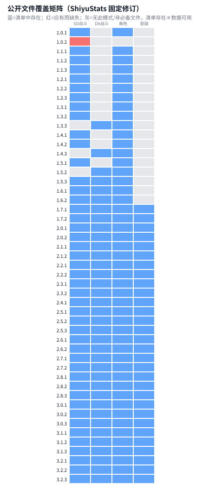

**真实公开战斗记录已导入**：共 4,013,856 条队伍战斗记录，其中 2,876,445 条符合各时期的有效通关规则。这里的记录数包含同一玩家的多场战斗，不能当成玩家总人数。

这些是社区公开样本，可以描述样本中的角色出场与成绩。提交样本存在选择偏差，无法代表全部玩家，也不能用来推算真实充值、购买行为或退坑率。下文的行为与收入模拟仍使用显式假设，尚未用这些观测数据标定。

| 模式 | 原始战斗记录 | 合格战斗记录 | 采集期与赛季组合数 |
| --- | --- | --- | --- |
| 危局强袭战 | 1,625,928 | 1,393,965 | 36 |
| 式舆防卫战 | 2,387,928 | 1,482,480 | 45 |

原始数据来自 [LvlUrArti / ShiyuData](https://huggingface.co/datasets/LvlUrArti/ShiyuData)，固定数据修订 `324c95d5fb05961fa8926168de8768acc8500c1b`。同一采集期内关联战斗与角色资料；不同采集期不合并为同一个玩家。

导入范围限定为项目当前登记的采集期；数据集新增的其他时期尚未并入本报告。

**成绩缺失**：50,795 条合格记录没有用时或分数。它们仍可用于角色出场统计，成绩分布只使用成绩已知的记录。

完整的分期覆盖、排除原因和质量检查分别见 [覆盖表](observations/obs_coverage.csv)、[排除原因](observations/exclusions.csv)和[质量记录](observations/quality_issues.json)。下表展示有合格通关记录的关卡。

| 赛季 | 模式 | 关卡 | 原始 | 合格 | 唯一ID | 对应首领与机制 | 状态 |
| --- | --- | --- | --- | --- | --- | --- | --- |
| 1.0.1 | shiyu_defense | 7-1 | 393 | 120 | 120 | — | ok |
| 1.0.1 | shiyu_defense | 7-2 | 392 | 119 | 119 | — | ok |
| 1.1.1 | shiyu_defense | 7-1 | 2471 | 1633 | 1633 | — | ok |
| 1.1.1 | shiyu_defense | 7-2 | 2471 | 1633 | 1633 | — | ok |
| 1.1.2 | shiyu_defense | 7-1 | 3509 | 2815 | 2815 | — | ok |
| 1.1.2 | shiyu_defense | 7-2 | 3509 | 2815 | 2815 | — | ok |
| 1.1.3 | shiyu_defense | 7-1 | 3693 | 3200 | 3200 | — | ok |
| 1.1.3 | shiyu_defense | 7-2 | 3693 | 3200 | 3200 | — | ok |
| 1.2.1 | shiyu_defense | 7-1 | 2746 | 2487 | 2487 | — | ok |
| 1.2.1 | shiyu_defense | 7-2 | 2746 | 2487 | 2487 | — | ok |
| 1.2.2 | shiyu_defense | 7-1 | 3995 | 3698 | 3698 | — | ok |
| 1.2.2 | shiyu_defense | 7-2 | 3995 | 3698 | 3698 | — | ok |
| 1.2.3 | shiyu_defense | 7-1 | 4854 | 4376 | 4376 | — | ok |
| 1.2.3 | shiyu_defense | 7-2 | 4854 | 4376 | 4376 | — | ok |
| 1.3.1 | shiyu_defense | 7-1 | 4258 | 3802 | 3802 | — | ok |
| 1.3.1 | shiyu_defense | 7-2 | 4258 | 3802 | 3802 | — | ok |
| 1.3.2 | shiyu_defense | 7-1 | 3659 | 3267 | 3267 | — | ok |
| 1.3.2 | shiyu_defense | 7-2 | 3659 | 3267 | 3267 | — | ok |
| 1.4.1 | deadly_assault | 1-1 | 4232 | 2948 | 2948 | 牲鬼·布林格 [吟唱打断·异常检定] | ok |
| 1.4.1 | deadly_assault | 1-2 | 4064 | 2439 | 2439 | 侵蚀统领·庞培 [属性异常剥层·增伤窗口] | ok |
| 1.4.1 | deadly_assault | 1-3 | 4136 | 2344 | 2344 | 恶名·冥宁芙 [分身破坏·操作得分] | ok |
| 1.3.3 | shiyu_defense | 7-1 | 5953 | 5639 | 5639 | — | ok |
| 1.3.3 | shiyu_defense | 7-2 | 5953 | 5639 | 5639 | — | ok |
| 1.4.1 | shiyu_defense | 7-1 | 4748 | 4584 | 4584 | — | ok |
| 1.4.1 | shiyu_defense | 7-2 | 4748 | 4584 | 4584 | — | ok |
| 1.4.2 | deadly_assault | 1-1 | 4452 | 3812 | 3812 | 牲鬼·布林格 [吟唱打断·异常检定] | ok |
| 1.4.2 | deadly_assault | 1-2 | 4034 | 2457 | 2457 | 泰丰·挑战者 [三次招架·部位失衡] | ok |
| 1.4.2 | deadly_assault | 1-3 | 4355 | 2718 | 2718 | 死路屠夫 [闪避得分·叠层暴伤] | ok |
| 1.4.2 | shiyu_defense | 7-1 | 5805 | 5443 | 5443 | — | ok |
| 1.4.2 | shiyu_defense | 7-2 | 5805 | 5443 | 5443 | — | ok |

以下出场比例只在合格通关样本内计算，不等于角色持有率或全体玩家使用率。同一采集期内按唯一 ID 去重，并与每条队伍的出场率分开列出：

| 赛季 | 模式 | 角色 | 出场人数占比 | 每队伍出场率 | 样本人数 | 小样本 |
| --- | --- | --- | --- | --- | --- | --- |
| 1.0.1 | shiyu_defense | Ellen | 0.8917 | 0.4477 | 120 | False |
| 1.0.1 | shiyu_defense | Soukaku | 0.85 | 0.4268 | 120 | False |
| 1.0.1 | shiyu_defense | Nicole | 0.8 | 0.4017 | 120 | False |
| 1.0.1 | shiyu_defense | Lycaon | 0.6917 | 0.3473 | 120 | False |
| 1.0.1 | shiyu_defense | Zhu Yuan | 0.6417 | 0.3222 | 120 | False |
| 1.0.1 | shiyu_defense | Anby | 0.475 | 0.2385 | 120 | False |
| 1.0.1 | shiyu_defense | Koleda | 0.3167 | 0.159 | 120 | False |
| 1.0.1 | shiyu_defense | Lucy | 0.2833 | 0.1423 | 120 | False |
| 1.0.1 | shiyu_defense | Rina | 0.2583 | 0.1297 | 120 | False |
| 1.0.1 | shiyu_defense | Corin | 0.1333 | 0.06695 | 120 | False |
| 1.0.1 | shiyu_defense | Soldier 11 | 0.08333 | 0.04184 | 120 | False |
| 1.0.1 | shiyu_defense | Anton | 0.075 | 0.03766 | 120 | False |
| 1.0.1 | shiyu_defense | Piper | 0.075 | 0.03766 | 120 | False |
| 1.0.1 | shiyu_defense | Billy | 0.06667 | 0.03347 | 120 | False |
| 1.0.1 | shiyu_defense | Grace | 0.06667 | 0.03347 | 120 | False |

### 2.1 主核锚定与流派清洗

按现有角色字典为 60 名角色建立研究标签：35 名主核／体系引擎、25 名泛用插件。职业特性沿用游戏数据，Core Carry、Core Engine 与 Flex 是研究定位。耀嘉音、凯撒、妮可、莱特、柚叶等插件不进入主核签名；所有主核同时保留，换插件不改变流派。星见雅在角色字典中简称“雅”。标签按登记口径统一投射，不逐历史版本复原技能平衡调整。


以下比例以 2,866,763 条身份有效、成员互异的完整三人通关记录为分母。其中 2,769 种多核组合、1,032,309 条记录全部保留；人数不足或异常身份记录单列质量状态。


[角色标签维表](dim_observed_archetype.csv)与[全部组合映射](observed_comp_archetype.csv)保留原始标识、机制证据及辅助适配条件；[完整分类说明](observed_archetype_summary.md)列出维护口径。


### 2.2 跨赛季核心机制覆盖率

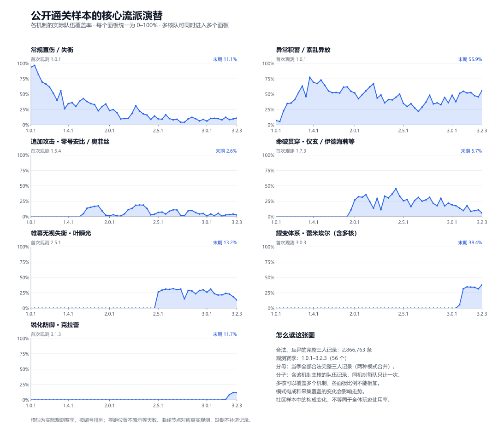

七个面积分面采用同一 0–100% 尺度：分子为当季包含对应核心机制的合法完整三人记录，分母为当季全部合法完整三人记录。同一多核队可覆盖多个机制，各分面占比可能合计超过 100%，不能相加或当作互斥份额。统计合并式舆与危局，按战斗记录而非去重玩家计数；模式构成与采集覆盖变化会影响走势。图示为队伍构成与能力标签，非战斗内技能实际触发率。


数据见[逐赛季机制覆盖表](observations/archetype_evolution.csv)，计算见[统计脚本](../../tools/build_archetype_evolution.py)和[绘图脚本](../../tools/plot_archetype_evolution.py)。


### 2.3 高频主核与多核流派 Top 12

| 主核与机制 | 记录数 | 占合法完整三人记录 |
| --- | --- | --- |
| 叶瞬光（强攻×帷幕无视失衡） | 517,713 | 18.06% |
| 仪玄（命破×贯穿） | 467,233 | 16.30% |
| 雅（异常×紊乱异放） | 248,774 | 8.68% |
| 多核组合：雅（异常×紊乱异放） + 薇薇安（异常×紊乱异放） | 131,497 | 4.59% |
| 多核组合：雅（异常×紊乱异放） + 柳（异常×紊乱异放） | 118,909 | 4.15% |
| 伊芙琳（强攻×常规直伤） | 94,405 | 3.29% |
| 爱芮（异常×紊乱异放） | 78,369 | 2.73% |
| 多核组合：奥菲丝&「鬼火」（强攻×追加攻击） + 零号·安比（强攻×追加攻击） | 62,108 | 2.17% |
| 零号·安比（强攻×追加攻击） | 57,561 | 2.01% |
| 多核组合：简（异常×异常伤害/积蓄） + 维琳娜（异常×紊乱异放） + 蕾米埃尔（异常×耀变体系）［耀变三异常］ | 55,040 | 1.92% |
| 多核组合：薇薇安（异常×紊乱异放） + 爱丽丝（异常×紊乱异放） | 51,073 | 1.78% |
| 多核组合：简（异常×异常伤害/积蓄） + 薇薇安（异常×紊乱异放） | 48,082 | 1.68% |


### 2.4 命破贯穿主核与专项辅助

至少含一名命破主核的合法完整三人记录共 562,652 条，按队伍去重。下表每行统计含该角色的队伍，混搭可能进入多行；单核要求整队仅一个已标注主核，辅助列也可能重叠。


| 命破主核 | 机制 | 含该主核 | 单核记录 | 与卢西娅同队 | 与潘引壶同队 |
| --- | --- | --- | --- | --- | --- |
| 伊德海莉 | 贯穿 | 35,072 | 34,348 | 31,780 | 1,909 |
| 仪玄 | 贯穿 | 474,793 | 467,233 | 341,106 | 121,624 |
| 真斗 | 贯穿 | 8,244 | 7,712 | 7,825 | 336 |
| 般岳 | 贯穿 | 16,694 | 16,287 | 14,502 | 1,288 |
| 星徽·比利 | 贯穿 | 28,566 | 28,373 | 25,982 | 2,330 |


卢西娅、潘引壶都保留 Flex 定位；适配命破不表示仅命破可用，也不使辅助成为流派定义核。


| 辅助 | 定位 | 能力 | 条件 | 技能依据 |
| --- | --- | --- | --- | --- |
| 卢西娅 | 命破通用辅助（非独占） | 全队贯穿力增益、生命上限增益、全队增伤 | 贯穿力来自强化特殊技合唱；基础增益不限定命破，额外暴伤需命破或击破队友。 | [来源](https://wiki.biligame.com/zzz/%E5%8D%A2%E8%A5%BF%E5%A8%85#%E6%A0%B8%E5%BF%83%E6%8A%80) |
| 潘引壶 | 命破向辅助（非独占） | 入场代理人贯穿力增益、条件全队增伤 | 贯穿力给快支或连携入场的下一代理人；额外增伤需命破或同阵营队友。 | [来源](https://wiki.biligame.com/zzz/%E6%BD%98%E5%BC%95%E5%A3%B6#%E6%A0%B8%E5%BF%83%E6%8A%80) |


### 2.5 主核与插件的高共现搭配

| 主核 | 插件 | 同队记录 | 含该主核记录 | 插件｜主核 | 主核｜插件 |
| --- | --- | --- | --- | --- | --- |
| 仪玄 | 卢西娅 | 341,106 | 474,793 | 71.84% | 80.53% |
| 仪玄 | 潘引壶 | 121,624 | 474,793 | 25.62% | 95.14% |
| 叶瞬光 | 照 | 434,989 | 524,366 | 82.96% | 96.15% |
| 叶瞬光 | 千夏 | 244,777 | 524,366 | 46.68% | 72.60% |


后两列分别是“含该主核的队伍中出现插件的比例”与反向条件比例。这是全期合格样本的同队关联，受角色出现时段和模式构成影响，不能据此认定插件专属、付费动机或留存因果。


### 2.6 从真实配队变化到反事实机制推演

从早期常规直伤与异常体系出发，命破贯穿在观测赛季 1.7.3 已出现，2.0 阶段在样本中扩展；叶瞬光帷幕队首见于 2.5.1；蕾米埃尔耀变队首见于 3.0.3；克拉蕾锐化队首见于 3.1.3。卢西娅／潘引壶、照／千夏与对应主核呈现高共现搭配。这些现象构成 Layer 2 参数化机制代理与 Layer 3 抽卡、留存敏感性推演的业务原型；观测赛季不等于角色上线版本，模拟参数与行为结论仍属显式情景假设。

### 2.7 危局 Boss 机制演进与实证阵容分布
历史维表登记 47 期、147 路 Boss；本地合格通关覆盖其中 35 期、105 路普通关卡。普通三路共 1,343,460 条合格记录，进阶路共 50,505 条，分开统计。观测缺期只保留历史映射，不补造通关记录。

各流派比例以身份有效、成员互异的完整三人通关记录为分母；多核可覆盖多个机制，比例不能相加。合格记录数另含人数不足或身份异常的队伍。成绩只对已知分数取中位数，普通三路与进阶路分开计算。

210 条合格记录的原始 Boss 标签与对应排期不一致，仍计入赛季与世代统计，在具体 Boss、机制锁和精确房间统计中另列未决关联，不强行归入排期 Boss。

| 首领机制世代 | 合格通关 | 完整三人通关 | 分数中位数 | 直伤/失衡 | 异常/紊乱 | 追加攻击 | 命破贯穿 | 帷幕 | 耀变 | 锐化 |
| --- | --- | --- | --- | --- | --- | --- | --- | --- | --- | --- |
| G1 早期部位/异常交互（1.4–1.7） | 95,558 | 93,013 | 26,196 | 35.21% | 59.33% | 6.15% | 1.47% | 0.00% | 0.00% | 0.00% |
| G2 秽盾/高防壁垒（2.0–2.4） | 332,773 | 331,495 | 28,169 | 19.27% | 47.30% | 11.59% | 26.86% | 0.00% | 0.00% | 0.00% |
| G3 控制技/帷幕对策（2.5–2.7） | 380,043 | 379,264 | 30,622 | 6.71% | 33.35% | 5.43% | 28.15% | 28.64% | 0.00% | 0.00% |
| G4 赴火暴伤锁（2.8） | 139,920 | 139,797 | 29,998 | 7.89% | 38.70% | 5.26% | 22.98% | 27.06% | 0.00% | 0.00% |
| G5 侵蚀壁垒/锋御对策（3.0–3.2） | 395,166 | 394,899 | 33,319 | 10.07% | 45.30% | 2.30% | 15.04% | 24.52% | 20.14% | 3.36% |

五种具体机制锁的真实配队对照（普通路）：

| 具体机制锁 | 完整三人通关 | 主要核心机制覆盖率（前三） | 分数中位数 |
| --- | --- | --- | --- |
| 秽盾·高防御与减伤 | 107,900 | 命破贯穿 83.44%；常规直伤/失衡 6.44%；异常/紊乱异放 5.43% | 32,144 |
| 紫光控制技·暴伤-40%/以太帷幕 | 45,009 | 异常/紊乱异放 64.33%；帷幕无视失衡 19.32%；命破贯穿 14.93% | 27,725 |
| 5层赴火·暴伤加成合计-125个百分点 | 42,624 | 异常/紊乱异放 97.41%；耀变体系 26.26%；常规直伤/失衡 1.17% | 32,122.5 |
| 侵蚀壁垒紫盾·异常削盾 | 89,932 | 异常/紊乱异放 96.57%；耀变体系 59.11%；帷幕无视失衡 1.36% | 37,606 |
| 侵蚀壁垒紫盾·异常伤害-40%/锋御识破 | 38,399 | 锐化防御 34.40%；帷幕无视失衡 23.80%；常规直伤/失衡 15.33% | 30,598 |

具体机制对照与按时代汇总分别计算；多核覆盖可以重叠，不将配队差异单独归因为 Boss 机制。

世代按赛季时间分组，不表示当期每个 Boss 都具有该世代的新机制。配队变化还受角色上线、模式与提交样本构成影响，描述同期间关联，不作为机制导致流派迁移的因果证据。

维表分别标注历史排期、日期与机制标签的来源状态。15 条房间排期、9 期起始日期采用提供资料，尚缺独立来源核验；其余条目保留原始快照、社区页面或公告依据。维表中的适配流派是机制推定，真实流派覆盖率按观测另算，二者不混用。

逐房间的 Boss、流派覆盖及各流派分数中位数见[Boss 机制与流派统计](boss_mechanism_archetype_stats.csv)。完整排期、普通三路与进阶路、来源链接见[危局 Boss 维表](dim_deadly_assault_bosses.csv)。

广义机制换锁流（Ref_Mechanism）的业务原型涵盖秽盾、紫光控制技、暴伤锁与侵蚀壁垒。当前 L2/L3 数值实现仍以盾防御、盾期减伤、输出时间和支援增益作参数代理，没有逐项实现这些真实 Boss 的技能或对策。

具体 Boss 的普通路汇总：

| Boss | 机制锁 | 合格通关 | 完整三人通关 | 已知分数 | 分数中位数 |
| --- | --- | --- | --- | --- | --- |
| 亵渎者 | 空中击落·招架窗口 | 137,062 | 136,728 | 137,062 | 29,533 |
| 侵蚀统领·庞培 | 属性异常剥层·增伤窗口 | 9,901 | 9,798 | 9,901 | 25,938 |
| 叛律孤歌·薇斯珀 | 紫光控制技·暴伤-40%/以太帷幕 | 45,048 | 45,009 | 45,048 | 27,725 |
| 基塔布鲁 | 侵蚀壁垒紫盾·异常削盾 | 41,685 | 41,673 | 41,685 | 34,515 |
| 太初梦魇·「始主」 | 分段秽盾·紫光控制技 | 79,716 | 79,453 | 79,716 | 32,229 |
| 库萨里库 | 侵蚀壁垒紫盾·异常伤害-40%/锋御识破 | 38,430 | 38,399 | 38,430 | 30,598 |
| 彷徨猎手 | 秽浊流界·高基础防御/贯穿增益 | 86,127 | 85,998 | 86,127 | 28,581 |
| 恶名·冥宁芙 | 分身破坏·操作得分 | 108,273 | 107,549 | 108,273 | 31,065 |
| 恶名·庞培 | 招架叠层·失衡爆发 | 47,488 | 47,393 | 47,488 | 27,376.5 |
| 恶名·死路屠夫 | 紊乱清除以太强化 | 122,503 | 121,793 | 122,503 | 29,752 |
| 未知复合侵蚀体 | 腿部破坏·部位检定 | 52,953 | 52,788 | 52,953 | 30,496 |
| 死路屠夫 | 闪避得分·叠层暴伤 | 16,327 | 16,288 | 16,327 | 31,799 |
| 死路屠夫 | 招架叠层·失衡爆发 | 4,700 | 4,668 | 4,700 | 28,739 |
| 泰丰·挑战者 | 三次招架·部位失衡 | 11,962 | 11,826 | 11,962 | 24,759 |
| 滞异·基塔布鲁 | 侵蚀壁垒紫盾·异常削盾 | 48,278 | 48,259 | 48,278 | 40,645 |
| 焚昼余火·法厄同 | 5层赴火·暴伤加成合计-125个百分点 | 42,636 | 42,624 | 42,636 | 32,122.5 |
| 熔狱行赭 | 熔狱陨石·连携招架 | 13,534 | 13,524 | 13,534 | 31,342.5 |
| 牲鬼·布林格 | 吟唱打断·异常检定 | 25,037 | 23,758 | 25,037 | 28,639 |
| 猎血清道夫 | 侵蚀壁垒·控制技反制 | 13,094 | 13,092 | 13,094 | 26,659 |
| 秽息司祭 | 秽盾·高防御与减伤 | 108,253 | 107,900 | 108,253 | 32,144 |
| 秽息妖鬼·名可名 | 秽盾·异常削盾 | 150,170 | 149,847 | 150,170 | 27,713 |
| 魇缚者·叶释渊 | 双实体·失衡窗口 | 140,073 | 139,891 | 140,073 | 31,924 |

## 3. 代理模型与固定配对（Layer 2）
广义机制换锁流（`Ref_Mechanism`）以秽盾、紫光控制技、暴伤锁与侵蚀壁垒等真实机制作为业务原型。当前数值实现仍是盾期防御加成、额外减伤、输出对齐与支援增益的参数代理，没有逐项复刻这些首领技能；下文 λ 与 a 的推演保持原科学配置。

上节的命破贯穿、帷幕易伤、耀变和锐化队伍，为防御区、机制覆盖和支援配对提供了业务原型。以下 Layer 2 以防御、盾期覆盖、输出对齐和支援增益作参数化代理，用固定队伍检验可控机制的敏感性，再由 Layer 3 推演显式购买与流失假设；模拟参数与行为结论仍按反事实情景解释。

> **核心业务发现（Key Takeaways）**
>
> - 0+0：无支援首次失效中位寿命 84 天（约 2 个区间）；S_A 后 210 天（×2.5），S_B 后 126 天（×1.5）。 <sub>依据：km_first_failure.csv（growth_from_debut）</sub>
> - 0+1：无支援首次失效中位寿命 126 天（约 3 个区间）；S_A 后 210 天（×1.7），S_B 后 294 天（×2.3）。 <sub>依据：km_first_failure.csv（growth_from_debut）</sub>
> - 2+1：无支援首次失效中位寿命 252 天（约 6 个区间）；S_A 后 294 天（×1.2），S_B 后 336 天（×1.3）。 <sub>依据：km_first_failure.csv（growth_from_debut）</sub>
> - 支援策略为“该支援出道即加入”：较晚出道的支援只能覆盖其出道后的主输出，因此支援之间的寿命倍数同时反映增益大小与出道时点，不能直接当作增益强弱排序。 <sub>依据：dim_reference_subject.support_policy</sub>
> - 0+1 无支援参考主体达标数随出道年龄变化：0 天 8/8；42 天 7/7；84 天 6/6；126 天 2/5。 <sub>依据：reference_trajectories.csv</sub>
> - 只加入支援、其余不变时：S_A 平均 ΔCI +0.538（相对 35.0%），S_B 平均 ΔCI +0.691（相对 45.0%）；这是增加支援资产的对照，不是等成本比较。 <sub>依据：benchmark_pairs.csv</sub>
> - 盾内/盾外输出对齐只改变时序分配：k=0.7 平均 ΔCI +0.032，k=1.3 平均 ΔCI -0.026（相对 κ=1）。 <sub>依据：benchmark_pairs.csv</sub>

公式见 combat.md 4.1–4.4；盾内相对保留率按分项计算（不重复乘 0.5222）。CI≥1 为模型达标代理，不代表真实多队满星。
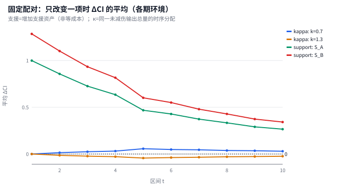
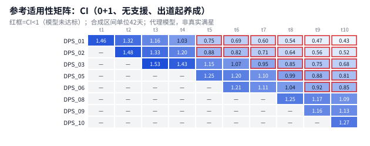

首次观测失效（KM，描述性；观测单位为预注册参考主体）：
| 投资 | 养成 | 支援 | 主体 | 事件 | 中位age(天) | 末期S |
| --- | --- | --- | --- | --- | --- | --- |
| 0+0 | fixed_G1 | join_on_debut:S_A | 8 | 5 | 126 | 0 |
| 0+0 | fixed_G1 | join_on_debut:S_B | 8 | 5 | 84 | 0 |
| 0+0 | fixed_G1 | none | 8 | 7 | 42 | 0 |
| 0+0 | growth_from_debut | join_on_debut:S_A | 8 | 4 | 210 | 0 |
| 0+0 | growth_from_debut | join_on_debut:S_B | 8 | 3 | 126 | 0.4 |
| 0+0 | growth_from_debut | none | 8 | 7 | 84 | 0 |
| 0+1 | fixed_G1 | join_on_debut:S_A | 8 | 4 | 210 | 0 |
| 0+1 | fixed_G1 | join_on_debut:S_B | 8 | 3 | 126 | 0.4 |
| 0+1 | fixed_G1 | none | 8 | 6 | 84 | 0 |
| 0+1 | growth_from_debut | join_on_debut:S_A | 8 | 3 | 210 | 0 |
| 0+1 | growth_from_debut | join_on_debut:S_B | 8 | 3 | 294 | 0 |
| 0+1 | growth_from_debut | none | 8 | 5 | 126 | 0 |
| 2+1 | fixed_G1 | join_on_debut:S_A | 8 | 3 | 252 | 0 |
| 2+1 | fixed_G1 | join_on_debut:S_B | 8 | 2 | MedianNotReached | 0.6 |
| 2+1 | fixed_G1 | none | 8 | 5 | 168 | 0 |
| 2+1 | growth_from_debut | join_on_debut:S_A | 8 | 2 | 294 | 0.3333 |
| 2+1 | growth_from_debut | join_on_debut:S_B | 8 | 2 | 336 | 0 |
| 2+1 | growth_from_debut | none | 8 | 3 | 252 | 0 |
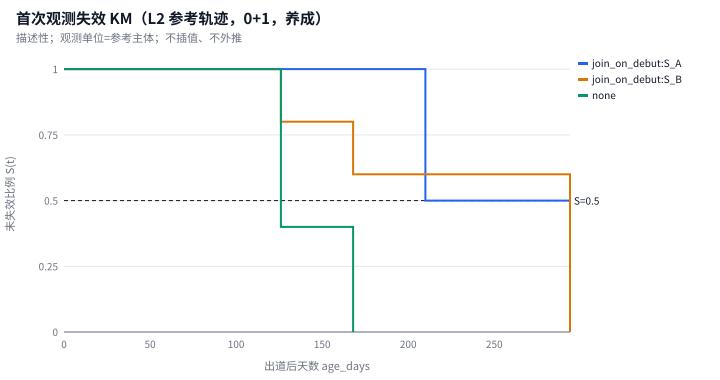

时变 Cox：skipped（disabled_by_default (statistics.md 11.3 探索性、默认关闭)）。

## 4. 模拟行为：三个假设参照情景（Layer 3）
> **核心业务发现（Key Takeaways）**
>
> - 基准情景 Ref_Mechanism：期末全体留存 73.0%、核心预算层 80.8%，观察期累计现金 191,540 元（200 人）。 <sub>依据：reference_runs.json</sub>
> - Ref_HP 相对基准：期末留存 -29.5 个百分点，累计现金 -18,196 元（-9.5%）；同一种子、不同科学配置的情景对比。 <sub>依据：reference_runs.json</sub>
> - Ref_Support 相对基准：期末留存 +5.0 个百分点，累计现金 5,220 元（+2.7%）；同一种子、不同科学配置的情景对比。 <sub>依据：reference_runs.json</sub>
> - 基准情景流失时序：P04–P08 占全部流失的 69%，单期峰值在 P04（7.5% 初始人群）；中期流失会截断其后的订阅与直购现金。 <sub>依据：retention_cash.csv</sub>
> - 基准情景现金中订阅占 57%、直购占 43%；抽数来源：本期免费 15%、历史免费 70%、订阅 9%、直购 6%。 <sub>依据：revenue_structure.csv</sub>

| 情景 | 种子 | 人数 | 累计现金(分) | 核心层期末留存 | 全体期末留存 |
| --- | --- | --- | --- | --- | --- |
| 粗暴加血流(Ref_HP) | 1101 | 200 | 17,334,400 | 0.4658 | 0.435 |
| 广义机制换锁流(Ref_Mechanism) | 1101 | 200 | 19,154,000 | 0.8082 | 0.73 |
| 专拐保值流(Ref_Support) | 1101 | 200 | 19,676,000 | 0.8493 | 0.78 |
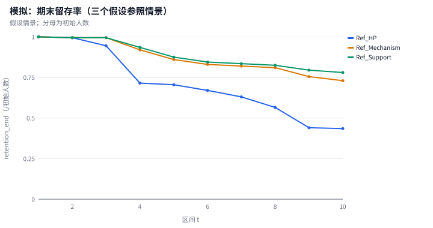
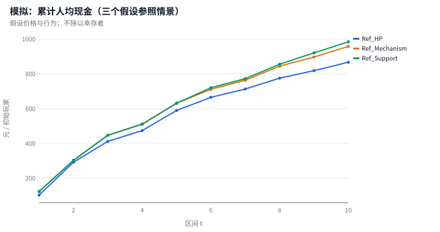
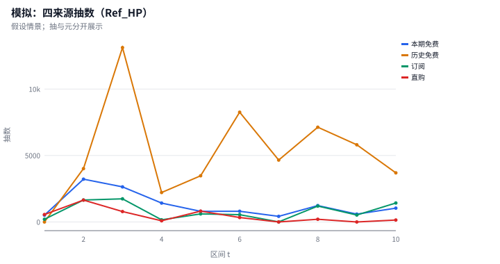
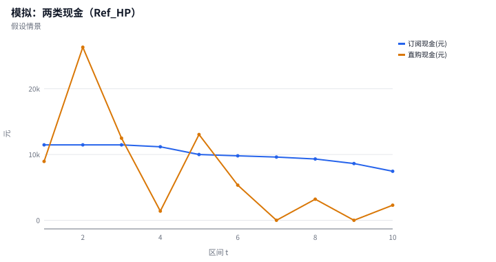

## 5. 固定获取队列三口径
> **核心业务发现（Key Takeaways）**
>
> - 最大获取队列 DPS_03（P03 获取，N=111）：活跃持有者达标率由 100% 降至 P10 的 19%，退出持有者占 11%；按冻结配置反事实计入退出者后为 17%（全队列活跃达标占比 17%）。 <sub>依据：cohort_availability.csv</sub>

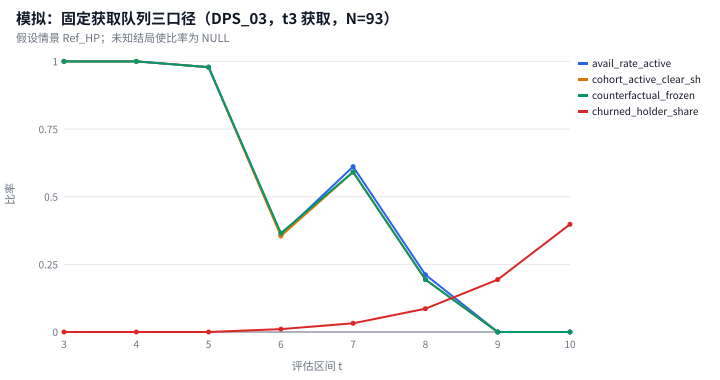
流失贡献 0 表示退出生态而非战斗失败；冻结口径是“停止投入的配置情景”，不是未退坑预测。

## 6. 25 点候选、独立复核与假设敏感性
> **核心业务发现（Key Takeaways）**
>
> - 机制强度 λ 从 0 到 2（筛选种子，对 a 取平均）：核心预算层期末留存均值 89.6% → 75.0%，每 run 累计现金均值 189,534 元 → 179,275 元；收入随水平单调下降，留存随水平单调下降。 <sub>依据：search_results.csv</sub>
> - 留存损失并非线性：λ 1.5→2 一步使核心层留存变化 -7.6 个百分点，约为其余相邻步平均幅度（2.3 个百分点）的 3.3 倍；复核种子上最大一步出现在同一区间。在此假设情景中，这一区间是机制强度的边际代价陡增点。 <sub>依据：search_results.csv</sub>
> - 相对基准点（λ=1, a=1）的同 seed 配对收入差均值在 λ=1.5→2 之间过零（1,620 元 → -23 元）。该过零点取决于基准点与对 a 的平均方式，不是收入峰值；收入形状以上一条为准。 <sub>依据：search_results.csv：delta_revenue_vs_base</sub>
> - 配对差的离散度：λ=0 处配对收入差均值 10,235 元、SD 9,921 元、负值占比 16%（n=25 个候选×种子，同 seed 共享 CRN，非独立重复）。 <sub>依据：search_results.csv</sub>
> - 支援增益缩放 a 从 0.8 到 1.6（对 λ 取平均）：核心层留存均值 77.6% → 88.6%，每 run 累计现金 177,146 元 → 189,147 元；收入随水平单调上升，留存随水平单调上升。 <sub>依据：search_results.csv</sub>
> - 复核种子下非支配入选频率最高的候选：L0.5_A1.6、L0_A1.6（100%）；只描述这几次复核结果。 <sub>依据：seed_robustness.csv</sub>
> - 筛选→复核排序一致性：收入 ρ=0.84、留存 ρ=0.98。 <sub>依据：rank_stability.csv</sub>
> - 痛感参数单因素扰动（对 25 候选取平均的相对变化）：failure_weight_x0.75 收入 +1.32%、留存 +6.78%；failure_weight_x1.25 收入 -0.91%、留存 -4.54%；gap_weight_x0.75 收入 +0.32%、留存 +1.59%；gap_weight_x1.25 收入 -0.28%、留存 -1.09%。 <sub>依据：parameter_sensitivity.csv</sub>
> - budget_weight_x0.75、budget_weight_x1.25 在本实验全部候选上收入与留存相对变化均为 0：这些扰动没有改变任何玩家的去留（机制见下条生命周期日志交叉核对）。 <sub>依据：parameter_sensitivity.csv</sub>
> - 基准参照 Ref_Mechanism：直购痛感与满星恢复的交叉：使用直购额度的 50 个活跃玩家-期中 50 个（100%）期末满星，50 个期末疲劳被截断在下界 0，其中流失 0 人次；未满星的 198 个玩家-期中仅 0 个使用直购，而全部 54 次流失里有 37 次发生在未满星期。 <sub>依据：budget_fatigue_cross.csv</sub>
> - 业务含义：在本情景中“掏钱的人”和“快流失的人”几乎不重叠——直购集中在当期满星的玩家身上，满星带来的疲劳恢复把直购压力完全抵消；濒临流失的未满星玩家很少直购，直购压力因此无法传导到流失。对付费设计的提示是：付费痛点若只作用于已获得目标的玩家，调节它不会改变留存，留存杠杆在未满星玩家的获取与战力缺口上。另外，按配置每期预算项最大为 w_b×b≤0.25（扰动上限），小于满星恢复 r_F=0.3，所以满星期内无论扰动多大都会被截断，零效应是结构性的。这是模型设定下的推演，不是对真实玩家心理的估计。 <sub>依据：budget_fatigue_cross.csv</sub>

实验 `search_9a1dba50e1f4`：候选 25 个，筛选种子 [1101, 1102, 1103, 1104, 1105]，复核种子 [9101, 9102, 9103]，扰动 7 组；逻辑 run 650，去重后不同 run 650。同seed候选共享CRN，不把这些运行数量当成独立统计重复数。
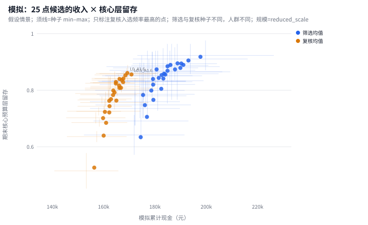

复核种子下的非支配入选频率（只描述这几次结果，不称真实最优概率）：
| 候选 | 收入均值(分) | 收入SD | 留存均值 | 留存SD | 入选频率 |
| --- | --- | --- | --- | --- | --- |
| L0.5_A1.6 | 17,083,000 | 1,126,082 | 0.8558 | 0.03034 | 1 |
| L0_A1.6 | 16,924,867 | 1,206,532 | 0.8608 | 0.01826 | 1 |
| L0_A1.4 | 16,845,733 | 1,141,467 | 0.8525 | 0.0129 | 0.3333 |
| L0_A0.8 | 16,675,400 | 1,424,683 | 0.8086 | 0.01478 | 0.3333 |
| L0_A1.2 | 16,768,600 | 1,074,131 | 0.8414 | 0.007991 | 0 |
| L0_A1 | 16,757,133 | 1,240,970 | 0.8287 | 0.01011 | 0 |
| L1_A1.6 | 16,705,400 | 1,063,273 | 0.8361 | 0.01925 | 0 |
| L0.5_A1.4 | 16,619,133 | 954,376 | 0.8398 | 0.02506 | 0 |
| L0.5_A1 | 16,618,000 | 1,268,276 | 0.8082 | 0.02401 | 0 |
| L1_A1.4 | 16,603,400 | 1,000,090 | 0.8163 | 0.009927 | 0 |
| L1_A1 | 16,496,200 | 1,342,309 | 0.7634 | 0.02752 | 0 |
| L1.5_A1.6 | 16,477,133 | 869,823 | 0.8292 | 0.02251 | 0 |
| L0.5_A1.2 | 16,475,333 | 1,041,709 | 0.8237 | 0.01985 | 0 |
| L0.5_A0.8 | 16,424,267 | 1,384,890 | 0.7922 | 0.02108 | 0 |
| L1.5_A1.4 | 16,375,933 | 783,313 | 0.7988 | 0.04427 | 0 |
| L1_A1.2 | 16,366,867 | 1,143,745 | 0.783 | 0.01597 | 0 |
| L1.5_A1.2 | 16,284,400 | 1,079,491 | 0.7684 | 0.02535 | 0 |
| L1.5_A1 | 16,229,867 | 1,109,459 | 0.7437 | 0.02381 | 0 |
| L1_A0.8 | 16,218,000 | 1,474,952 | 0.7214 | 0.02015 | 0 |
| L2_A1.6 | 16,218,000 | 1,070,197 | 0.7624 | 0.01336 | 0 |
| L2_A1.2 | 16,096,267 | 1,179,107 | 0.6847 | 0.01447 | 0 |
| L2_A1.4 | 16,049,667 | 968,289 | 0.7234 | 0.01471 | 0 |
| L2_A1 | 15,999,200 | 1,251,843 | 0.6394 | 0.02045 | 0 |
| L1.5_A0.8 | 15,978,867 | 1,255,464 | 0.7013 | 0.01978 | 0 |
| L2_A0.8 | 15,632,600 | 1,355,527 | 0.5262 | 0.06583 | 0 |

秩稳定（并列平均秩；无变异时 NULL）：
| 扰动 | 比较 | ρ收入 | ρ留存 |
| --- | --- | --- | --- |
| P0 | train_mean_vs_validation_mean | 0.839 | 0.9785 |
| budget_weight_x0.75 | validation_vs_P0_validation | 1 | 1 |
| budget_weight_x1.25 | validation_vs_P0_validation | 1 | 1 |
| failure_weight_x0.75 | validation_vs_P0_validation | 0.996 | 0.9762 |
| failure_weight_x1.25 | validation_vs_P0_validation | 0.994 | 0.9723 |
| gap_weight_x0.75 | validation_vs_P0_validation | 0.9975 | 0.9938 |
| gap_weight_x1.25 | validation_vs_P0_validation | 0.996 | 0.9954 |

按 λ（机制强度）汇总的筛选种子均值（对 5 个 a 取平均，描述用）：
| 水平 | 候选数 | 收入均值(分) | 平均种子SD(分) | 核心层留存均值 |
| --- | --- | --- | --- | --- |
| L0 | 5 | 18,953,368 | 1,591,302 | 0.8961 |
| L0.5 | 5 | 18,639,400 | 1,625,452 | 0.8675 |
| L1 | 5 | 18,218,184 | 1,542,235 | 0.8441 |
| L1.5 | 5 | 18,091,824 | 1,377,679 | 0.8266 |
| L2 | 5 | 17,927,528 | 1,544,779 | 0.7504 |

按 a（支援增益缩放）汇总：
| 水平 | 候选数 | 收入均值(分) | 平均种子SD(分) | 核心层留存均值 |
| --- | --- | --- | --- | --- |
| A0.8 | 5 | 17,714,568 | 1,519,823 | 0.7756 |
| A1 | 5 | 18,095,296 | 1,452,993 | 0.8138 |
| A1.2 | 5 | 18,429,888 | 1,465,393 | 0.8462 |
| A1.4 | 5 | 18,675,896 | 1,572,378 | 0.8633 |
| A1.6 | 5 | 18,914,656 | 1,670,860 | 0.8858 |

假设参数扰动（与种子波动分表；对 25 个候选取平均的相对变化）：
| 扰动 | 收入相对变化 | 留存相对变化 |
| --- | --- | --- |
| budget_weight_x0.75 | 0 | 0 |
| budget_weight_x1.25 | 0 | 0 |
| failure_weight_x0.75 | 0.01324 | 0.06784 |
| failure_weight_x1.25 | -0.009075 | -0.04539 |
| gap_weight_x0.75 | 0.003249 | 0.01586 |
| gap_weight_x1.25 | -0.002765 | -0.01088 |

CRN同种子配对差（相对同一扰动/种子的预设基准；P0复核）：
| 候选 | 有效配对n | 收入差均值(分) | 配对差SD | 差值最小 | 差值最大 | 留存差均值 |
| --- | --- | --- | --- | --- | --- | --- |
| L0.5_A0.8 | 3 | -71,933 | 197,508 | -196,400 | 155,800 | 0.02873 |
| L0.5_A1 | 3 | 121,800 | 82,999 | 27,200 | 182,400 | 0.04477 |
| L0.5_A1.2 | 3 | -20,867 | 460,802 | -550,000 | 292,200 | 0.06031 |
| L0.5_A1.4 | 3 | 122,933 | 483,071 | -432,400 | 446,000 | 0.07635 |
| L0.5_A1.6 | 3 | 586,800 | 272,880 | 271,800 | 751,000 | 0.09239 |
| L0_A0.8 | 3 | 179,200 | 175,600 | 3600 | 354,800 | 0.04513 |
| L0_A1 | 3 | 260,933 | 244,101 | 3600 | 489,200 | 0.06524 |
| L0_A1.2 | 3 | 272,400 | 268,667 | 29,200 | 560,800 | 0.07793 |
| L0_A1.4 | 3 | 349,533 | 200,928 | 156,600 | 557,600 | 0.08905 |
| L0_A1.6 | 3 | 428,667 | 154,186 | 334,400 | 606,600 | 0.09732 |
| L1.5_A0.8 | 3 | -517,333 | 413,299 | -914,000 | -89,200 | -0.06218 |
| L1.5_A1 | 3 | -266,333 | 344,720 | -661,800 | -29,400 | -0.01974 |
| L1.5_A1.2 | 3 | -211,800 | 397,165 | -667,400 | 61,400 | 0.004928 |
| L1.5_A1.4 | 3 | -120,267 | 764,958 | -1,000,200 | 386,400 | 0.03539 |
| L1.5_A1.6 | 3 | -19,067 | 617,878 | -730,200 | 386,400 | 0.06574 |
| L1_A0.8 | 3 | -278,200 | 257,375 | -509,600 | -1000 | -0.04207 |
| L1_A1 | 3 | 0 | 0 | 0 | 0 | 0 |
| L1_A1.2 | 3 | -129,333 | 296,935 | -469,000 | 81,000 | 0.0196 |
| L1_A1.4 | 3 | 107,200 | 401,621 | -351,400 | 396,200 | 0.0529 |
| L1_A1.6 | 3 | 209,200 | 318,596 | -153,200 | 445,200 | 0.07265 |
| L2_A0.8 | 3 | -863,600 | 417,263 | -1,188,400 | -393,000 | -0.2372 |
| L2_A1 | 3 | -497,000 | 382,401 | -867,600 | -103,800 | -0.124 |
| L2_A1.2 | 3 | -399,933 | 418,316 | -843,800 | -13,000 | -0.07872 |
| L2_A1.4 | 3 | -446,533 | 679,002 | -1,222,800 | 37,000 | -0.03999 |
| L2_A1.6 | 3 | -278,200 | 625,785 | -972,400 | 242,600 | -0.001002 |

随机种子波动与参数扰动分表列出。CRN比较应查看同种子差值的均值、SD、范围及有效配对数；各候选各自的种子SD不能用来判断配对差异是否可区分。当前仅少量复核种子，配对摘要是描述性结果，不构成显著性、等效性或商业最优检验。ρ衡量排序一致性，不能单独确定排序变化的原因。痛感系数扰动通过疲劳只改变流失概率；其对现金的影响取决于流失发生在观察期中的哪一期。

## 7. 解释边界、局限与复现
- 所有行为、价格与疲劳系数为假设情景参数，未由公开数据估计；结果是机制推演，不是市场预测。
- 情景解析含三条显式假设（HP 复利、首发强度复利、理想化贯穿占比），版本 `scenario_resolve_v1_assumed`。
- 代理模型不模拟逐段属性、异常积蓄与真实排轴；完整 ZSim 未运行。
- 小样本或缩减规模下的排序差异可能完全来自随机波动。
- 部分参数经情景标定（见文首声明）：标定目标本身不能作为发现引用。

从已有产物重新生成报告与静态看板（复用已导入的观测数据）：

```powershell
python -m zzz_research report --dir "outputs/final_release"
python -m zzz_research app --dir "outputs/final_release"
```

分步重建基准、运行与候选搜索的命令见项目 README；已发布实验的配置保存在 `config_snapshot/`。

数据来源：ShiyuStats（LvlUrArti，MIT，修订 d930cec5）；ZSim 防御公式（GPL-3.0，修订 e248e9f1）仅作公式参考。
