# 机制锁与售后专拐：老角色保值、付费心理与长期现金

> 《绝区零》业务原型下的三层研究：公开通关样本描述 + 固定战斗配对 + 玩家行为反事实情景。

## 1. 研究问题与结论导读

官方通过强化机制锁 λ，或提高售后支援的净增益 a，分别会怎样改变老角色的可用寿命、玩家囤抽与付费，以及长期现金和留存？

- **高机制压力存在长期代价。** 20 期独立复核中，λ 从 0 增至 2，核心留存变化 **-21.30 个百分点**，累计现金变化 **-5.70% [-10.60, -0.81]%**（逐项 95% 区间）。前 10 期筛选样本中，同一对照的累计现金变化为 **+3.00% [+1.10, +4.90]%**：机制压力先推高现金，到 20 期转为现金与留存同时下降。
- **强专拐主要体现为保值与现金结构变化。** a 从 0.8 增至 1.6，核心留存变化 **+3.15 个百分点**；总现金变化 **-0.22% [-2.87, +2.42]%**。点估计中，新主 C 池直购减少，专拐池直购与月卡续订增加。
- **售后到得晚，救回可用也不等于延后首次失效。** 同配置固定配对能观察到延寿、零延寿和失效后恢复三种结果；支援排期是保值策略的一部分。
- **扩样后排名更稳定，但没有唯一最优结论。** 每次 N=1000、5 组筛选 + 3 组独立复核；总现金排序相关 ρ 在 10/20 期分别为 **0.803 / 0.902**。预先指定的 λ=1 候选在 20 期复核的非支配集合入选为 **a=1.4：0/3、a=1.6：0/3**。
- **结构消融区分稳健结论与心理假设依赖结论。** 三种行为函数（N=200、3 组复核种子、9 个角点／中心点）下，λ 0→2 降低核心留存、a 提高替代部分新主 C 池直购，点估计方向一致；停氪缓冲只改变月卡续订现金，不改变留存。长期现金的负号与 a 的留存收益只在“抽新主 C 主要由强度缺口驱动”时成立：强追新偏好 M2 下，λ 的 20 期现金变化为 **+0.37% [-9.92, +10.65]%**，a 的留存变化为 **-0.03pp [-1.06, +1.00]pp**。
- **外部校验：抽卡机制吻合，收入结构偏离。** 模拟的软保底、小保底与综合出率与 rng.moe 全服统计一致；但模拟现金约七成来自月卡续订，而真实头部主C池的月卡／常驻地板占比不超过约四分之一，且模拟只有体系绑定型专拐，没有耀嘉音、浮波柚叶这类高需求泛用辅助（第 6 节）。

| 层次 | 证据与规模 | 回答什么 |
| --- | --- | --- |
| Layer 1 公开样本 | 4,013,856 条已导入；2,876,445 条合格通关；2,866,763 条合法完整三人记录 | 真实样本中的机制与队伍搭配、条件成绩、真实主C出场轨迹 |
| Layer 2 固定参考 | λ=1、a=1；16 名主 C，3 档投资、2 档养成、5 档支援 | 同一主 C、同一环境下的模型内延寿与恢复 |
| Layer 3 行为情景 | 25 候选 × 8 种子 × 1000 初始玩家；20 期，另取前 10 期 | 指定心理和商品假设下的现金、囤抽及留存取舍 |

### 研究内容与证据强度分级

| 研究模块 | 现有数据支撑边界 | 证据等级 | 本报告的使用方式 |
| --- | --- | --- | --- |
| 1. 配队流派、机制演替（G1–G5）、主核—插件共现 | ShiyuStats 清洗后 2,866,763 条合法完整三人记录；危局精确首领池 1,388,743 条 | L1 强实证（描述统计） | 作为揭示偏好展示；完整三人、已知成绩与危局精确池三种分母分开报告 |
| 2. 专拐与通关成绩的条件关系 | 固定单主核、已知影画／专武档位及第三人后的条件比较 | L1.5 中强实证（条件关联） | 同时给出 P25／P50／P75 与样本量 n；仍受操作、驱动盘词条与主动提交选择影响，不是无偏因果净效应 |
| 3. 角色保值寿命与售后恢复 | 56 期真实主C出场与 0+1 分数轨迹；DPS_01–DPS_16 固定排期受控代理 | L2 双轨对照（实证轨迹＋受控代理） | 真实轨迹给出经验半衰期与售后事件窗；合成队在相同 Boss 排期下剥离登场时点 |
| 4. 囤抽、充值、停氪、退坑与长期现金 | 公开样本无跨期个人 ID 与充值标签；效用、疲劳、停氪函数为显式设定 | L3 反事实推演（情景模拟＋结构边界） | 扩大人口与种子只降低给定公式下的抽样误差；用两个市场的卡池流水、全服调频统计与付费动机调查校验结构，三种行为函数做结构消融 |

四个模块的证据强度不同。L1／L1.5 是真实样本的描述与条件关联；L2 把真实轨迹与受控代理并列；L3 的留存与现金差（如 λ 0→2 的核心留存与累计现金变化）是固定初始队列在显式行为函数下的模拟结果，不是《绝区零》的官方流水或真实退坑率。扩大模拟人口与种子只降低给定公式下的蒙特卡洛误差，不弥补行为设定本身的缺口，因此本版用外部卡池流水结构和行为函数结构消融界定 L3 结论的适用边界。

## 2. 公开样本：真实配队、机制演替与校准锚点（Layer 1）

公开记录来自 ShiyuStats / Hugging Face 固定快照 `SHIYU_HF_324c95d5fb05`，覆盖 56 个观测战斗赛季（1.0.1–3.2.3）、60 名角色。总导入、合格通关与合法完整三人是不同分母；下列流派表以完整三人为分母，机制精确对照另排除 Boss 关联未决记录。

### 四级样本漏斗：每张表使用哪个分母

| 样本层级 | 记录数 | 筛选口径 | 使用范围 |
| --- | ---: | --- | --- |
| ① 原始战斗记录（已导入） | 4,013,856 | 全量已导入战斗记录，尚未应用有效通关筛选。 | 覆盖率与数据清洗起点。 |
| ② 合格记录 | 2,876,445 | 通过有效通关筛选；含 50,795 条既无评分也无用时的记录。 | 合格出场与覆盖统计。成绩统计另取 2,825,650 条已知结果，并按模式与制式分开。 |
| ③ 合法完整三人记录 | 2,866,763 | 队伍须有三名身份已确认且互异的角色；排除 9,682 条单/双人或身份异常记录。 | 配队结构、流派占比；专拐匹配在此基础上再限定主核、投资、第三人及有效成绩。 |
| ④ 精确首领机制比较池（危局） | 1,388,743 | 从第③级先取危局完整三人 1,388,953 条，再剔除 210 条首领关联未决记录。 | λ 机制表、机制格内对策率与 HHI；普通路 1,338,258 条、进阶路 50,485 条分开统计。 |

缺成绩是成绩比较的并行筛选条件，不从出场和配队计数中统一扣除。评分与通关用时分别统计，中位数、分位数和成绩比仅使用各模式、关卡及匹配格内已知且有效的成绩；本次 50,795 条缺结果记录均位于式舆样本。第④级已限定危局，不能用全模式完整三人总数直接减去首领未决数作为其分母。机制配装匹配还要求单主核、已知影画/专武及相应养成条件，每行保留自身样本数。

来源：[观测清单](observations/observations_manifest.json)、[流派清洗清单](observations/archetype_evolution_manifest.json)、[首领统计清单](boss_mechanism_stats_manifest.json)、[机制实证表](empirical_knob1_boss_lock.csv)（`scope=mechanism`；普通/进阶分别汇总）。


### 2.1 主核锚定与流派清洗

按现有角色字典为 60 名角色建立研究标签：35 名主核／体系引擎、25 名泛用插件。职业特性沿用游戏数据，Core Carry、Core Engine 与 Flex 是研究定位。耀嘉音、凯撒、妮可、莱特、柚叶等插件不进入主核签名；所有主核同时保留，换插件不改变流派。星见雅在角色字典中简称“雅”。标签按登记口径统一投射，不逐历史版本复原技能平衡调整。


以下比例以 2,866,763 条身份有效、成员互异的完整三人通关记录为分母。其中 2,769 种多核组合、1,032,309 条记录全部保留；人数不足或异常身份记录单列质量状态。


[角色标签维表](dim_observed_archetype.csv)与[全部组合映射](observed_comp_archetype.csv)保留原始标识、机制证据及辅助适配条件；[完整分类说明](observed_archetype_summary.md)列出维护口径。


### 2.2 跨赛季核心机制覆盖率

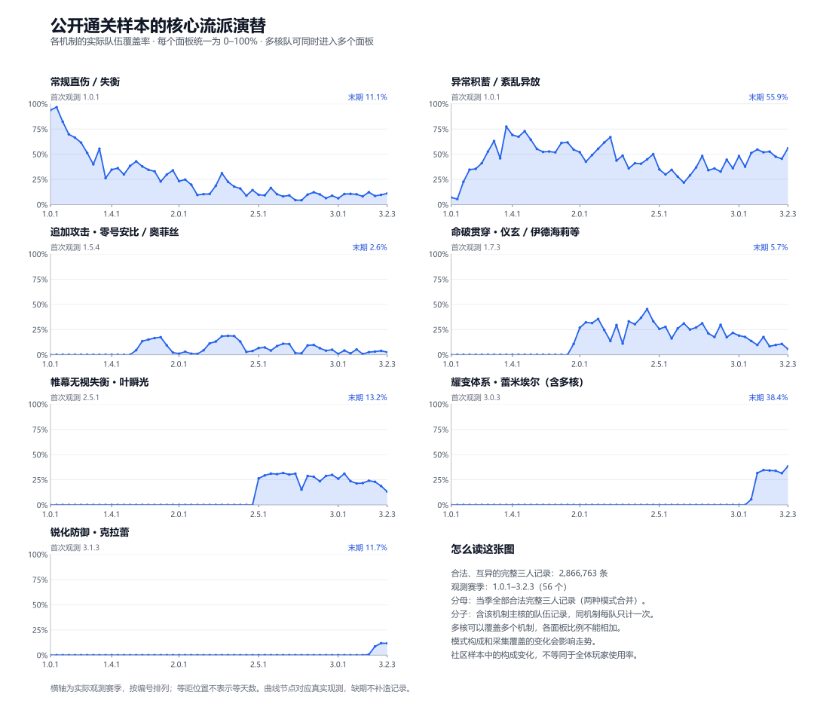

七个面积分面采用同一 0–100% 尺度：分子为当季包含对应核心机制的合法完整三人记录，分母为当季全部合法完整三人记录。同一多核队可覆盖多个机制，各分面占比可能合计超过 100%，不能相加或当作互斥份额。统计合并式舆与危局，按战斗记录而非去重玩家计数；模式构成与采集覆盖变化会影响走势。图示为队伍构成与能力标签，非战斗内技能实际触发率。


数据见[逐赛季机制覆盖表](observations/archetype_evolution.csv)，计算见[统计脚本](../../tools/build_archetype_evolution.py)和[绘图脚本](../../tools/plot_archetype_evolution.py)。


### 2.3 高频主核与多核流派 Top 12

| 主核与机制 | 记录数 | 占合法完整三人记录 |
| --- | --- | --- |
| 叶瞬光（强攻×帷幕无视失衡） | 517,713 | 18.06% |
| 仪玄（命破×贯穿） | 467,233 | 16.30% |
| 雅（异常×紊乱异放） | 248,774 | 8.68% |
| 多核组合：雅（异常×紊乱异放） + 薇薇安（异常×紊乱异放） | 131,497 | 4.59% |
| 多核组合：雅（异常×紊乱异放） + 柳（异常×紊乱异放） | 118,909 | 4.15% |
| 伊芙琳（强攻×常规直伤） | 94,405 | 3.29% |
| 爱芮（异常×紊乱异放） | 78,369 | 2.73% |
| 多核组合：奥菲丝&「鬼火」（强攻×追加攻击） + 零号·安比（强攻×追加攻击） | 62,108 | 2.17% |
| 零号·安比（强攻×追加攻击） | 57,561 | 2.01% |
| 多核组合：简（异常×异常伤害/积蓄） + 维琳娜（异常×紊乱异放） + 蕾米埃尔（异常×耀变体系）［耀变三异常］ | 55,040 | 1.92% |
| 多核组合：薇薇安（异常×紊乱异放） + 爱丽丝（异常×紊乱异放） | 51,073 | 1.78% |
| 多核组合：简（异常×异常伤害/积蓄） + 薇薇安（异常×紊乱异放） | 48,082 | 1.68% |


### 2.4 命破贯穿主核与专项辅助

至少含一名命破主核的合法完整三人记录共 562,652 条，按队伍去重。下表每行统计含该角色的队伍，混搭可能进入多行；单核要求整队仅一个已标注主核，辅助列也可能重叠。


| 命破主核 | 机制 | 含该主核 | 单核记录 | 与卢西娅同队 | 与潘引壶同队 |
| --- | --- | --- | --- | --- | --- |
| 伊德海莉 | 贯穿 | 35,072 | 34,348 | 31,780 | 1,909 |
| 仪玄 | 贯穿 | 474,793 | 467,233 | 341,106 | 121,624 |
| 真斗 | 贯穿 | 8,244 | 7,712 | 7,825 | 336 |
| 般岳 | 贯穿 | 16,694 | 16,287 | 14,502 | 1,288 |
| 星徽·比利 | 贯穿 | 28,566 | 28,373 | 25,982 | 2,330 |


卢西娅、潘引壶都保留 Flex 定位；适配命破不表示仅命破可用，也不使辅助成为流派定义核。


| 辅助 | 定位 | 能力 | 条件 | 技能依据 |
| --- | --- | --- | --- | --- |
| 卢西娅 | 命破通用辅助（非独占） | 全队贯穿力增益、生命上限增益、全队增伤 | 贯穿力来自强化特殊技合唱；基础增益不限定命破，额外暴伤需命破或击破队友。 | [来源](https://wiki.biligame.com/zzz/%E5%8D%A2%E8%A5%BF%E5%A8%85#%E6%A0%B8%E5%BF%83%E6%8A%80) |
| 潘引壶 | 命破向辅助（非独占） | 入场代理人贯穿力增益、条件全队增伤 | 贯穿力给快支或连携入场的下一代理人；额外增伤需命破或同阵营队友。 | [来源](https://wiki.biligame.com/zzz/%E6%BD%98%E5%BC%95%E5%A3%B6#%E6%A0%B8%E5%BF%83%E6%8A%80) |


### 2.5 主核与插件的高共现搭配

| 主核 | 插件 | 同队记录 | 含该主核记录 | 插件｜主核 | 主核｜插件 |
| --- | --- | --- | --- | --- | --- |
| 仪玄 | 卢西娅 | 341,106 | 474,793 | 71.84% | 80.53% |
| 仪玄 | 潘引壶 | 121,624 | 474,793 | 25.62% | 95.14% |
| 叶瞬光 | 照 | 434,989 | 524,366 | 82.96% | 96.15% |
| 叶瞬光 | 千夏 | 244,777 | 524,366 | 46.68% | 72.60% |


后两列分别是“含该主核的队伍中出现插件的比例”与反向条件比例。这是全期合格样本的同队关联，受角色出现时段和模式构成影响，不能据此认定插件专属、付费动机或留存因果。


### 2.6 从真实配队变化到反事实机制推演

从早期常规直伤与异常体系出发，命破贯穿在观测赛季 1.7.3 已出现，2.0 阶段在样本中扩展；叶瞬光帷幕队首见于 2.5.1；蕾米埃尔耀变队首见于 3.0.3；克拉蕾锐化队首见于 3.1.3。卢西娅／潘引壶、照／千夏与对应主核呈现高共现搭配。这些现象构成 Layer 2 参数化机制代理与 Layer 3 抽卡、留存敏感性推演的业务原型；观测赛季不等于角色上线版本，模拟参数与行为结论仍属显式情景假设。

### 2.7 危局 Boss 机制演进与实证阵容分布
历史维表登记 47 期、147 路 Boss；本地合格通关覆盖其中 35 期、105 路普通关卡。普通三路共 1,343,460 条合格记录，进阶路共 50,505 条，分开统计。观测缺期只保留历史映射，不补造通关记录。

各流派比例以身份有效、成员互异的完整三人通关记录为分母；多核可覆盖多个机制，比例不能相加。合格记录数另含人数不足或身份异常的队伍。成绩只对已知分数取中位数，普通三路与进阶路分开计算。

210 条合格记录的原始 Boss 标签与对应排期不一致，仍计入赛季与世代统计，在具体 Boss、机制锁和精确房间统计中另列未决关联，不强行归入排期 Boss。

| 首领机制世代 | 合格通关 | 完整三人通关 | 分数中位数 | 直伤/失衡 | 异常/紊乱 | 追加攻击 | 命破贯穿 | 帷幕 | 耀变 | 锐化 |
| --- | --- | --- | --- | --- | --- | --- | --- | --- | --- | --- |
| G1 早期部位/异常交互（1.4–1.7） | 95,558 | 93,013 | 26,196 | 35.21% | 59.33% | 6.15% | 1.47% | 0.00% | 0.00% | 0.00% |
| G2 秽盾/高防壁垒（2.0–2.4） | 332,773 | 331,495 | 28,169 | 19.27% | 47.30% | 11.59% | 26.86% | 0.00% | 0.00% | 0.00% |
| G3 控制技/帷幕对策（2.5–2.7） | 380,043 | 379,264 | 30,622 | 6.71% | 33.35% | 5.43% | 28.15% | 28.64% | 0.00% | 0.00% |
| G4 赴火暴伤锁（2.8） | 139,920 | 139,797 | 29,998 | 7.89% | 38.70% | 5.26% | 22.98% | 27.06% | 0.00% | 0.00% |
| G5 侵蚀壁垒/锋御对策（3.0–3.2） | 395,166 | 394,899 | 33,319 | 10.07% | 45.30% | 2.30% | 15.04% | 24.52% | 20.14% | 3.36% |

五种具体机制锁的真实配队对照（普通路）：

| 具体机制锁 | 完整三人通关 | 主要核心机制覆盖率（前三） | 分数中位数 |
| --- | --- | --- | --- |
| 秽盾·高防御与减伤 | 107,900 | 命破贯穿 83.44%；常规直伤/失衡 6.44%；异常/紊乱异放 5.43% | 32,144 |
| 紫光控制技·暴伤-40%/以太帷幕 | 45,009 | 异常/紊乱异放 64.33%；帷幕无视失衡 19.32%；命破贯穿 14.93% | 27,725 |
| 5层赴火·暴伤加成合计-125个百分点 | 42,624 | 异常/紊乱异放 97.41%；耀变体系 26.26%；常规直伤/失衡 1.17% | 32,122.5 |
| 侵蚀壁垒紫盾·异常削盾 | 89,932 | 异常/紊乱异放 96.57%；耀变体系 59.11%；帷幕无视失衡 1.36% | 37,606 |
| 侵蚀壁垒紫盾·异常伤害-40%/锋御识破 | 38,399 | 锐化防御 34.40%；帷幕无视失衡 23.80%；常规直伤/失衡 15.33% | 30,598 |

具体机制对照与按时代汇总分别计算；多核覆盖可以重叠，不将配队差异单独归因为 Boss 机制。

世代按赛季时间分组，不表示当期每个 Boss 都具有该世代的新机制。配队变化还受角色上线、模式与提交样本构成影响，描述同期间关联，不作为机制导致流派迁移的因果证据。

维表分别标注历史排期、日期与机制标签的来源状态。15 条房间排期、9 期起始日期采用提供资料，尚缺独立来源核验；其余条目保留原始快照、社区页面或公告依据。维表中的适配流派是机制推定，真实流派覆盖率按观测另算，二者不混用。

逐房间的 Boss、流派覆盖及各流派分数中位数见[Boss 机制与流派统计](boss_mechanism_archetype_stats.csv)。完整排期、普通三路与进阶路、来源链接见[危局 Boss 维表](dim_deadly_assault_bosses.csv)。

Layer 2/3 采用防御、有效输出窗口、侵蚀壁垒三个通道的参数化代理。贯穿只跳过防御区；角色与机制的适配度、支援净增益及适配修复分别登记。真实 Boss 的条件成绩用于选择情景锚点，模型未逐技能复现战斗。

具体 Boss 的普通路汇总：

| Boss | 机制锁 | 合格通关 | 完整三人通关 | 已知分数 | 分数中位数 |
| --- | --- | --- | --- | --- | --- |
| 亵渎者 | 空中击落·招架窗口 | 137,062 | 136,728 | 137,062 | 29,533 |
| 侵蚀统领·庞培 | 属性异常剥层·增伤窗口 | 9,901 | 9,798 | 9,901 | 25,938 |
| 叛律孤歌·薇斯珀 | 紫光控制技·暴伤-40%/以太帷幕 | 45,048 | 45,009 | 45,048 | 27,725 |
| 基塔布鲁 | 侵蚀壁垒紫盾·异常削盾 | 41,685 | 41,673 | 41,685 | 34,515 |
| 太初梦魇·「始主」 | 分段秽盾·紫光控制技 | 79,716 | 79,453 | 79,716 | 32,229 |
| 库萨里库 | 侵蚀壁垒紫盾·异常伤害-40%/锋御识破 | 38,430 | 38,399 | 38,430 | 30,598 |
| 彷徨猎手 | 秽浊流界·高基础防御/贯穿增益 | 86,127 | 85,998 | 86,127 | 28,581 |
| 恶名·冥宁芙 | 分身破坏·操作得分 | 108,273 | 107,549 | 108,273 | 31,065 |
| 恶名·庞培 | 招架叠层·失衡爆发 | 47,488 | 47,393 | 47,488 | 27,376.5 |
| 恶名·死路屠夫 | 紊乱清除以太强化 | 122,503 | 121,793 | 122,503 | 29,752 |
| 未知复合侵蚀体 | 腿部破坏·部位检定 | 52,953 | 52,788 | 52,953 | 30,496 |
| 死路屠夫 | 闪避得分·叠层暴伤 | 16,327 | 16,288 | 16,327 | 31,799 |
| 死路屠夫 | 招架叠层·失衡爆发 | 4,700 | 4,668 | 4,700 | 28,739 |
| 泰丰·挑战者 | 三次招架·部位失衡 | 11,962 | 11,826 | 11,962 | 24,759 |
| 滞异·基塔布鲁 | 侵蚀壁垒紫盾·异常削盾 | 48,278 | 48,259 | 48,278 | 40,645 |
| 焚昼余火·法厄同 | 5层赴火·暴伤加成合计-125个百分点 | 42,636 | 42,624 | 42,636 | 32,122.5 |
| 熔狱行赭 | 熔狱陨石·连携招架 | 13,534 | 13,524 | 13,534 | 31,342.5 |
| 牲鬼·布林格 | 吟唱打断·异常检定 | 25,037 | 23,758 | 25,037 | 28,639 |
| 猎血清道夫 | 侵蚀壁垒·控制技反制 | 13,094 | 13,092 | 13,094 | 26,659 |
| 秽息司祭 | 秽盾·高防御与减伤 | 108,253 | 107,900 | 108,253 | 32,144 |
| 秽息妖鬼·名可名 | 秽盾·异常削盾 | 150,170 | 149,847 | 150,170 | 27,713 |
| 魇缚者·叶释渊 | 双实体·失衡窗口 | 140,073 | 139,891 | 140,073 | 31,924 |


### 2.8 两个旋钮如何使用实证锚点

[机制条件成绩表](empirical_knob1_boss_lock.csv)比较当期机制对策与非对策样本，[专拐条件成绩表](empirical_knob2_support_lift.csv)保留主 C 投资、第三人及装备匹配分层。危局普通路、固定第三人匹配的强绑定 0+1 例中，仪玄、星见雅、蕾米埃尔与席德的条件成绩比约为 1.27–1.32；主 C 养成匹配与式舆防卫战分层的数值另列于同表。这些是特定分层的点估计，不是统一上限。自拐饱和或通用队伍的增量可能接近 1。逐层行同时给出两臂的样本量 n 与 P25／P50／P75，比值之外可直接比较分布宽度；它们仍受玩家操作、驱动盘词条与主动提交的样本选择影响，属于条件关联。

模型把这些现象转译为防御适配、有效输出窗口和侵蚀壁垒三个通道；支援分为强/弱净增益与独立适配修复。a 放大净增益项，λ 改变机制压力；具体映射及心理参数在科学配置中保留证据标签。

### 2.9 辅助为谁服务：体系归属、混合型与换代

辅助的服务范围从主核一侧衡量：某主核的完整三人记录中带该辅助的比例（搭配率），只统计辅助上线之后的赛季。搭配率 ≥30% 的主核记为强搭配；强搭配主核只有一名为单核专拐，都在同一机制流派组为体系专拐，跨两个以上流派组为跨体系，八名以上为泛用。“*”表示该辅助晚于这名主核上线，对它属于售后；其余为体系底座。

| 辅助 | 职业 | 上线 | 类别 | 机制流派组 | 强搭配主核数 | 强搭配主核（* 售后） |
| --- | --- | --- | --- | --- | --- | --- |
| 耀嘉音 | 支援 | 2025-01-22 | 泛用 | 常规直伤/失衡、追加攻击 | 12 | 伊芙琳89%、希希芙64%、佩洛伊斯62%、艾莲53%*、希格莉德49%、「11号」45%*、可琳41%*、悠真41%*、「席德」39%、猫又38%*、零号·安比36%、朱鸢31%* |
| 波可娜 | 击破 | 2025-03-12 | 未定型 | — | 0 | — |
| 「扳机」 | 击破 | 2025-04-02 | 跨体系 | 常规直伤/失衡、追加攻击 | 5 | 零号·安比81%*、奥菲丝&「鬼火」75%、「席德」47%、悠真45%*、希希芙33% |
| 潘引壶 | 防护 | 2025-06-06 | 单核专拐 | 命破贯穿 | 0 | — |
| 橘福福 | 击破 | 2025-06-25 | 体系专拐 | 命破贯穿 | 2 | 仪玄47%*、真斗35% |
| 浮波柚叶 | 支援 | 2025-07-16 | 体系专拐 | 异常/紊乱异放 | 9 | 爱丽丝78%、薇薇安74%*、派派67%*、雅63%*、简56%*、柳55%*、柏妮思53%*、普罗米娅52%、格莉丝50%* |
| 卢西娅 | 支援 | 2025-10-15 | 体系专拐 | 命破贯穿 | 5 | 真斗95%、星徽·比利91%、伊德海莉91%、仪玄88%*、般岳87% |
| 琉音 | 击破 | 2025-11-26 | 泛用 | 命破贯穿、帷幕无视失衡、常规直伤/失衡 | 11 | 猫又63%*、星徽·比利60%、般岳55%、叶瞬光48%、真斗47%*、朱鸢41%*、艾莲39%*、仪玄37%*、希格莉德36%、雨果35%*、伊德海莉31%* |
| 照 | 防护 | 2025-12-30 | 单核专拐 | 帷幕无视失衡 | 1 | 叶瞬光83% |
| 千夏 | 支援 | 2026-02-06 | 跨体系 | 帷幕无视失衡、常规直伤/失衡、异常/紊乱异放 | 3 | 叶瞬光57%*、爱芮51%、猫又41%* |
| 南宫羽 | 击破 | 2026-03-24 | 体系专拐 | 异常/紊乱异放 | 2 | 雅53%*、爱芮51%* |
| 诺姆 | 击破 | 2026-07-08 | 跨体系 | 常规直伤/失衡、锐化防御 | 5 | 「11号」58%*、佩洛伊斯42%*、希格莉德37%、伊芙琳34%*、克拉蕾31% |
| 蕾米埃尔 | 异常 | 2026-07-29 | 混合型 | 异常/紊乱异放 | 10 | 维琳娜96%*、简93%*、派派91%*、柏妮思91%*、普罗米娅90%*、格莉丝84%*、爱丽丝81%*、爱芮75%*、薇薇安53%*、柳51%* |
| 洛克茜 | 击破 | 2026-09-30 | 未定型 | 常规直伤/失衡、锐化防御 | 0 | — |

卢西娅覆盖命破全部五名主核（搭配率 87%–95%），但只有对仪玄属于售后，对之后的真斗、伊德海莉、般岳、星徽·比利是体系底座；浮波柚叶覆盖九名异常主核；照几乎只服务叶瞬光。完整的辅助×主核搭配率见[搭配率表](empirical_support_attach.csv)。

**混合型：蕾米埃尔。** 她在数据中是主核（耀变体系），队伍几乎全部满足三异常；对十名异常主核的搭配率在 51%–96%，且全部属于售后。带她的危局队伍中 99.4%–100.0% 同时有其他异常主核，她几乎总是与旧主C同队输出。下表为危局各期的异常体系结构（异常队指含异常主核的队伍）。

| 赛季 | 开始 | 三异常队伍占比 | 异常队中带蕾米埃尔 | 带维琳娜 | 带浮波柚叶 | 带南宫羽 | 带耀嘉音 | 简出场 | 柏妮思出场 | 克拉蕾出场 |
| --- | --- | --- | --- | --- | --- | --- | --- | --- | --- | --- |
| 2.7.1 | 2026-03-27 | 0% | 0% | 0% | 57% | 39% | 16% | 1% | 2% | 0% |
| 2.7.2 | 2026-04-10 | 0% | 0% | 0% | 50% | 70% | 9% | 1% | 0% | 0% |
| 2.8.1 | 2026-05-08 | 0% | 0% | 0% | 83% | 61% | 7% | 0% | 1% | 0% |
| 2.8.2 | 2026-05-22 | 0% | 0% | 0% | 61% | 51% | 11% | 1% | 2% | 0% |
| 2.8.3 | 2026-06-05 | 0% | 0% | 0% | 81% | 58% | 7% | 3% | 0% | 0% |
| 3.0.1 | 2026-06-19 | 0% | 0% | 50% | 71% | 33% | 16% | 5% | 3% | 0% |
| 3.0.2 | 2026-07-03 | 0% | 0% | 76% | 83% | 20% | 9% | 6% | 4% | 0% |
| 3.0.3 | 2026-07-17 | 0% | 0% | 51% | 61% | 35% | 13% | 4% | 4% | 0% |
| 3.1.1 | 2026-07-28 | 34% | 51% | 53% | 36% | 28% | 5% | 14% | 6% | 0% |
| 3.1.2 | 2026-08-14 | 39% | 87% | 80% | 10% | 8% | 1% | 11% | 7% | 0% |
| 3.1.3 | 2026-08-28 | 39% | 67% | 61% | 29% | 22% | 3% | 11% | 7% | 0% |
| 3.2.1 | 2026-09-11 | 37% | 87% | 79% | 11% | 9% | 1% | 10% | 7% | 9% |
| 3.2.2 | 2026-09-25 | 33% | 83% | 74% | 14% | 13% | 1% | 12% | 4% | 14% |
| 3.2.3 | 2026-10-09 | 38% | 68% | 63% | 28% | 25% | 2% | 5% | 7% | 12% |

蕾米埃尔上线前，三异常队伍为 0%，浮波柚叶在异常队中的搭配率为 50%–83%；上线后三异常队伍占 33%–39%，浮波柚叶降至 10%–36%，简的出场由 0%–6% 回到 5%–14%。被替代的是旧专拐，旧主C反而回到场上；三异常要求队内全是异常职业，非异常的浮波柚叶、南宫羽、耀嘉音因此被挤出。她的卡池以主C规格售出（日本流水约 ¥13.8 亿，40 个卡池中第 4），对旧主C的作用却接近售后专拐。

**新体系换代：锋御。** 克拉蕾（锋御）上线的同期，危局出现针对锋御设计、同时压制异常的首领。

| 赛季 | 房间 | 首领 | 机制 | 对策组 | 异常队占比 | 锋御队占比 |
| --- | --- | --- | --- | --- | --- | --- |
| 3.2.1 | ADV | 异构·焚昼余火 | 控制技反制·锐化伤害 | 锋御/克拉蕾 | 66% | 19% |
| 3.2.1 | S1 | 库萨里库 | 侵蚀壁垒紫盾·异常伤害-40%/锋御识破 | 锋御/克拉蕾 | 5% | 27% |
| 3.2.1 | S2 | 滞异·基塔布鲁 | 侵蚀壁垒紫盾·异常削盾 | 蕾米/三异常 | 99% | 0% |
| 3.2.1 | S3 | 魇缚者·叶释渊 | 双实体·失衡窗口 | 击破/强攻 | 6% | 0% |
| 3.2.2 | ADV | 异构·焚昼余火 | 控制技反制·锐化伤害 | 锋御/克拉蕾 | 61% | 26% |
| 3.2.2 | S1 | 库萨里库 | 侵蚀壁垒紫盾·异常伤害-40%/锋御识破 | 锋御/克拉蕾 | 10% | 38% |
| 3.2.2 | S2 | 秽息妖鬼·名可名 | 秽盾·异常削盾 | 异常 | 94% | 0% |
| 3.2.2 | S3 | 魇缚者·叶释渊 | 双实体·失衡窗口 | 击破/强攻 | 5% | 0% |
| 3.2.3 | ADV | 异构·基塔布鲁 | 侵蚀壁垒紫盾·异常削盾 | 蕾米/三异常 | 88% | 8% |
| 3.2.3 | S1 | 焚昼余火·法厄同 | 5层赴火·暴伤加成合计-125个百分点 | 蕾米/异放/异常 | 98% | 0% |
| 3.2.3 | S2 | 熔狱行赭 | 熔狱陨石·连携招架 | 锋御/强攻 | 47% | 0% |
| 3.2.3 | S3 | 库萨里库 | 侵蚀壁垒紫盾·异常伤害-40%/锋御识破 | 锋御/克拉蕾 | 3% | 38% |

“异常伤害 −40%”的库萨里库房间里，异常队只占 3%–10%，锋御队占 27%–38%；同期偏向异常的房间里异常队占 88%–99%。这是同一批玩家按房间换队，不是退坑。随后（10-21）上线的菲欧妮是异常职业、蕾米埃尔的队友（不在 ShiyuStats 角色表中，按项目方说明登记），开池约 10 天的日本、中国 iPhone 流水已超过克拉蕾与洛克茜整期：官方一边用机制锁推动换代，一边继续给被压制的主流体系出售后。

## 3. 固定战斗对照：投资、养成与售后时点（Layer 2）

公开样本中的机制与队伍更替提供业务原型。固定面板将玩家购买选择、退坑与钱包全部移开，只比较同一主 C 在同一环境中是否获得对应支援。以 CI≥1.00 定义满星，0.95 为舒适偏好线；角色年龄从登场开始按真实 42 天物理期推进。

本节同时展示真实角色与 DPS_01～DPS_16。真实角色（如仪玄、星见雅、简）反映 56 期实际排期下的经验出场率与条件分数轨迹；DPS_01～DPS_16 固定首发间隔与养成节奏，在完全相同的 Boss 排期下剥离登场时间的混杂，单独测量首次失效寿命与后期专拐恢复。

### 3.1 实证轨：真实主C的跨赛季保值轨迹

ShiyuStats 按采集期重编匿名 ID，无法追踪同一玩家；但角色、影画／专武档位、配队与赛季时间在 56 期间口径固定。下表以每名主 C 首次进入合格样本的赛季为 Δt=0，出场占比的分母为当期合法完整三人记录；半衰期为出场占比首次跌破自身峰值 50% 的赛季。艾莲、朱鸢与简的首发早于数据起点，其 Δt=0 为数据覆盖起点（左删失）。

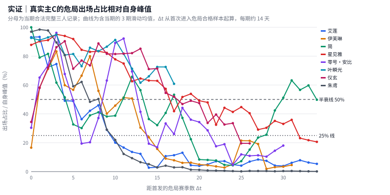

| 主 C | 模式 | Δt=0 赛季 | 峰值出场占比（赛季） | 跌破峰值 50% | 跌破峰值 25% | 最新赛季／峰值 | 观测赛季数 |
| --- | --- | --- | --- | --- | --- | --- | --- |
| 艾莲 | 式舆防卫战 | 1.1.1 | 42.8%（1.1.1） | 5 期／77 天 | 8 期／123 天 | 0% | 43 |
| 朱鸢 | 式舆防卫战 | 1.1.1 | 41.4%（1.1.1） | 6 期／92 天 | 8 期／123 天 | 0% | 43 |
| 简 | 式舆防卫战 | 1.1.2 | 29.8%（1.2.1） | 6 期／91 天 | 8 期／124 天 | 13% | 42 |
| 星见雅 | 式舆防卫战 | 1.3.3 | 45.3%（1.7.2） | 13 期／283 天 | 21 期／444 天 | 44% | 35 |
| 艾莲 | 危局强袭战 | 1.4.1 | 12.1%（1.5.2） | 4 期／77 天 | 4 期／77 天 | 7% | 35 |
| 简 | 危局强袭战 | 1.4.1 | 18.8%（1.4.1） | 3 期／49 天 | 9 期／189 天 | 29% | 35 |
| 星见雅 | 危局强袭战 | 1.4.1 | 43.8%（1.5.2） | 12 期／259 天 | 20 期／434 天 | 40% | 35 |
| 朱鸢 | 危局强袭战 | 1.4.1 | 15.9%（1.4.2） | 5 期／105 天 | 9 期／189 天 | 0% | 35 |
| 伊芙琳 | 危局强袭战 | 1.5.2 | 17.7%（1.5.4） | 4 期／98 天 | 8 期／182 天 | 5% | 32 |
| 伊芙琳 | 式舆防卫战 | 1.5.2 | 22.1%（1.6.1） | 2 期／56 天 | 2 期／56 天 | 11% | 32 |
| 零号·安比 | 危局强袭战 | 1.5.4 | 15.1%（1.6.2） | 4 期／84 天 | 4 期／84 天 | 15% | 31 |
| 零号·安比 | 式舆防卫战 | 1.6.1 | 21.8%（1.6.3） | 3 期／56 天 | 3 期／56 天 | 21% | 31 |
| 仪玄 | 危局强袭战 | 1.7.3 | 31.5%（2.0.3） | 5 期／112 天 | 21 期／424 天 | 13% | 27 |
| 仪玄 | 式舆防卫战 | 2.0.1 | 39.5%（2.0.2） | 4 期／84 天 | 5 期／112 天 | 20% | 27 |
| 叶瞬光 | 式舆防卫战 | 2.5.1 | 31.1%（2.6.4） | 17 期／276 天 | 未跌破（右删失） | 48% | 18 |
| 叶瞬光 | 危局强袭战 | 2.5.1 | 32.2%（3.0.2） | 17 期／280 天 | 未跌破（右删失） | 41% | 18 |

危局轨道上，简、艾莲、伊芙琳、零号·安比、朱鸢、仪玄的经验半衰期为 3–5 期（49–112 天）；星见雅 12 期（259 天）、叶瞬光 17 期（280 天）的保值期明显更长。出场占比下降同时包含新角色竞争、机制对口度和样本构成变化，不等同于持有者退坑或角色失效。

固定 0+1、单主核（队内唯一主核）的危局记录给出分数轨迹。为消除首领难度差，每条分数除以同赛季同房间全部合法记录的分数中位数；下表为各世代房间相对分数 P50 的房间中位数，分别列主 C 属于预登记对策组（对口）与不属于（非对口）的房间。

| 主 C | G1 | G2 | G3 | G4 | G5 |
| --- | --- | --- | --- | --- | --- |
| 艾莲 | 对口 0.88／非对口 0.75 | 对口 0.86／非对口 0.74 | 对口 0.76／非对口 0.75 | 对口 0.76 | 对口 0.74／非对口 0.49 |
| 朱鸢 | 对口 0.96／非对口 0.86 | 对口 0.82／非对口 0.73 | 非对口 0.72 | — | — |
| 简 | 对口 0.88／非对口 0.95 | 对口 0.80 | 对口 0.83 | 对口 0.83 | 对口 0.83 |
| 星见雅 | 对口 0.97／非对口 1.05 | 对口 0.91／非对口 0.80 | 对口 0.97／非对口 0.74 | 对口 0.99／非对口 0.80 | 对口 0.78／非对口 0.66 |
| 伊芙琳 | 对口 1.11／非对口 0.84 | 对口 0.94／非对口 0.81 | 对口 0.71／非对口 0.77 | 对口 0.75／非对口 0.73 | 对口 0.75／非对口 0.77 |
| 零号·安比 | 对口 1.00／非对口 0.80 | 对口 1.01／非对口 0.83 | 对口 0.81／非对口 0.81 | 对口 0.84／非对口 0.80 | 对口 0.74／非对口 0.74 |
| 仪玄 | 非对口 1.01 | 对口 1.02／非对口 1.00 | 对口 0.98／非对口 0.83 | 对口 0.97／非对口 0.82 | 对口 0.95／非对口 0.82 |
| 叶瞬光 | — | — | 对口 0.95／非对口 0.91 | 对口 0.94／非对口 0.82 | 对口 0.90／非对口 0.71 |

同时有对口与非对口房间的 29 个主 C × 世代组合中，24 个非对口相对分更低；8 名主 C 中有 5 名的非对口最低点出现在 G5。逐房间的 n、P25／P50／P75 与首领机制见[真实主C保值轨迹表](empirical_real_dps_longevity.csv)。

### 3.2 实证轨：真实售后专拐上线的事件窗口

以插件首次进入合格样本的赛季为事件期，比较首发前 2 期与首发当期及后 2 期。成绩对照固定主核 0+1，并固定第三名队友身份、要求旧辅助与新插件同职业（`fixed_third_matched`）；旧辅助为 A／常驻 S／免费 S，或早于该插件上线的支援／副输出。相对分数的定义同 3.1。

| 主 C + 插件 | 危局事件期 | 主 C 出场占比变化（危局／式舆） | 带新插件／带旧辅 n | 带新插件 相对分 P50 [P25–P75] | 带旧辅 相对分 P50 [P25–P75] | 层内中位数比几何均值（稳定层） | 事件前 旧辅 P50 [P25–P75] |
| --- | --- | --- | --- | --- | --- | --- | --- |
| 艾莲 + 耀嘉音 | 1.5.1 | -5.4pp／-3.9pp | 285／357 | 0.92 [0.82–1.04] | 0.86 [0.81–0.93] | 1.20（1 层） | 0.94 [0.89–1.03] |
| 朱鸢 + 耀嘉音 | 1.5.1 | -2.8pp／-4.1pp | 361／816 | 1.04 [0.89–1.28] | 0.96 [0.88–1.12] | 1.08（3 层） | 1.02 [0.92–1.18] |
| 仪玄 + 潘引壶 | 1.7.3 | 同期首发／同期首发 | 4,233／186 | 1.02 [0.86–1.21] | 0.95 [0.83–1.12] | 1.12（2 层） | — |
| 简 + 浮波柚叶 | 2.0.3 | +6.7pp／+12.9pp | 4,708／956 | 1.05 [0.86–1.26] | 0.93 [0.78–1.13] | 1.16（10 层） | 0.92 [0.85–1.07] |
| 星见雅 + 浮波柚叶 | 2.0.3 | -8.0pp／-2.7pp | 5,187／10,761 | 1.03 [0.86–1.25] | 0.89 [0.77–1.07] | 1.20（25 层） | 0.96 [0.82–1.14] |
| 仪玄 + 卢西娅 | 2.3.1 | +6.4pp／+25.6pp | 20,088／2,282 | 1.15 [0.94–1.37] | 0.78 [0.70–0.91] | 1.42（20 层） | 0.95 [0.84–1.13] |
| 叶瞬光 + 照 | 2.5.1 | 同期首发／同期首发 | 32,717／161 | 0.97 [0.79–1.17] | 0.74 [0.65–0.89] | 1.30（2 层） | — |
| 叶瞬光 + 千夏 | 2.6.1 | -3.3pp／+0.0pp | 10,187／2,769 | 1.03 [0.87–1.22] | 0.91 [0.77–1.08] | 1.15（8 层） | 0.98 [0.79–1.20] |

售后上线的插件在固定第三人分层中均与更高的相对分数同时出现，层内中位数比为 1.08–1.42。出场占比方面，卢西娅上线后仪玄的危局出场占比 +6.4pp，浮波柚叶上线后简 +6.7pp；同一窗口内若有新主 C 首发（如耀嘉音窗口的伊芙琳、零号·安比），老主 C 的出场占比仍可下降。潘引壶与照与主 C 同期首发，没有事件前窗口，只作同期搭配对照。带新插件的样本可能集中于更投入的玩家，比值是条件关联，不是售后的因果增益；完整分层见[事件窗口表](empirical_support_event_window.csv)。

### 3.3 受控轨：自然寿命只记录第一次失效

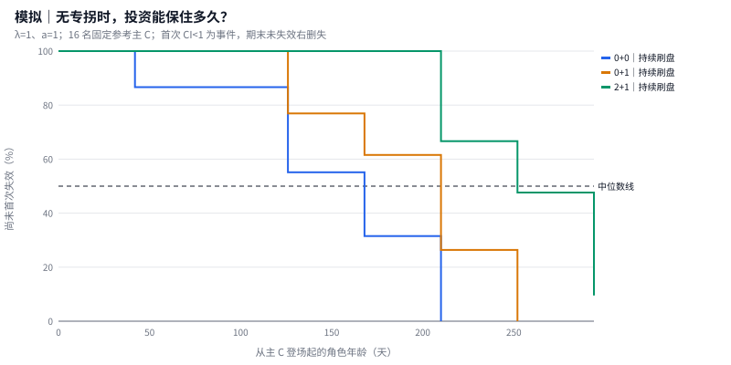

| 投资 | 养成 | 参考主 C 数 | 首次失效事件数 | KM 中位寿命 |
| --- | --- | --- | --- | --- |
| 0+0 | 初始面板（不刷盘） | 16 | 13 | 126 天 |
| 0+1 | 初始面板（不刷盘） | 16 | 12 | 168 天 |
| 2+1 | 初始面板（不刷盘） | 16 | 11 | 252 天 |
| 0+0 | 持续刷盘养成（上限 +16%） | 16 | 12 | 168 天 |
| 0+1 | 持续刷盘养成（上限 +16%） | 16 | 11 | 210 天 |
| 2+1 | 持续刷盘养成（上限 +16%） | 16 | 10 | 252 天 |

首次 CI<1 为不可撤销事件，KM 曲线单调不增；窗口结束仍未失效按右删失处理。这些曲线汇总固定合成商品的寿命，展示不同登场队列与环境路径的结果，不把 16 名角色当作独立现实玩家估计因果置信区间。

### 3.4 受控轨：同条件配对下，支援排期决定延寿还是恢复

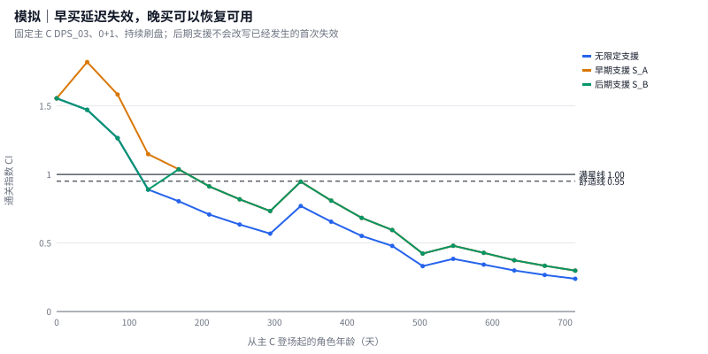

下表固定早期三名主 C、0+1、持续刷盘，列出科学配置预先登记的全部五个早期配对。未配置配对的支援不算作对应售后；零延寿结果保留。

| 主 C + 支援 | 无支援首次失效 | 有支援首次失效 | 观察窗新增满星期数 | 失效后首次恢复年龄 |
| --- | --- | --- | --- | --- |
| DPS_01 + S_A | 168 天 | 210 天 | +1 期 | — |
| DPS_01 + S_B | 168 天 | 168 天 | +0 期 | — |
| DPS_02 + S_A | 126 天 | 168 天 | +1 期 | — |
| DPS_03 + S_A | 126 天 | 210 天 | +2 期 | — |
| DPS_03 + S_B | 126 天 | 126 天 | +1 期 | 168 天 |

DPS_03 的后期支援 S_B 到场时，首次失效已经发生：观察窗内新增 1 个满星期，但首次失效年龄仍为 126 天。早期 S_A 将其首次失效推迟到 210 天。后期辅助的“首次失效寿命”较短，是到场时点和不可撤销事件定义的共同结果。

完整的三档投资、两档养成和全部支援配对见[固定寿命表](research/fixed/tables/l2_reference_lifetimes.csv)、[支援配对表](research/fixed/tables/l2_support_pair_effects.csv)与[逐期参考面板](research/fixed/tables/l2_reference_panel.csv)。

### 3.5 虚拟实验：售后类型、环境与新体系换代

现实事件里，专拐、环境变化与新角色竞争同时发生（3.2 节）。本节在一个带体系标签的合成世界里，让同一批玩家（同一种子、同一随机数流）分别经历不同的商品与环境组合，把三者拆开。世界含三个体系：大体系 L（异常型，主C在第 1、3、5、9、11、13、18 期登场，第 4 期有体系底座专拐）、小体系 S（命破型）与第 14 期起的新体系 N（锋御型）；辅助增益由体系成员关系生成，数值为情景设定。每格 N=200、复核种子 9101／9102／9103、20 期全日志，共 32 格、96 次运行。

| 实验组 | 因素 | 水平 |
| --- | --- | --- |
| A：第 7 期上线的商品（针对大体系 L） | 商品类型 | 无效对照（照常上线但无增益）／窄专拐（只对 L03 有效）／体系专拐（对全部 L 主C有效）／混合型（可当主C，也给 L 主C增益，增益高于旧专拐；坐辅助位时按份额 ρ∈{0, 0.25, 0.5, 0.75} 计入自身伤害） |
|  | 第 7–9 期环境 | 对口 L（输出窗口机制）／非对口 L（壁垒机制） |
|  | 机制锁 λ | 1／2 |
| B：第 14–16 期新体系换代 | 换代锁 | 无／有（壁垒机制，压制 L、利好 N，相当于库萨里库） |
|  | 旧主流售后 | 第 15 期给 L 出体系队友：无／有（相当于菲欧妮） |

**A 组：旧主C上场比例的拆分。** 指标为 L 旧主C（L01、L03、L05）是玩家最佳队伍主C的比例，比较第 5–6 期与第 7–9 期。朴素前后变化 = 时间趋势（无效对照＋非对口）+ 环境效应 + 商品效应（对口）。

| λ | 商品 | 朴素前后变化（对口，pp） | 时间趋势 | 环境效应 | 商品效应·对口 [95%] | 商品效应·非对口 | 交互 | 核心留存差·对口 [95%，pp] |
| --- | --- | --- | --- | --- | --- | --- | --- | --- |
| λ=1 | 窄专拐 | -21.9 | -38.8 | +13.3 | +3.6 [-0.5, +7.6] | +4.2 | -0.6 | +0.8 [-0.9, +2.5] |
| λ=1 | 体系专拐 | -23.1 | -38.8 | +13.3 | +2.4 [-0.0, +4.9] | +4.2 | -1.7 | +2.0 [-1.0, +4.9] |
| λ=1 | 混合型 ρ=0 | -46.8 | -38.8 | +13.3 | -21.4 [-28.8, -13.9] | -19.7 | -1.6 | +18.3 [+4.5, +32.0] |
| λ=1 | 混合型 ρ=0.25 | -27.3 | -38.8 | +13.3 | -1.8 [-7.5, +3.9] | +6.3 | -8.1 | +21.5 [+12.9, +30.1] |
| λ=1 | 混合型 ρ=0.5 | -19.7 | -38.8 | +13.3 | +5.8 [+1.1, +10.4] | +12.2 | -6.4 | +23.9 [+15.9, +31.9] |
| λ=1 | 混合型 ρ=0.75 | -17.4 | -38.8 | +13.3 | +8.1 [+3.4, +12.8] | +14.3 | -6.2 | +26.0 [+14.0, +38.1] |
| λ=2 | 窄专拐 | -4.7 | -36.4 | +25.6 | +6.2 [+5.0, +7.3] | +1.8 | +4.4 | +1.4 [-5.8, +8.7] |
| λ=2 | 体系专拐 | -9.3 | -36.4 | +25.6 | +1.6 [+0.5, +2.6] | +2.4 | -0.9 | +11.1 [-0.8, +23.0] |
| λ=2 | 混合型 ρ=0 | -43.4 | -36.4 | +25.6 | -32.6 [-39.4, -25.8] | -20.3 | -12.3 | +34.5 [+24.9, +44.1] |
| λ=2 | 混合型 ρ=0.25 | -17.5 | -36.4 | +25.6 | -6.6 [-9.8, -3.4] | +3.9 | -10.6 | +38.6 [+30.1, +47.2] |
| λ=2 | 混合型 ρ=0.5 | -13.5 | -36.4 | +25.6 | -2.7 [-4.7, -0.7] | +12.6 | -15.3 | +44.2 [+37.8, +50.5] |
| λ=2 | 混合型 ρ=0.75 | -13.3 | -36.4 | +25.6 | -2.4 [-4.0, -0.8] | +14.6 | -17.0 | +45.9 [+37.6, +54.1] |

λ=1 时，体系专拐的朴素前后变化为 -23.1pp，其中时间趋势 -38.8pp、环境效应 +13.3pp，专拐本身只贡献 +2.4pp；λ=2 时环境效应升至 +25.6pp。环境效应是专拐效应的 6–16 倍，新角色竞争带来的时间趋势更大；现实事件窗口中的出场变化（如卢西娅上线后仪玄 +6.4pp）不能直接读作专拐效果。混合型的效果取决于它坐辅助位时自身还贡献多少伤害，见下文“混合型与旧主C复活”。

**选择偏差。** 观测型比值：同一格内持有新商品与未持有者的 L03 通关指数中位数之比，对应现实的层内成绩比；实验型比值：同一批持有者在商品格与对照格的通关指数之比。

<details>
<summary>展开选择偏差对照</summary>


| λ | 商品 | 环境 | 观测型比值 | 实验型比值 | 选择偏差 | 持有／未持有人数 |
| --- | --- | --- | --- | --- | --- | --- |
| λ=1 | 窄专拐 | 对口 | 1.29 | 1.29 | +0.00 | 18／93 |
| λ=1 | 窄专拐 | 非对口 | 1.27 | 1.27 | +0.00 | 37／73 |
| λ=1 | 体系专拐 | 对口 | 1.29 | 1.29 | +0.00 | 18／93 |
| λ=1 | 体系专拐 | 非对口 | 1.27 | 1.27 | +0.00 | 37／73 |
| λ=1 | 混合型 ρ=0 | 对口 | 1.36 | 1.36 | +0.00 | 42／69 |
| λ=1 | 混合型 ρ=0 | 非对口 | 1.34 | 1.34 | +0.00 | 58／53 |
| λ=1 | 混合型 ρ=0.25 | 对口 | 1.75 | 1.75 | +0.00 | 66／45 |
| λ=1 | 混合型 ρ=0.25 | 非对口 | 1.73 | 1.73 | +0.00 | 72／39 |
| λ=1 | 混合型 ρ=0.5 | 对口 | 2.14 | 2.14 | +0.00 | 95／16 |
| λ=1 | 混合型 ρ=0.5 | 非对口 | 2.12 | 2.12 | +0.00 | 94／18 |
| λ=1 | 混合型 ρ=0.75 | 对口 | 2.54 | 2.54 | +0.00 | 107／5 |
| λ=1 | 混合型 ρ=0.75 | 非对口 | 2.51 | 2.51 | +0.00 | 103／8 |
| λ=2 | 窄专拐 | 对口 | 1.35 | 1.35 | +0.00 | 45／67 |
| λ=2 | 窄专拐 | 非对口 | 1.49 | 1.27 | +0.21 | 16／94 |
| λ=2 | 体系专拐 | 对口 | 1.35 | 1.35 | +0.00 | 45／67 |
| λ=2 | 体系专拐 | 非对口 | 1.43 | 1.27 | +0.16 | 17／93 |
| λ=2 | 混合型 ρ=0 | 对口 | 1.43 | 1.43 | +0.00 | 62／51 |
| λ=2 | 混合型 ρ=0 | 非对口 | 1.35 | 1.35 | +0.00 | 55／56 |
| λ=2 | 混合型 ρ=0.25 | 对口 | 1.82 | 1.82 | +0.00 | 85／28 |
| λ=2 | 混合型 ρ=0.25 | 非对口 | 1.74 | 1.74 | +0.00 | 73／39 |
| λ=2 | 混合型 ρ=0.5 | 对口 | 2.13 | 2.21 | -0.08 | 104／9 |
| λ=2 | 混合型 ρ=0.5 | 非对口 | 2.13 | 2.13 | +0.00 | 91／22 |
| λ=2 | 混合型 ρ=0.75 | 对口 | 2.40 | 2.60 | -0.20 | 110／3 |
| λ=2 | 混合型 ρ=0.75 | 非对口 | 2.52 | 2.52 | +0.00 | 101／12 |


</details>

多数格的观测型与实验型比值相同（约 1.27–1.43），只在 λ=2、非对口时出现 0.16–0.21 的偏差。模拟玩家之间只有预算带来的养成差异，没有操作水平差异，因此这是选择偏差的下限；现实中卢西娅的层内成绩比 1.42 落在模拟的纯效应范围内，现实里额外的技术与养成选择无法由本模型排除。

**旧专拐被替代。** L 体系队伍（第 8–12 期）中新商品与旧底座专拐的使用比例：

| λ | 商品 | 环境 | 新商品占辅助位 | 旧专拐占辅助位（对照格 → 本格） | 新商品作为主C上场 | 含混合型队伍中它坐辅助位 |
| --- | --- | --- | --- | --- | --- | --- |
| λ=1 | 窄专拐 | 对口 | 16% | 12% → 11% | 0% | — |
| λ=1 | 窄专拐 | 非对口 | 37% | 19% → 15% | 0% | — |
| λ=1 | 体系专拐 | 对口 | 21% | 12% → 11% | 0% | — |
| λ=1 | 体系专拐 | 非对口 | 51% | 19% → 11% | 0% | — |
| λ=1 | 混合型 ρ=0 | 对口 | 35% | 12% → 7% | 13% | 67% |
| λ=1 | 混合型 ρ=0 | 非对口 | 48% | 19% → 7% | 18% | 65% |
| λ=1 | 混合型 ρ=0.25 | 对口 | 66% | 12% → 6% | 3% | 94% |
| λ=1 | 混合型 ρ=0.25 | 非对口 | 80% | 19% → 5% | 2% | 96% |
| λ=1 | 混合型 ρ=0.5 | 对口 | 87% | 12% → 2% | 1% | 99% |
| λ=1 | 混合型 ρ=0.5 | 非对口 | 91% | 19% → 2% | 0% | 100% |
| λ=1 | 混合型 ρ=0.75 | 对口 | 96% | 12% → 1% | 0% | 100% |
| λ=1 | 混合型 ρ=0.75 | 非对口 | 95% | 19% → 1% | 0% | 100% |
| λ=2 | 窄专拐 | 对口 | 33% | 12% → 11% | 0% | — |
| λ=2 | 窄专拐 | 非对口 | 20% | 23% → 20% | 0% | — |
| λ=2 | 体系专拐 | 对口 | 40% | 12% → 10% | 0% | — |
| λ=2 | 体系专拐 | 非对口 | 40% | 23% → 15% | 0% | — |
| λ=2 | 混合型 ρ=0 | 对口 | 43% | 12% → 6% | 20% | 68% |
| λ=2 | 混合型 ρ=0 | 非对口 | 56% | 23% → 7% | 13% | 73% |
| λ=2 | 混合型 ρ=0.25 | 对口 | 74% | 12% → 5% | 5% | 94% |
| λ=2 | 混合型 ρ=0.25 | 非对口 | 81% | 23% → 5% | 3% | 96% |
| λ=2 | 混合型 ρ=0.5 | 对口 | 90% | 12% → 2% | 2% | 98% |
| λ=2 | 混合型 ρ=0.5 | 非对口 | 91% | 23% → 1% | 0% | 100% |
| λ=2 | 混合型 ρ=0.75 | 对口 | 97% | 12% → 1% | 0% | 100% |
| λ=2 | 混合型 ρ=0.75 | 非对口 | 96% | 23% → 1% | 0% | 100% |

**混合型与旧主C复活。** 混合型坐辅助位时，队伍伤害 = 主C伤害 + ρ × 混合型单独出战的伤害（按其自身养成与机制适配，不带支援）。ρ=0 时它只是增益更高的专拐：新角色战力更高，常常自己当主C，旧主C上场比例变化 -32.6～-21.4pp（对口）。现实中带蕾米埃尔的危局队伍有 99.4%–100.0% 同时含其他异常主核；模拟中含混合型的队伍里它坐辅助位的比例，ρ=0 时为 65%–73%，ρ=0.25 时为 94%–96%，ρ=0.5 时为 98%–100%，ρ=0.75 时为 100%。区间触及现实的最低档是 ρ=0.5。在 ρ≥0.5 下，λ=1 时旧主C上场比例对口 +5.8～+8.1pp、非对口 +12.2～+14.3pp；λ=2 时非对口 +12.6～+14.6pp，对口 -2.7～-2.4pp。λ=2 对口时对照格中的旧主C已接近饱和，第 9 期新 L 主C登场后混合型同样抬高新主C。旧专拐的辅助位占比由 12%–23% 降到 1%–2%，方向与浮波柚叶被挤出一致；核心留存差为 +23.9～+45.9pp（对口）。混合型以主C规格售出，又让玩家已有的旧主C重回场上，替代的是旧专拐而不是旧主C。

**B 组：新体系换代锁与旧主流售后（λ=1）。**

| 指标 | 换代锁效应（无售后）[95%] | 售后效应（有换代锁）[95%] | 售后挽回比例 |
| --- | --- | --- | --- |
| L 体系玩家第 20 期留存（pp） | -0.8 [-5.3, +3.6] | +0.4 [-1.4, +2.2] | — |
| L 体系玩家第 14–16 期直购许可率（pp） | +1.3 [-0.0, +2.7] | +1.5 [-0.7, +3.8] | — |
| L 体系玩家第 14–20 期现金（元） | +1,481 [-4,577, +7,538] | +1,388 [-1,832, +4,608] | — |
| 第 14–16 期 L 体系上场比例（pp） | -4.6 [-6.0, -3.2] | +0.8 [-1.5, +3.0] | 17% |
| 第 14–16 期 N 体系上场比例（pp） | +7.6 [+4.6, +10.5] | -0.7 [-2.5, +1.1] | 9% |
| N 体系卡池直购（元） | +747 [-6,547, +8,040] | +0 [+0, +0] | — |
| 第 15 期旧主流售后卡池直购（元） | +0 [+0, +0] | +0 [+0, +0] | — |
| 20 期总现金（元） | +207 [-9,246, +9,660] | +1,388 [-1,832, +4,608] | — |

换代锁使 L 体系第 14–16 期上场比例变化 -4.6pp、N 体系 +7.6pp，留存与现金的变化区间都跨零。旧主流售后对 L 体系上场比例的挽回点估计为 17%，但售后效应本身区间跨零；售后卡池在模拟里几乎没有直购。现实中库萨里库房间的异常队占比从八九成降到个位数，远强于模拟：现实玩家按房间换队，而模拟每期只有一种机制环境；现实中菲欧妮的早期流水超过锋御卡池，而模拟中辅助池需求偏低（6.3 节）。B 组只用于说明换代锁改变上场结构的方向，不支持现金结论。

实验配置、运行清单与逐运行指标见[体系实验清单](research/archetype/experiment_manifest.json)、[拆分表](research/archetype/tables/a_decomposition.csv)、[替代表](research/archetype/tables/a_displacement.csv)与[换代表](research/archetype/tables/b_generation_shift.csv)。

## 4. 玩家行为：从卡关痛感到付费、停氪与留存（Layer 3）

每期按资源发放 → Pre-Eval → 购买决策与逐抽 → 部分成果入库 → Post-Eval → 疲劳与流失推进。历史疲劳、连续失败与上次付费后仍失败进入续订/直购意愿；玩家可以保持免费活跃而停止付款。可负担预算与是否愿意付费分别处理，已购月卡权益留在独立库存。

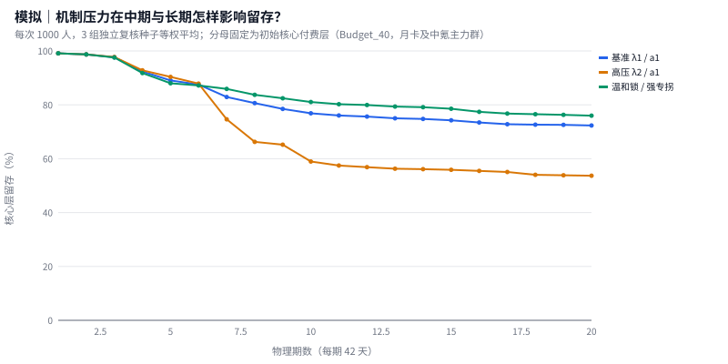

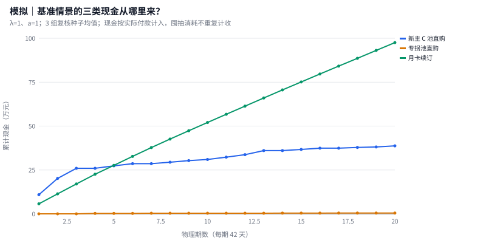

λ=1、a=1 的 20 期复核平均累计现金为 **¥1,367,258**，核心留存 **72.3%**。核心层指初始核心付费层（Budget_40，月卡及中氪主力群），停氪仍活跃者继续计入留存；三组种子先各自按固定分母计算，再等权平均。

现金仅包括实际续订与实际直购：本期免费、历史免费囤抽、已购月卡权益和直购抽数分别记账。新主 C 池直购含本体、影画与专武；专拐池对应支援本体。20 期为 840 天；10 期来自同一运行的前半段。

<details>
<summary>战斗与付费回路的 2×2 结构对照（N=200 固定种子）</summary>


固定 λ=1、a=1、种子 1101，分别替换战斗代理与付费回路。用于定位两个模块各自的贡献，不作为千人主网格的跨种子效应估计。

| 期数 | 战斗模块 | 付费模块 | 初始人数 | 累计现金 | 核心留存 |
| --- | --- | --- | --- | --- | --- |
| 10 | 单盾代理 | 基线行为 | 200 | ¥191,540 | 80.8% |
| 10 | 单盾代理 | 疲劳接入付费 | 200 | ¥189,310 | 80.8% |
| 10 | 三通道代理 | 基线行为 | 200 | ¥197,264 | 83.6% |
| 10 | 三通道代理 | 疲劳接入付费 | 200 | ¥190,716 | 83.6% |
| 20 | 单盾代理 | 基线行为 | 200 | ¥324,894 | 74.0% |
| 20 | 单盾代理 | 疲劳接入付费 | 200 | ¥318,426 | 74.0% |
| 20 | 三通道代理 | 基线行为 | 200 | ¥311,750 | 75.3% |
| 20 | 三通道代理 | 疲劳接入付费 | 200 | ¥301,424 | 75.3% |


</details>

## 5. 候选策略与稳健性：保留取舍，区分可辨与不可辨

### 5.1 机制锁与专拐的跨种子配对效应

每个种子内先匹配同一批玩家，再对差值求均值和 Student-t 逐项 95% 区间。λ 端点在五档 a 上等权平均；a 端点在五档 λ 上等权平均。

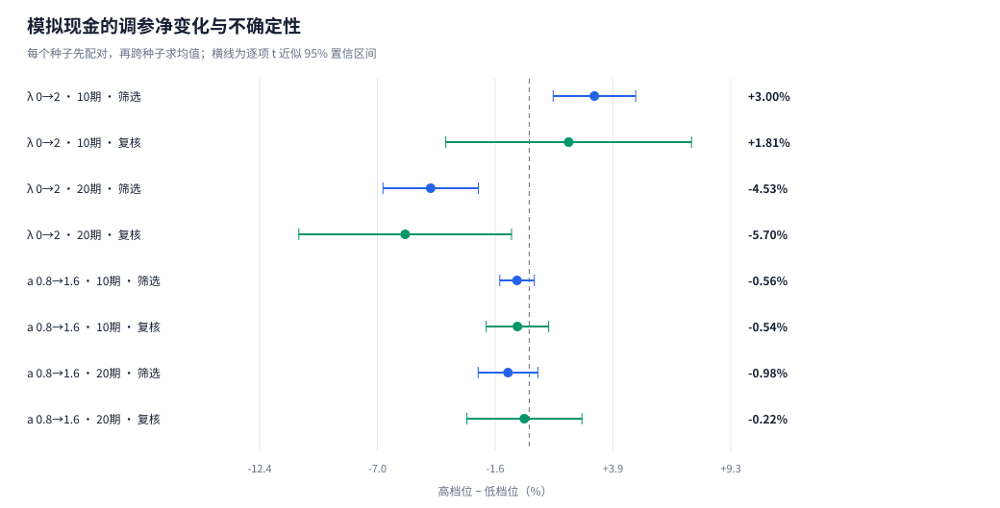

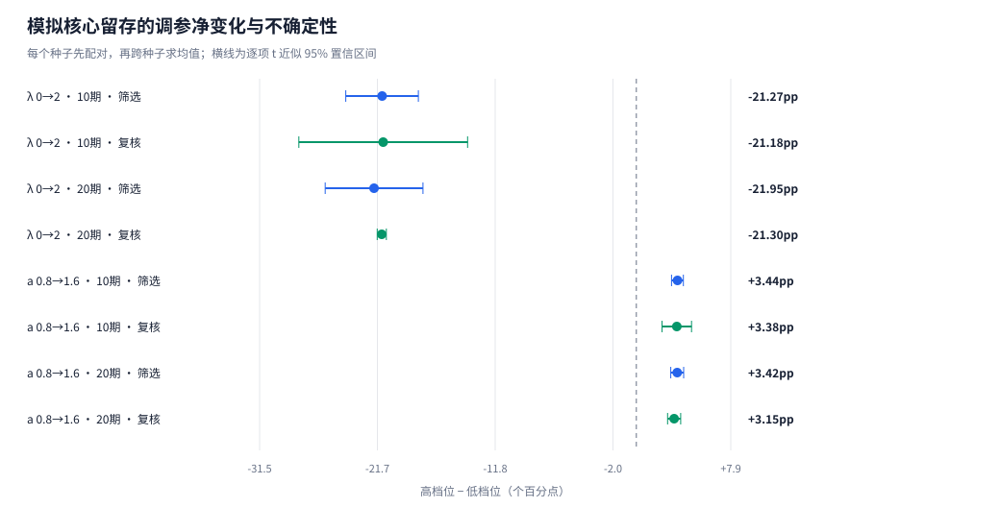

| 期数 | 用途 | 端点对照 | 配对种子数 | 总现金相对变化 [95%区间] | 核心留存变化 [95%区间] |
| --- | --- | --- | --- | --- | --- |
| 10 | 筛选 | λ 0→2 | 5 | +3.00% [+1.10, +4.90]% | -21.27pp [-24.31, -18.24]pp |
| 10 | 筛选 | a 0.8→1.6 | 5 | -0.56% [-1.35, +0.23]% | +3.44pp [+2.94, +3.93]pp |
| 10 | 复核 | λ 0→2 | 3 | +1.81% [-3.84, +7.47]% | -21.18pp [-28.24, -14.12]pp |
| 10 | 复核 | a 0.8→1.6 | 3 | -0.54% [-1.98, +0.89]% | +3.38pp [+2.15, +4.61]pp |
| 20 | 筛选 | λ 0→2 | 5 | -4.53% [-6.73, -2.34]% | -21.95pp [-26.04, -17.86]pp |
| 20 | 筛选 | a 0.8→1.6 | 5 | -0.98% [-2.35, +0.40]% | +3.42pp [+2.88, +3.96]pp |
| 20 | 复核 | λ 0→2 | 3 | -5.70% [-10.60, -0.81]% | -21.30pp [-21.68, -20.92]pp |
| 20 | 复核 | a 0.8→1.6 | 3 | -0.22% [-2.87, +2.42]% | +3.15pp [+2.61, +3.70]pp |

### 5.2 总现金接近中性，是否掩盖了商品之间的变化？

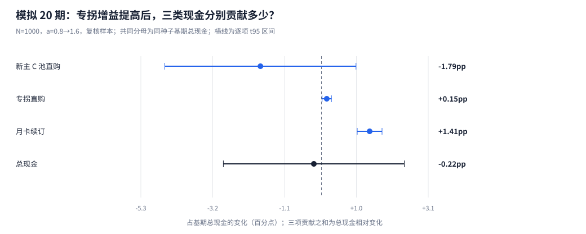

20 期复核，a 0.8→1.6。各分项先在种子内配对，贡献统一除以该种子 a=0.8 的总现金；不是各分项自身增长率。

| 现金项 | 配对种子数 | 现金差 [95%区间，元] | 基期总现金贡献 [95%区间，百分点] |
| --- | --- | --- | --- |
| 新主 C 池直购 | 3 | -24,662 [-65,037, +15,712] | -1.79 [-4.58, +1.01] |
| 专拐池直购 | 3 | +2,117 [-87, +4,321] | +0.15 [+0.02, +0.29] |
| 月卡续订 | 3 | +19,012 [+14,407, +23,617] | +1.41 [+1.05, +1.77] |
| 总现金 | 3 | -3,533 [-39,446, +32,379] | -0.22 [-2.87, +2.42] |

点估计中，新主 C 池直购减少，专拐池直购与月卡续订增加。绝对金额口径下，新主 C 池直购与专拐池直购的区间均跨零，不能单凭点估计认定现实替代关系。三项均值与贡献可加；总区间从种子内三项之和单独估计，保留协方差，区间端点不能相加。金额均值与归一化贡献使用不同估计量，随机基期分母可使两者的区间跨零情况不同。

### 5.3 换一批玩家与随机数，排名有多稳定？

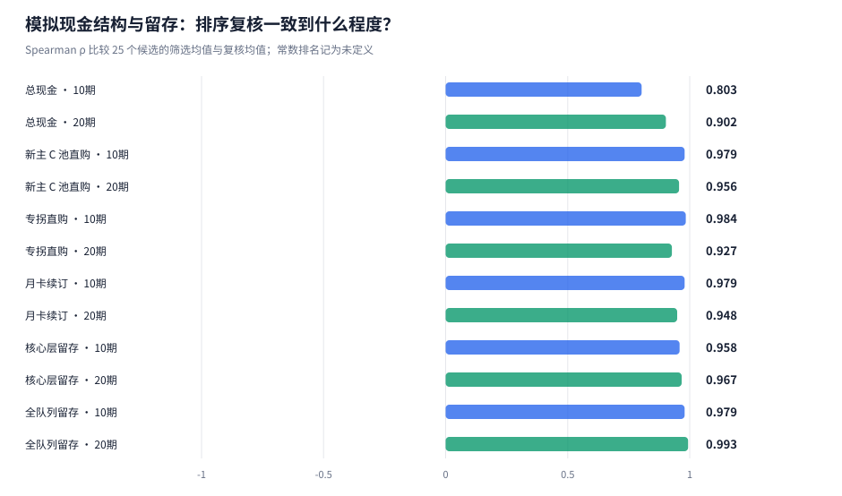

| 指标 | 期数 | N=200，5+3 种子 ρ | N=1000，5+3 种子 ρ |
| --- | --- | --- | --- |
| 总现金 | 10 | 0.171 | 0.803 |
| 总现金 | 20 | 0.842 | 0.902 |
| 新主 C 池直购 | 10 | 0.780 | 0.979 |
| 新主 C 池直购 | 20 | 0.453 | 0.956 |
| 专拐池直购 | 10 | 0.032 | 0.984 |
| 专拐池直购 | 20 | 0.469 | 0.927 |
| 月卡续订 | 10 | 0.959 | 0.979 |
| 月卡续订 | 20 | 0.927 | 0.948 |
| 核心层留存 | 10 | 0.948 | 0.958 |
| 核心层留存 | 20 | 0.813 | 0.967 |
| 全队列留存 | 10 | 0.983 | 0.979 |
| 全队列留存 | 20 | 0.911 | 0.993 |

ρ 比较 25 个候选的筛选均值与独立复核均值排序，收入与留存分别评估。扩大人口后的排序更稳，不意味着所有配对区间都缩窄：复核仍只有三组种子，自由度为 2。不同人口的精度以相对变化或每名初始玩家的现金差比较，见[精度对照表](research/n1000/tables/population_precision_comparison.csv)。

### 5.4 哪些候选反复进入非支配集合？

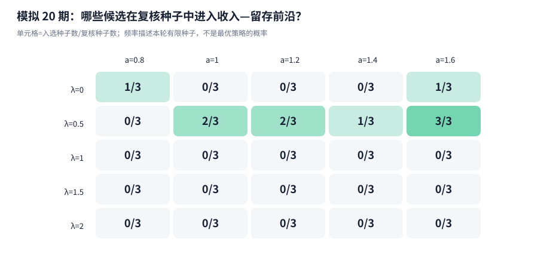

分别以现金和核心留存为两个目标，每个复核种子单独求指定 25 个候选中的非支配集合。频率描述模型内复核结果，不将均值前沿称为全局最优。

| 每次人数 | 预设关注候选 | 人均累计现金 | 核心留存 | 相对基准人均现金差 [95%区间，元] | 入选次数 |
| --- | --- | --- | --- | --- | --- |
| 200 | λ=1，a=1.4 | ¥1,273.01 | 72.2% | +21.44 [-12.54, +55.42] | 0/3 |
| 200 | λ=1，a=1.6 | ¥1,258.42 | 74.1% | +6.85 [-68.90, +82.60] | 0/3 |
| 1000 | λ=1，a=1.4 | ¥1,359.95 | 71.8% | -7.31 [-19.74, +5.12] | 0/3 |
| 1000 | λ=1，a=1.6 | ¥1,360.00 | 73.3% | -7.26 [-36.79, +22.28] | 0/3 |

<details>
<summary>展开 25 个候选的 20 期独立复核成绩</summary>


| 机制锁 λ | 专拐 a | 累计现金均值 | 核心留存 | 复核前沿入选 |
| --- | --- | --- | --- | --- |
| 0 | 0.8 | ¥1,383,599 | 74.5% | 1/3 |
| 0 | 1 | ¥1,376,352 | 74.6% | 0/3 |
| 0 | 1.2 | ¥1,362,494 | 74.2% | 0/3 |
| 0 | 1.4 | ¥1,361,591 | 74.9% | 0/3 |
| 0 | 1.6 | ¥1,360,709 | 75.1% | 1/3 |
| 0.5 | 0.8 | ¥1,388,407 | 73.7% | 0/3 |
| 0.5 | 1 | ¥1,390,133 | 74.6% | 2/3 |
| 0.5 | 1.2 | ¥1,375,592 | 74.8% | 2/3 |
| 0.5 | 1.4 | ¥1,371,010 | 74.9% | 1/3 |
| 0.5 | 1.6 | ¥1,370,073 | 76.0% | 3/3 |
| 1 | 0.8 | ¥1,350,460 | 68.1% | 0/3 |
| 1 | 1 | ¥1,367,258 | 72.3% | 0/3 |
| 1 | 1.2 | ¥1,361,005 | 72.2% | 0/3 |
| 1 | 1.4 | ¥1,359,945 | 71.8% | 0/3 |
| 1 | 1.6 | ¥1,360,001 | 73.3% | 0/3 |
| 1.5 | 0.8 | ¥1,332,317 | 62.3% | 0/3 |
| 1.5 | 1 | ¥1,340,095 | 64.1% | 0/3 |
| 1.5 | 1.2 | ¥1,333,374 | 64.3% | 0/3 |
| 1.5 | 1.4 | ¥1,330,550 | 64.4% | 0/3 |
| 1.5 | 1.6 | ¥1,354,311 | 68.8% | 0/3 |
| 2 | 0.8 | ¥1,303,233 | 54.3% | 0/3 |
| 2 | 1 | ¥1,299,645 | 53.7% | 0/3 |
| 2 | 1.2 | ¥1,286,165 | 52.2% | 0/3 |
| 2 | 1.4 | ¥1,274,077 | 51.2% | 0/3 |
| 2 | 1.6 | ¥1,295,256 | 55.4% | 0/3 |


</details>

### 5.5 换一种同样合理的行为函数，结论还成立吗？

主网格的扩样只降低既定行为公式下的抽样误差。本节改用三种竞争性行为结构，各自在 N=200、复核种子 9101／9102／9103、λ∈{0,1,2} × a∈{0.8,1.0,1.6} 共 9 个角点／中心点上运行，端点对照在另一轴的三档上等权平均；M0 的 27 次运行直接复用 N=200 多种子实验中配置身份一致的结果，M1／M2 新增 54 次。

| 行为设定 | 定义 |
| --- | --- |
| M0 现行（停氪缓冲） | 连续未满星与“当期付费仍未满星”降低下期直购与月卡续订意愿；玩家可停氪但继续免费活跃 |
| M1 无停氪缓冲 | 疲劳、连续失败与付费后仍失败对直购、续订意愿的扣减系数置零；只要在玩且有缺口，按初始预算能力付费；疲劳只驱动退坑 |
| M2 强追新偏好 | 新主 C 池的下池效用另加不随 CI₀ 满星归零的固定项 β_novelty=1.5；初始核心付费层对已满星新主 C 池的基础下池概率由约 7.6% 升至约 26.9% |

**结论对行为假设的依赖性（20 期，3 组复核种子逐项 95% 区间）**

| 待检验的商业命题 | M0 现行（停氪缓冲） | M1 无停氪缓冲 | M2 强追新偏好 |
| --- | --- | --- | --- |
| A：λ 0→2 损害核心留存 | 下降 -17.95pp [-22.62, -13.29] | 下降 -17.95pp [-22.62, -13.29] | 下降 -8.48pp [-17.18, +0.22]，区间跨零 |
| A：λ 0→2 降低 20 期总现金 | 下降 -9.35% [-13.07, -5.64] | 下降 -8.59% [-12.19, -4.98] | 上升 +0.37% [-9.92, +10.65]，区间跨零 |
| B：a 0.8→1.6 提升核心留存 | 提升 +3.80pp [-0.02, +7.63]，区间跨零 | 提升 +3.80pp [-0.02, +7.63]，区间跨零 | 下降 -0.03pp [-1.06, +1.00]，区间跨零 |
| C：a 0.8→1.6 替代新主C池直购（基期总现金贡献） | 减少 -2.60pp [-5.30, +0.10]，区间跨零 | 减少 -2.59pp [-5.35, +0.16]，区间跨零 | 减少 -5.12pp [-9.17, -1.07] |
| C：a 0.8→1.6 的 20 期总现金 | 下降 -1.03% [-2.03, -0.03] | 下降 -1.12% [-2.19, -0.05] | 下降 -4.75% [-8.19, -1.32] |

| 行为设定 | λ 0→2 核心留存 | λ 0→2 现金（10 期 → 20 期） | a 0.8→1.6 核心留存 | a 0.8→1.6 总现金 | a 0.8→1.6 新主C直购贡献 | 专拐直购／月卡续订贡献 |
| --- | --- | --- | --- | --- | --- | --- |
| M0 现行（停氪缓冲） | -17.95pp [-22.62, -13.29]pp | +0.71% [-8.63, +10.05]% → -9.35% [-13.07, -5.64]% | +3.80pp [-0.02, +7.63]pp | -1.03% [-2.03, -0.03]% | -2.60pp [-5.30, +0.10]pp | +0.04／+1.53pp |
| M1 无停氪缓冲 | -17.95pp [-22.62, -13.29]pp | +1.47% [-8.22, +11.15]% → -8.59% [-12.19, -4.98]% | +3.80pp [-0.02, +7.63]pp | -1.12% [-2.19, -0.05]% | -2.59pp [-5.35, +0.16]pp | +0.04／+1.43pp |
| M2 强追新偏好 | -8.48pp [-17.18, +0.22]pp | +7.08% [-1.34, +15.51]% → +0.37% [-9.92, +10.65]% | -0.03pp [-1.06, +1.00]pp | -4.75% [-8.19, -1.32]% | -5.12pp [-9.17, -1.07]pp | +0.28／+0.08pp |

M1 与 M0 的核心层与全队列留存在 27/27 次配对运行中完全相同，总抽数在 19/27 次中相同：取消停氪缓冲让更多续订与直购许可通过，只有少数转化为额外抽取，阵容、疲劳与退坑没有因此改变，差异主要体现在月卡续订现金。命题 A、B、C 的方向与幅度因此不依赖停氪缓冲；现行模型中的退坑由战斗挫败驱动，停氪状态是现金通道。M2 改变的是“抽新主 C 的动机”。追新驱动下，玩家即便老队满星也持续获得新主 C，机制锁造成的挫败更少转化为退坑与收入损失，λ 的 20 期现金差不再可区分；专拐对老主 C 的保值价值也不再体现为留存。a 提高后新主 C 池直购下降的点估计在三种设定下同向，M2 中因新主 C 直购基数更大，替代的共同分母贡献更大且区间不跨零。

| 结论类型 | 内容 |
| --- | --- |
| 跨设定稳健（方向） | λ 0→2 降低核心留存：M0／M1 区间不跨零，M2 幅度约为一半、区间上界贴近 0；a 提高时新主 C 池直购下降：三者点估计同向，M0／M1 区间上界略过零；停氪缓冲不改变留存 |
| 依赖“缺口驱动抽卡” | λ 的长期现金负号与 a 的留存收益：只有当玩家主要因强度缺口抽新主 C 时，挫败才传导为退坑与现金损失，专拐延寿才转化为留存；外部调查中自报付费动机以角色收集为主（6.4 节） |
| 依赖具体参数与网格 | 各端点效应的大小与候选排名；a 的总现金在 N=200 九点子网格三种设定下均为负且区间不跨零，在千人五档主网格中区间跨零 |

消融表与逐运行结果见[命题对照表](research/ablation/tables/proposition_summary.csv)、[端点效应](research/ablation/tables/axis_effects.csv)与[运行清单](research/ablation/experiment_manifest.json)。

## 6. 外部校验：真实市场、全服调频统计与行为研究

本节用三类外部数据检验 L3 模拟器的商品收入结构、抽卡结构与行为结构。它们都是聚合或横截面数据，只能校验相对量级与函数形式，不能识别单个玩家的付费因果。

### 6.1 主C池 vs 专拐池：两个市场的卡池流水与畅销榜

[Gacha Revenue Tracker](https://derkein.github.io/gacha-tracker-/#zzz)的数据文件提供 40 个卡池的日本 game-i 日元估算（合计约 ¥228 亿）、中国区七麦 iPhone 逐日流水估算按卡池窗口的加总，以及中国 iPhone 畅销总榜的逐日名次（数据更新于 2026-10-30）。卡池窗口长短不一，下表同时给出总额比与日均比；“扣除地板”用当年最低日均卡池近似月卡与常驻消费，得到专拐池相对主C池的增量流水比。

| 类别（2.9 节规则） | 专拐池 | 强搭配的售后主核数 | 参照主C池 | 日本流水（专拐／主C） | 日本总额比 | 日本日均比 | 中国 iPhone 日均比 | 扣除地板后增量比 | 中国 iPhone 畅销最高名次（专拐／主C） |
| --- | --- | --- | --- | --- | --- | --- | --- | --- | --- |
| 体系专拐 | 卢西娅 | 1 | 仪玄 | ¥3.01 亿／¥11.52 亿 | 26% | 24% | 18% | 9% | #17／#4 |
| 体系专拐 | 橘福福 | 1 | 仪玄 | ¥3.20 亿／¥11.52 亿 | 28% | 26% | 16% | 12% | #23／#4 |
| 体系专拐 | 浮波柚叶 | 7 | 星见雅＆浅羽悠真 | ¥8.20 亿／¥17.51 亿 | 47% | 76% | 50% | 68% | #10／#2 |
| 体系专拐 | 南宫羽 | 2 | 爱芮 | ¥3.96 亿／¥3.37 亿 | 118% | 101% | 135% | 102% | #18／#30 |
| 跨体系 | 千夏 | 2 | 叶瞬光＆照 | ¥3.74 亿／¥18.56 亿 | 20% | 17% | 19% | 6% | #25／#2 |
| 跨体系 | 「扳机」 | 2 | 零号·安比 | ¥3.18 亿／¥4.63 亿 | 69% | 72% | 98% | 49% | #21／#20 |
| 泛用 | 凯撒 | 0 | 简 | ¥7.28 亿／¥8.82 亿 | 83% | 79% | 32% | 70% | #15／#7 |
| 泛用 | 耀嘉音 | 6 | 星见雅＆浅羽悠真 | ¥10.19 亿／¥17.51 亿 | 58% | 94% | 28% | 92% | #13／#2 |

同为体系专拐，流水差距取决于上线时能“售后”多少已有主核：卢西娅、橘福福上线时命破体系只有仪玄一名已有主核，扣除地板后的增量为 9%–12%，中国 iPhone 畅销榜最高名次从仪玄池的第 4 名落到第 17–23 名；浮波柚叶上线时对应 7 名已有异常主核，增量比为 68%。南宫羽的比值（102%）取决于参照池：她对照的是同期流水较低的爱芮池。跨体系的千夏、扳机为 6%–49%，泛用的凯撒、耀嘉音为 70%–92%。第三方流水由 App Store／Google Play 畅销榜排名与日度权重反推，不含官方 PC 端与支付中心直充，双 UP 卡池同开期按规则切分。完整序列见[卡池流水表](external_gacha_banner_revenue.csv)与[品类比值表](external_banner_category_ratios.csv)。

### 6.2 全服调频统计：出金曲线、角色池与音擎池、主C池与专拐池

[rng.moe 全服统计](https://zzz.rng.moe/en/tracker/global)的公开接口提供 26 个限定角色池与 26 个音擎池的聚合数据（2024-07 至 2026-01；该站 2026-01-30 起维护，之后的卡池无统计），含参与人数、总抽数、小保底胜负与逐抽出金率。[StarDB Signal Tracker](https://stardb.gg/en/zzz/signal-tracker)只展示登录用户自己导入的记录，没有全服聚合，因此不提供可用数据。

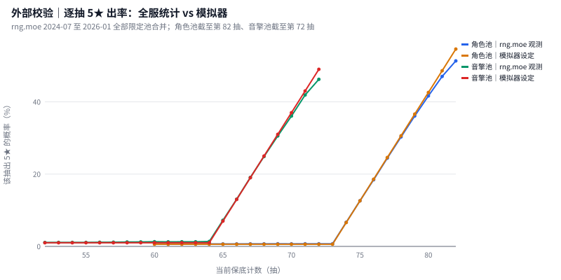

图中只对比到出率仍单调上升的位置。之后观测出率反而回落，与硬保底必出矛盾，应来自导入记录的计数偏差；这部分样本极少（角色池第 82 抽之后占 0.07%，音擎池第 72 抽之后占 0.14%），不纳入对照。

<details>
<summary>展开 26 个限定角色池的全服抽数</summary>


| UP 角色 | 定位 | 开池 | 参与人数 | 角色池总抽数 | 人均抽数 | 音擎÷角色抽数 | 抽音擎人数占比 |
| --- | --- | --- | --- | --- | --- | --- | --- |
| 艾莲 | 主C | 2024-07-04 | 118,895 | 11.21M | 94.2 | 0.27 | 57% |
| 朱鸢 | 主C | 2024-07-24 | 102,119 | 7.04M | 69.0 | 0.22 | 41% |
| 青衣 | 支援 | 2024-08-13 | 91,257 | 5.75M | 63.0 | 0.18 | 34% |
| 简 | 主C | 2024-09-04 | 104,876 | 7.60M | 72.5 | 0.27 | 52% |
| 凯撒 | 支援 | 2024-09-24 | 90,748 | 5.47M | 60.3 | 0.25 | 41% |
| 柏妮思 | 副C | 2024-10-16 | 100,197 | 6.81M | 67.9 | 0.21 | 41% |
| 柳 | 副C | 2024-11-06 | 92,536 | 5.97M | 64.5 | 0.25 | 44% |
| 莱特 | 支援 | 2024-11-27 | 60,034 | 2.84M | 47.2 | 0.22 | 31% |
| 星见雅 | 主C | 2024-12-18 | 138,208 | 19.47M | 140.9 | 0.37 | 88% |
| 耀嘉音 | 支援 | 2025-01-22 | 115,367 | 9.82M | 85.1 | 0.17 | 40% |
| 伊芙琳 | 主C | 2025-02-12 | 102,951 | 8.63M | 83.8 | 0.31 | 57% |
| 零号·安比 | 主C | 2025-03-12 | 92,849 | 6.76M | 72.8 | 0.30 | 56% |
| 「扳机」 | 支援 | 2025-04-02 | 78,310 | 5.05M | 64.5 | 0.33 | 51% |
| 薇薇安 | 副C | 2025-04-23 | 84,395 | 6.45M | 76.4 | 0.26 | 49% |
| 雨果 | 主C | 2025-05-14 | 50,424 | 3.34M | 66.2 | 0.28 | 43% |
| 仪玄 | 主C | 2025-06-06 | 90,882 | 10.46M | 115.1 | 0.34 | 76% |
| 橘福福 | 支援 | 2025-06-06 | 67,001 | 4.19M | 62.5 | 0.20 | 35% |
| 浮波柚叶 | 支援 | 2025-07-16 | 81,031 | 8.47M | 104.6 | 0.27 | 60% |
| 爱丽丝 | 主C | 2025-08-06 | 58,682 | 4.51M | 76.8 | 0.29 | 51% |
| 「席德」 | 主C | 2025-09-04 | 37,604 | 2.43M | 64.6 | 0.35 | 50% |
| 奥菲丝&「鬼火」 | 副C | 2025-09-24 | 35,173 | 2.03M | 57.8 | 0.39 | 53% |
| 卢西娅 | 支援 | 2025-10-15 | 52,092 | 5.06M | 97.2 | 0.30 | 66% |
| 伊德海莉 | 主C | 2025-11-05 | 36,969 | 1.91M | 51.6 | 0.24 | 36% |
| 琉音 | 支援 | 2025-11-26 | 53,045 | 3.82M | 72.0 | 0.24 | 47% |
| 般岳 | 主C | 2025-12-17 | 19,435 | 0.94M | 48.6 | 0.27 | 38% |
| 叶瞬光 | 主C | 2025-12-30 | 43,753 | 6.15M | 140.6 | 0.36 | 84% |


</details>

1.5 版本起角色池为新角色与复刻角色双 UP，统计按卡池合并；“定位”取新角色。贡献者是自愿导入记录的活跃玩家，抽数含免费资源。

### 6.3 模拟器对照校验

| 校验指标 | 真实（外部数据） | 模拟器 | 判定 | 口径 |
| --- | --- | --- | --- | --- |
| 角色池 5★ 综合出率（每抽） | 1.62% | 1.62% | 一致 | rng.moe 全部限定角色池合并；模拟为两次全日志基准运行 |
| 角色池基础出率／软保底起点 | 0.69%／第 74 抽 | 0.60%／第 74 抽 | 一致 | 第 74–78 抽观测出率 6.7%、12.6%、18.4%、24.4%、30.3%；模型 6.6%、12.6%、18.6%、24.6%、30.6% |
| 音擎池基础出率／软保底起点 | 1.12%／第 65 抽 | 1.00%／第 65 抽 | 一致 | — |
| 角色池小保底胜率（单 UP 池） | 51.9% | 49.4% | 一致 | 1.5 起双 UP 合并统计的池不计入；模拟为非大保底状态下出 S 的 UP 比例 |
| 音擎池 UP 胜率（单 UP 池） | 75.5% | 76.6% | 一致 | 单 UP 音擎池逐池胜率的算术均值 |
| 主C池 音擎抽数 ÷ 角色抽数 | 0.22–0.37（中位 0.29） | 0.13–0.62（中位 0.42） | 模拟偏高 | 真实 13 个主C池；模拟各档目标路径均含专武 |
| 体系专拐池 ÷ 同体系头部主C池 角色抽数 | 40%–48%（中位 44%） | 15%–49%（中位 24%） | 模拟偏低 | 卢西娅、橘福福 vs 仪玄；浮波柚叶 vs 星见雅；模拟为专拐期 ÷ 前一主C期 |
| 泛用辅助池 ÷ 前一主C池 角色抽数 | 50%–72%（中位 61%） | 15%–49%（中位 24%） | 模拟偏低 | 凯撒 vs 简；耀嘉音 vs 星见雅；模拟只有一类支援商品 |
| 体系专拐 ÷ 主C 日均流水（日本 game-i） | 24%–101%（中位 51%） | 49%–95%（中位 67%） | 一致 | 模拟为专拐期 ÷ 前一主C期的总现金（含月卡续订） |
| 体系专拐 ÷ 主C 日均流水（中国 iPhone 七麦） | 16%–135%（中位 34%） | 49%–95%（中位 67%） | 一致 | 七麦日度总额按卡池窗口加总 |
| 体系专拐 ÷ 主C 扣除地板后的增量 | 9%–102%（中位 40%） | 1%–20%（中位 5%） | 模拟偏低 | 真实扣除当年最低日均卡池；模拟只取直购 |
| 泛用辅助 ÷ 主C 扣除地板后的增量 | 70%–92%（中位 81%） | 1%–20%（中位 5%） | 模拟偏低 | 模拟只有一类支援商品 |
| 头部主C期现金中的月卡／常驻地板占比 | ≤ 26% | 34%–95%（中位 82%） | 模拟偏高 | 同期专拐池的日均流水是头部主C期（仪玄、叶瞬光＆照）地板的上界；模拟为主C期月卡续订 ÷ 总现金 |
| 20 期累计现金中的月卡续订占比 | — | 68%–73%（中位 71%） | 无直接真实对照 | 25 个候选的 20 期复核均值 |

判定规则：比率类指标以模拟中位数是否落在真实四分位区间（不足 4 个值时用全距）内为准，单值指标以相对差 15% 为界。保底与 UP 机制与全服统计一致：软保底起点、逐抽斜率和小保底胜率都吻合，模拟中的抽数到角色的转换可信。收入与抽数结构有四处偏差：

- **收入过度依赖月卡续订。** 模拟 20 期累计现金中续订约占七成，主C期现金中续订地板占比中位约八成；真实头部主C池的地板占比不超过 26%。现实收入远比模拟集中在主C池直购上，模拟中“新主C池直购”通道的权重偏低。
- **专拐池需求偏低。** 模拟专拐期的角色池抽数约为前一主C期的四分之一，真实体系专拐约为同体系头部主C池的四成多，泛用辅助约六成；扣除地板后，模拟专拐直购（中位约 5%）与只服务一名已有主核的命破专拐相当，远低于服务多名已有主核的浮波柚叶和泛用辅助。主网格中的 S_A～S_D 在经济上对应小体系专拐。
- **音擎抽取偏多。** 模拟各预算层的目标路径都含专武，主C池音擎÷角色抽数中位约 0.42；真实约 0.29，约一半的主C池参与者不抽音擎。
- **基础出金率略低。** 全服统计在软保底前的出金率为 0.69%／1.12%，略高于模拟采用的 0.6%／1.0%；综合出率两者均约 1.62%，对抽数到角色的转换影响很小。

对结论的影响：a 的核心机制是专拐延寿替代新主C池直购（命题 C）。现实收入更依赖主C池直购，这一替代对总现金的权重应高于模拟，a 的总现金点估计在现实中可能更负。λ 0→2 的 20 期现金变化由月卡续订 -10.7 万元与新主C直购 +2.8 万元构成（千人主网格复核）；在续订占比更低、主C直购占比更高的现实结构中，直购增加对续订损失的抵消更强，λ 的长期现金负号更不稳。两者的方向判断仍需结合 5.5 节的行为结构依赖性。

### 6.4 行为研究与公开数据集

行为状态机将“停氪但继续免费活跃”与“退坑”分开建模。[Fernández del Río 等（2021，arXiv:2003.10287）](https://arxiv.org/abs/2003.10287)在一款移动免费 RPG 的约 210 万玩家日志上，把登录流失（9 天未登录）与付费流失（付费玩家 50 天无购买）作为两条独立的日度序列建模，二者对抽卡活动、团战活动与节假日等协变量的响应不同；[Mustač 等（2022，Applied Sciences 12(6):2795）](https://www.mdpi.com/2076-3417/12/6/2795)在一款免费叙事手游四年的玩家记录上单独预测登录流失。两项研究支持双状态结构本身，不提供本模型的系数。

付费动机方面，[Lakić、Bernik、Čep（2023，Information 14(7):399）](https://www.mdpi.com/2078-2489/14/7/399)对 713 名抽卡游戏玩家的调查中，612 条付费原因里 77.7% 为解锁角色／武器、39.3% 为皮肤，为更快推进 20.5%、为竞争优势仅 5.8%；53.8% 的受访者因限时角色或武器付费。自报动机以角色收集为主、强度推进为辅，更接近 M2 的追新结构而非纯缺口驱动；5.5 节中依赖“缺口驱动抽卡”的结论（λ 的长期现金负号、a 的留存收益）因此只能视为情景结论。该样本来自 Reddit 自选，“解锁角色”也无法区分喜爱与强度动机。

公开数据集方面，[Kaggle “Mobile Game Retention & Churn Analysis”](https://www.kaggle.com/datasets/rajatsurana979/mobile-game-retention-and-churn-analysis)只有一款未具名游戏的 27,291 行日活事件，无付费字段、无采集来源，D1／D7／D30 尺度也与既有队列的 42 天期不对应，不能支撑停氪与退坑的区分；Figshare 以 gacha、gacha spending、loot box spending survey 检索，只有 Frontiers in Psychiatry 2026 青少年抽卡与问题赌博研究的补充 PDF、一篇香港问题赌博论文与开箱相关系数表，没有受访者级的抽卡付费动机数据。两者均登记为已评估、未采用。来源登记见[外部来源清单](external_source_manifest.json)。

## 7. 适用范围与已知限制

- **公开样本的选择性。** 数据来自主动提交且已通关的记录，存在队伍、装备与玩家水平选择；条件成绩锚点不等于 λ 或 a 的因果估计，不能从这些通关样本识别退坑或真实收入。完整三人、合格通关、具体机制与已知成绩分母分别保留。
- **模型映射的不确定性。** 防御结构参考 ZSim；输出覆盖、排轴、环境增长、支援净增益及适配修复均采用显式情景映射。行为权重、¥98/42 天订阅与其权益是情景设定，不代表官方月卡规格。
- **复核与多重比较。** 三组独立复核种子的区间较粗；所有区间为逐项 95%，没有对全候选两两比较提供同时覆盖保证。主网格区间衡量随机误差；当前心理参数的扰动检验需按其科学配置另行执行，不能由扩人口替代。
- **固定队列与规划范围。** 不含获客、回流、社交传播与运营成本；玩家只规划当前池，不预知后续排期或求解跨期最优囤抽。囤抽结果展示该局部规则下的库存变化。累计现金不是现实全盘流水、利润或完整 LTV。
- **时间与失效定义。** 42 天为标准物理期；固定角色从登场起计龄，后期登场者随观察窗右删失。失效后恢复可用与首次失效寿命分开统计；10/20 期共享运行前缀，不是两套独立实验。
- **真实轨迹的口径。** 出场占比是社区提交样本内的部署份额，受新角色竞争和 2.1.2 起样本量扩大的构成变化共同影响；早期主 C 左删失。0+1 只固定影画与专武，不固定等级、盘词条与技能等级。事件窗口内的成绩比是条件关联。
- **外部数据的口径。** 卡池流水为第三方按畅销榜反推的移动端估算；全服调频统计来自自愿导入的活跃玩家，覆盖到 2026-01；两者都是聚合数据，用于校验模拟器的结构与量级，不进入参数估计。
- **体系实验的范围。** 合成世界的体系、战力与增益为情景设定；多主核同队只在混合型坐辅助位时以副输出份额 ρ 表达，ρ 由带蕾米埃尔的队伍结构约束，没有伤害拆分数据可供估计，两名非混合型主核同队不在模型范围内；每期只有一种机制环境，按房间换队的现实行为被压缩；辅助池需求偏低使 B 组现金结论不可用。
- **结构消融的范围。** 消融在 N=200 的 9 点子网格上进行，只有 3 组复核种子；它回答结论方向是否依赖行为结构，不重新估计主网格的效应大小。β_novelty 取单一情景值。

## 8. 数据、配置与复现入口

| 材料 | 入口与用途 |
| --- | --- |
| 当前科学配置 | [配置快照](research/config_science.json)；[研究入口](../../config/research_v2/experiment.json) |
| 主实验 | [N1000 清单](research/n1000/experiment_manifest.json)、[25 候选均值](research/n1000/tables/grid_summary.csv)、[逐期结果](research/n1000/tables/period_outcomes.csv) |
| 配对统计 | [端点与相邻档](research/n1000/tables/axis_effects.csv)、[全部候选配对](research/n1000/tables/paired_all_candidates.csv)、[现金拆解](research/n1000/tables/axis_cash_decomposition.csv) |
| 扩样对照 | [N200 摘要](research/n200/experiment_manifest.json)、[人群构成](research/n1000/tables/population_by_seed.csv) |
| 公开来源 | [观测清单](observations/observations_manifest.json)、[机制锁锚点](empirical_knob1_boss_lock.csv)、[专拐锚点](empirical_knob2_support_lift.csv) |
| 真实轨迹 | [真实主C保值轨迹](empirical_real_dps_longevity.csv)、[售后事件窗口](empirical_support_event_window.csv) |
| 行为结构消融 | [命题对照](research/ablation/tables/proposition_summary.csv)、[消融清单](research/ablation/experiment_manifest.json)、[M2 入口](../../config/research_v2/experiment_m2_novelty.json) |
| 外部校验 | [外部来源清单](external_source_manifest.json)、[40 卡池流水](external_gacha_banner_revenue.csv)、[品类比值](external_banner_category_ratios.csv)、[全服卡池抽数](external_rngmoe_banner_stats.csv)、[逐抽出金率](external_rngmoe_pity_curve.csv)、[模拟器对照](external_sim_benchmarks.csv) |
| 研究边界与审阅 | [审核入口](../../docs/review/REVIEW_GUIDE.md)、[实验协议](../../docs/development/research_v2_stability_protocol.md) |
| 旧版对照 | [V1 基线报告](report/BASELINE_REPORT.md)；其科学配置与当前研究分开 |

科学配置身份：`38ac505e61920e78eff1d52043892dc6c48332f53843205867c7dbc87441c7f8`。主网格共 200 个 20 期运行，摘要日志；10 期从现有库截取。轻量视图重绘只读取发布目录内的 CSV、汇总 JSON、清洗维表和 SVG，不依赖 SQLite 或原始快照，也不重新模拟或导入公开数据。

```powershell
.\.venv\Scripts\python.exe -m zzz_research report --dir outputs\final_release
.\.venv\Scripts\python.exe -m zzz_research app --dir outputs\final_release
.\.venv\Scripts\python.exe -m pytest -q
```

基准素材重提使用三个源实验目录的 CSV/JSON/SVG，并读取千人基准运行 SQLite 中记录的科学配置快照；它不重新模拟，也不需要 Hugging Face 原始快照。

```powershell
.\.venv\Scripts\python.exe tools\rebuild_final_release.py
```

完整重算采用独立目录；有相同科学身份的完成运行会复用：

```powershell
.\.venv\Scripts\python.exe tools\run_research_v2_stability.py --players 1000 --workers 4 --out outputs\research_v2_stability_n1000
```

真实主 C 轨迹与事件窗口只读观测库；行为结构消融复用 N=200 的 M0 运行并新增 M1／M2：

```powershell
.\.venv\Scripts\python.exe tools\build_empirical_longevity.py --dir outputs\final_release
.\.venv\Scripts\python.exe tools\build_external_benchmarks.py --dir outputs\final_release
.\.venv\Scripts\python.exe tools\run_behavior_ablation.py --workers 6
```

辅助体系归属只读观测库；体系实验为每格生成独立配置并开全日志运行：

```powershell
.\.venv\Scripts\python.exe tools\build_support_archetypes.py --dir outputs\final_release
.\.venv\Scripts\python.exe tools\run_archetype_experiment.py --workers 6
.\.venv\Scripts\python.exe tools\analyze_archetype_experiment.py
```
