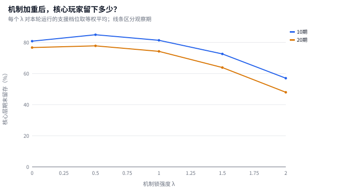
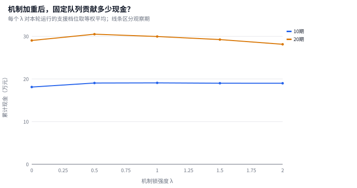
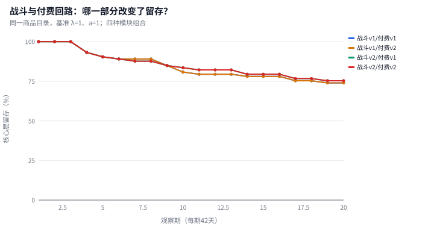
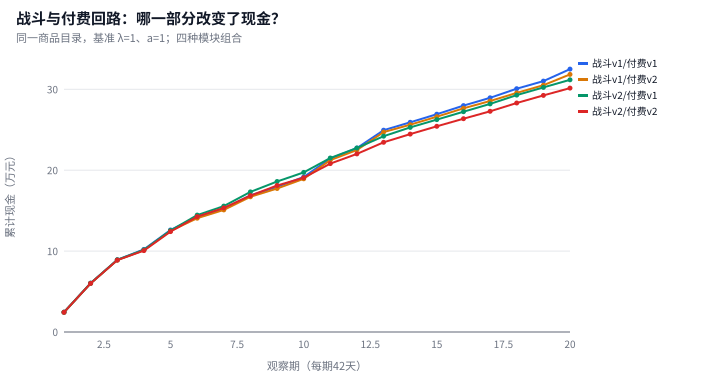

# 机制锁与售后支援：固定玩家队列对照实验

研究问题：在持续推出新主输出、机制环境与限定支援的抽卡动作游戏中，机制锁强度 λ 与售后支援强度 a 如何改变老角色的可用寿命、玩家囤抽和付费意愿，以及固定初始队列的收入与留存？

本次实验：每个运行 200 名初始玩家，2 组独立种子；观察期为 10 / 20 期。共完成 112 个运行。

- **机制锁的现金效应随观察期变化**：筛选样本中，λ 从 0 到 2，对支援档位取等权平均后，10 期累计现金变化 +4.9%；20 期累计现金变化 -3.1%。
- **机制锁 λ 从 0 到 2**：对另一个旋钮的已运行档位取均值，20 期核心层留存从 76.7% 变为 47.9%（-28.8 个百分点）；累计现金从 ¥290,254 变为 ¥281,238（-3.1%）。
- **专拐净增益 a 从 0.8 到 1.6**：对另一个旋钮的已运行档位取均值，20 期核心层留存从 67.4% 变为 69.9%（+2.5 个百分点）；累计现金从 ¥295,102 变为 ¥293,724（-0.5%）。
- **第二轮周期仍需独立观察**：λ=1、a=1 时，前 10 期现金 ¥190,716，延长至 20 期累计 ¥301,424，后续窗口新增 ¥110,708；核心层期末留存由 83.6% 变为 75.3%。

这些是本次情景下的筛选样本结果；独立复核与适用范围见第 6、7 节。完整现金、两类付费和固定队列留存可直接核对[候选汇总](tables/grid_summary.csv)与[独立运行](tables/run_summary.csv)。

## 1. 对照设计

所有候选共用商品目录、首发数量、资源、价格、HP 和主输出基准增长路径。λ 仅改变机制惩罚，a 仅改变相对通用旧辅的专属支援净收益。四个极端组合用于解释取舍；正式候选集合为本次实际运行的网格点。

短期 10 期与长期 20 期采用同一 20 期目录的前缀。两轮环境与售后周期使第一轮角色能被追踪到下一轮机制更替；角色出道较晚带来的右删失单独保留。

初始预算层不随停氪改变。订阅续费意愿、直购意愿与活跃状态分别记录；停氪玩家仍保留已获得角色、保底和免费/月卡库存。

## 2. 机制锁 × 支援强度的收入与留存

下表使用筛选种子的均值；复核种子、每个独立运行和逐期现金均保存在配套 CSV 中。前沿表示在本次有限候选中，未被其他候选同时在收入和核心留存两方面超过。

| 观察期 | λ | a | 累计现金 | 其中订阅 | 其中直购 | 核心层留存 | 全队列留存 | 非支配 |
|---:|---:|---:|---:|---:|---:|---:|---:|:---:|
| 10 | 0 | 0.8 | ¥180,556 | ¥104,860 | ¥75,696 | 80.8% | 72.0% |  |
| 10 | 0 | 1 | ¥180,924 | ¥104,860 | ¥76,064 | 80.8% | 72.0% |  |
| 10 | 0 | 1.2 | ¥180,924 | ¥104,860 | ¥76,064 | 80.8% | 72.0% |  |
| 10 | 0 | 1.4 | ¥181,468 | ¥104,860 | ¥76,608 | 80.8% | 72.0% |  |
| 10 | 0 | 1.6 | ¥181,164 | ¥104,860 | ¥76,304 | 80.8% | 72.5% |  |
| 10 | 0.5 | 0.8 | ¥189,586 | ¥105,154 | ¥84,432 | 84.9% | 74.0% |  |
| 10 | 0.5 | 1 | ¥190,052 | ¥105,252 | ¥84,800 | 84.9% | 75.5% |  |
| 10 | 0.5 | 1.2 | ¥190,694 | ¥105,350 | ¥85,344 | 84.9% | 75.5% |  |
| 10 | 0.5 | 1.4 | ¥190,988 | ¥105,644 | ¥85,344 | 83.6% | 76.5% |  |
| 10 | 0.5 | 1.6 | ¥190,880 | ¥105,840 | ¥85,040 | 86.3% | 78.5% | ★ |
| 10 | 1 | 0.8 | ¥189,172 | ¥103,684 | ¥85,488 | 78.1% | 72.0% |  |
| 10 | 1 | 1 | ¥190,716 | ¥104,860 | ¥85,856 | 83.6% | 75.0% |  |
| 10 | 1 | 1.2 | ¥191,456 | ¥105,056 | ¥86,400 | 83.6% | 74.0% | ★ |
| 10 | 1 | 1.4 | ¥191,260 | ¥104,860 | ¥86,400 | 79.5% | 72.5% |  |
| 10 | 1 | 1.6 | ¥191,250 | ¥105,154 | ¥86,096 | 82.2% | 75.0% |  |
| 10 | 1.5 | 0.8 | ¥189,784 | ¥101,528 | ¥88,256 | 69.9% | 67.5% |  |
| 10 | 1.5 | 1 | ¥189,160 | ¥102,312 | ¥86,848 | 71.2% | 67.5% |  |
| 10 | 1.5 | 1.2 | ¥189,900 | ¥102,508 | ¥87,392 | 72.6% | 67.5% |  |
| 10 | 1.5 | 1.4 | ¥190,096 | ¥102,704 | ¥87,392 | 72.6% | 67.0% |  |
| 10 | 1.5 | 1.6 | ¥190,968 | ¥103,880 | ¥87,088 | 76.7% | 70.0% |  |
| 10 | 2 | 0.8 | ¥193,110 | ¥100,646 | ¥92,464 | 57.5% | 58.0% | ★ |
| 10 | 2 | 1 | ¥189,930 | ¥100,842 | ¥89,088 | 57.5% | 58.5% |  |
| 10 | 2 | 1.2 | ¥188,136 | ¥100,744 | ¥87,392 | 57.5% | 57.5% |  |
| 10 | 2 | 1.4 | ¥187,254 | ¥99,862 | ¥87,392 | 53.4% | 56.0% |  |
| 10 | 2 | 1.6 | ¥190,678 | ¥101,430 | ¥89,248 | 58.9% | 59.0% |  |
| 20 | 0 | 0.8 | ¥293,056 | ¥199,136 | ¥93,920 | 76.7% | 68.5% |  |
| 20 | 0 | 1 | ¥291,936 | ¥199,136 | ¥92,800 | 76.7% | 68.5% |  |
| 20 | 0 | 1.2 | ¥288,688 | ¥199,136 | ¥89,552 | 76.7% | 68.5% |  |
| 20 | 0 | 1.4 | ¥288,210 | ¥199,234 | ¥88,976 | 76.7% | 69.0% |  |
| 20 | 0 | 1.6 | ¥289,378 | ¥199,234 | ¥90,144 | 76.7% | 69.5% |  |
| 20 | 0.5 | 0.8 | ¥305,124 | ¥200,116 | ¥105,008 | 78.1% | 70.5% |  |
| 20 | 0.5 | 1 | ¥305,558 | ¥200,214 | ¥105,344 | 78.1% | 70.5% | ★ |
| 20 | 0.5 | 1.2 | ¥305,846 | ¥199,430 | ¥106,416 | 76.7% | 70.0% | ★ |
| 20 | 0.5 | 1.4 | ¥303,676 | ¥200,508 | ¥103,168 | 76.7% | 72.0% |  |
| 20 | 0.5 | 1.6 | ¥304,266 | ¥202,762 | ¥101,504 | 79.5% | 74.5% | ★ |
| 20 | 1 | 0.8 | ¥297,656 | ¥194,824 | ¥102,832 | 71.2% | 67.0% |  |
| 20 | 1 | 1 | ¥301,424 | ¥199,136 | ¥102,288 | 75.3% | 69.5% |  |
| 20 | 1 | 1.2 | ¥302,306 | ¥200,018 | ¥102,288 | 76.7% | 69.0% |  |
| 20 | 1 | 1.4 | ¥299,170 | ¥196,882 | ¥102,288 | 72.6% | 67.5% |  |
| 20 | 1 | 1.6 | ¥297,154 | ¥199,234 | ¥97,920 | 75.3% | 69.5% |  |
| 20 | 1.5 | 0.8 | ¥293,778 | ¥185,122 | ¥108,656 | 61.6% | 61.0% |  |
| 20 | 1.5 | 1 | ¥290,044 | ¥186,396 | ¥103,648 | 61.6% | 60.5% |  |
| 20 | 1.5 | 1.2 | ¥290,468 | ¥187,572 | ¥102,896 | 63.0% | 60.5% |  |
| 20 | 1.5 | 1.4 | ¥292,584 | ¥188,552 | ¥104,032 | 64.4% | 60.5% |  |
| 20 | 1.5 | 1.6 | ¥294,520 | ¥192,472 | ¥102,048 | 68.5% | 63.0% |  |
| 20 | 2 | 0.8 | ¥285,898 | ¥174,538 | ¥111,360 | 49.3% | 53.0% |  |
| 20 | 2 | 1 | ¥281,400 | ¥175,224 | ¥106,176 | 47.9% | 53.0% |  |
| 20 | 2 | 1.2 | ¥278,744 | ¥175,224 | ¥103,520 | 47.9% | 52.0% |  |
| 20 | 2 | 1.4 | ¥276,842 | ¥172,186 | ¥104,656 | 45.2% | 51.0% |  |
| 20 | 2 | 1.6 | ¥283,304 | ¥176,792 | ¥106,512 | 49.3% | 54.0% |  |

## 3. 战斗与付费行为的分离对照

在 λ=1、a=1 的同一商品目录上，比较战斗 v1/v2 × 付费行为 v1/v2 四种组合。战斗 v1 保留旧秽盾惩罚；行为 v1 保留固定付费能力、不启用疲劳驱动的续订和直购意愿门控。该对照检验结果来自哪个模块，不能把两个模块同时变化的总差异解释为单一参数效应。

| 观察期 | 战斗 | 付费行为 | 累计现金 | 订阅现金 | 直购现金 | 核心层留存 |
|---:|:---:|:---:|---:|---:|---:|---:|
| 10 | v1 | v1 | ¥191,540 | ¥109,172 | ¥82,368 | 80.8% |
| 10 | v1 | v2 | ¥189,310 | ¥106,526 | ¥82,784 | 80.8% |
| 10 | v2 | v1 | ¥197,264 | ¥108,976 | ¥88,288 | 83.6% |
| 10 | v2 | v2 | ¥190,716 | ¥104,860 | ¥85,856 | 83.6% |
| 20 | v1 | v1 | ¥324,894 | ¥205,310 | ¥119,584 | 74.0% |
| 20 | v1 | v2 | ¥318,426 | ¥199,626 | ¥118,800 | 74.0% |
| 20 | v2 | v1 | ¥311,750 | ¥206,486 | ¥105,264 | 75.3% |
| 20 | v2 | v2 | ¥301,424 | ¥199,136 | ¥102,288 | 75.3% |

## 4. 老角色：首次失效、售后恢复与维护需求

L2 固定参考面板在同条件下逐个比较不配限定支援与支援出道即加入，输出每名主输出 × 投资档位 × 养成路径 × 支援方案的完整轨迹。首次失效采用首次 CI<1；后续重新满星记作恢复，不回写首次失效时间。观察结束仍未失效的主体保留右删失。

[L2 参考寿命](tables/l2_reference_lifetimes.csv)记录首次失效/删失天数、恢复时点、满星期数与总观测期数；[L2 完整轨迹](tables/l2_reference_panel.csv)可复核所有 CI；[支援配对净收益](tables/l2_support_pair_effects.csv)逐主体比较支援与无支援的新增满星期数。只有两条轨迹均已首次失效时才计算首次失效天数差，不把右删失当作已测得的完整寿命。L3 的[老资产结果](tables/old_asset_outcomes.csv)在四角和基准配置全量记录所有持有老角色，包含仓库角色与退坑冻结配置；实际活跃期首次失败与含冻结反事实随访的首次失败分别记录。

首 3 期出道主输出的预设适配支援对照，λ=1、a=1、0+1、持续养成：

| 主输出 | 适配支援 | 无专拐首次失效/删失（天） | 配支援首次失效/删失（天） | 额外满星期数 |
|---|---|---:|---:|---:|
| DPS_01 | S_A | 168 | 210 | +1 |
| DPS_01 | S_B | 168 | 168 | +0 |
| DPS_02 | S_A | 126 | 168 | +1 |
| DPS_03 | S_A | 126 | 210 | +2 |
| DPS_03 | S_B | 126 | 126 | +1 |

`run_summary.csv` 中售后池抽数与直购金额反映支援维护需求。它们是该支援池的实际支付，不把一次支援购买重复分摊为多个主输出的成本，也不视为单个老角色延寿的因果价格。

## 5. 囤抽、停氪与退坑

[逐期经济结果](tables/period_outcomes.csv)同时保留四来源抽数、免费与订阅期末库存、两类现金、实际付费人数以及固定初始层留存。现金字段 `_yuan` 的单位为元；逐期原始流水 `sub_fen`、`topup_fen` 的单位为分。[付费意愿结果](tables/spending_outcomes.csv)记录续费/直购门控概率、决策前疲劳和连续失败，并单列拒绝付费但期末仍活跃的人数；同一玩家同一期同一付费类型仅计一次。付费拒绝事件不等于永久降层；下一期仍可恢复意愿。

## 6. 跨种子复核

| 观察期 | 配对候选数 | 筛选种子数 | 复核种子数 | 收入排名 ρ | 留存排名 ρ |
|---:|---:|---:|---:|---:|---:|
| 10 | 25 | 1 | 1 | 0.052 | 0.828 |
| 20 | 25 | 1 | 1 | 0.645 | 0.890 |

各配置的入选频率以独立种子下的非支配集合分别计算，见 `tables/grid_summary.csv`；只有一个种子时频率仅为 0/1，不能作为稳定概率。收入与留存排名分别报告，不合成总分。

## 7. 适用范围与数据索引

Layer 1 的[机制对口/非对口成绩](../final_release/empirical_knob1_boss_lock.csv)与[专拐/替代辅助成绩](../final_release/empirical_knob2_support_lift.csv)为条件观测锚点，不是随机实验，不能直接识别 λ 或 a 的因果值。模型把这些区间与机制分类作为可解释的情景参数；行为权重仍是显式假设。[参数登记表](tables/parameter_registry.csv)区分源码公式、显式情景取值和带条件观测参照的情景取值。

本实验只有固定初始玩家队列，没有获客、回流和现实更新成本。20 期累计现金是该队列在情景内的收入，不是游戏全盘流水或完整生命周期价值；未观察到的后续付费与退坑不外推。短窗口现金与长期留存的取舍由表中结果呈现，不预设售后或机制锁必胜。

购买规划器只评估当前卡池的部分获取结果，不预知未来排期，也不求解跨期最优囤抽。囤抽记忆 h 表示随经历调整的行为状态，本实验不能据此识别玩家的理性预期或 Coase 式等待均衡。

| 文件 | 内容 |
|---|---|
| `experiment_manifest.json` | 入口配置、种子、规模、运行路径与科学配置身份 |
| `tables/run_summary.csv` | 独立运行的收入、留存、售后支出与旧资产恢复 |
| `tables/grid_summary.csv` | 各观察期/种子组的候选均值及非支配入选频率 |
| `tables/rank_stability.csv` | 收入与留存排序的独立复核 |
| `tables/parameter_registry.csv` | 基准科学配置逐参数来源与适用范围 |
| `tables/period_outcomes.csv` | 逐期现金、库存、抽数来源与固定层留存 |
| `tables/spending_outcomes.csv` | 续订/直购意愿与停氪但活跃人期 |
| `tables/old_asset_outcomes.csv` | 全量日志配置的历史持有角色轨迹摘要 |
| `tables/l2_reference_panel.csv` | 固定同条件战斗轨迹 |
| `tables/l2_reference_lifetimes.csv` | 首次失效、右删失与售后恢复 |
| `tables/l2_support_pair_effects.csv` | 同条件支援净增满星期数与首次失效差 |
