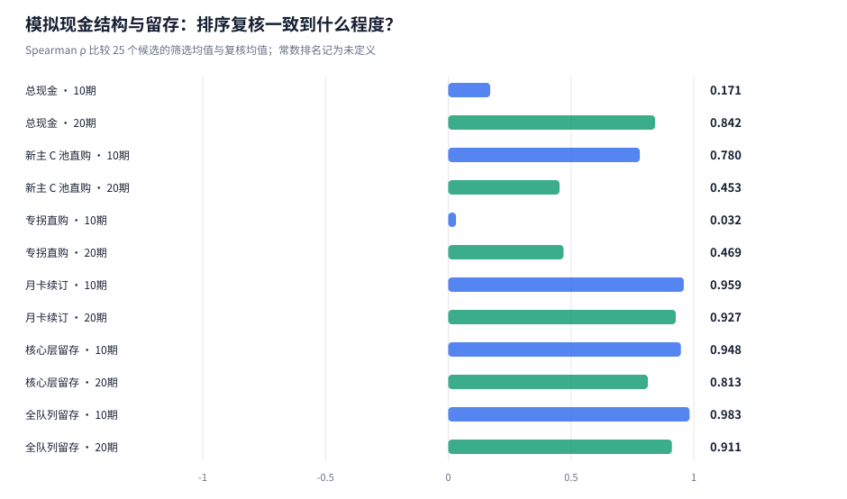
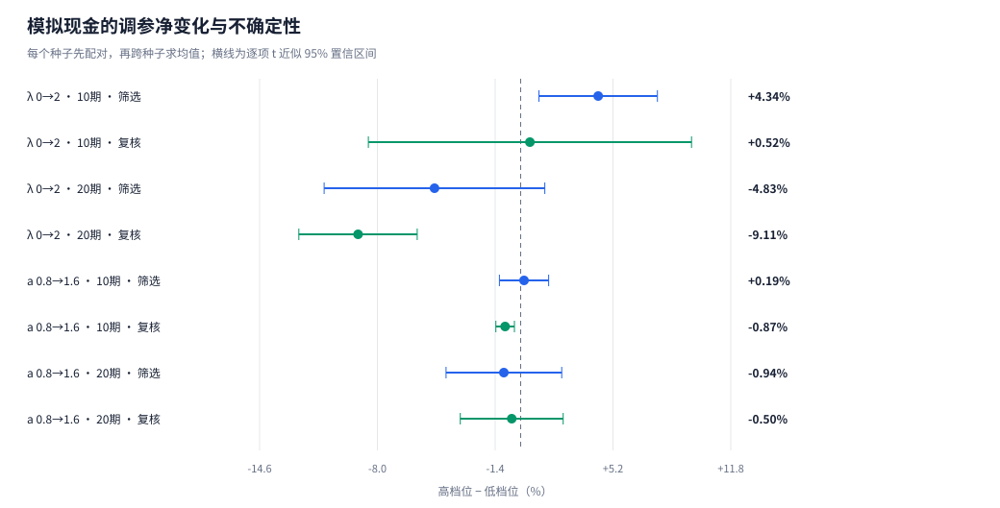
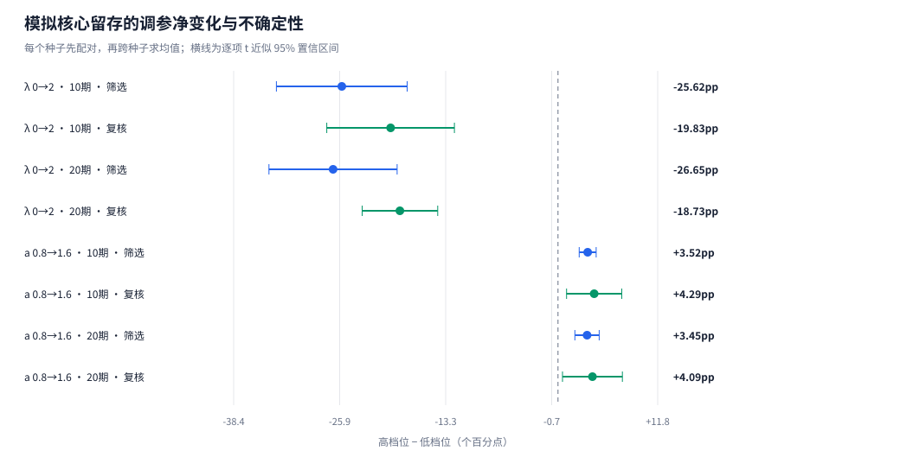
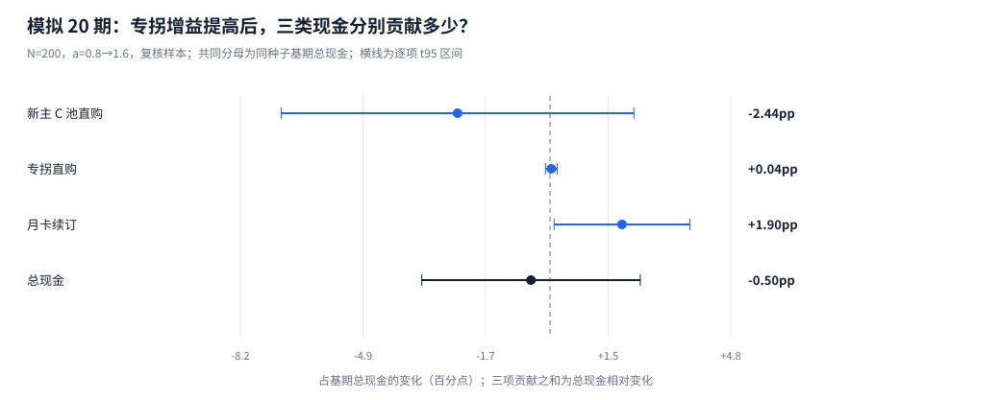
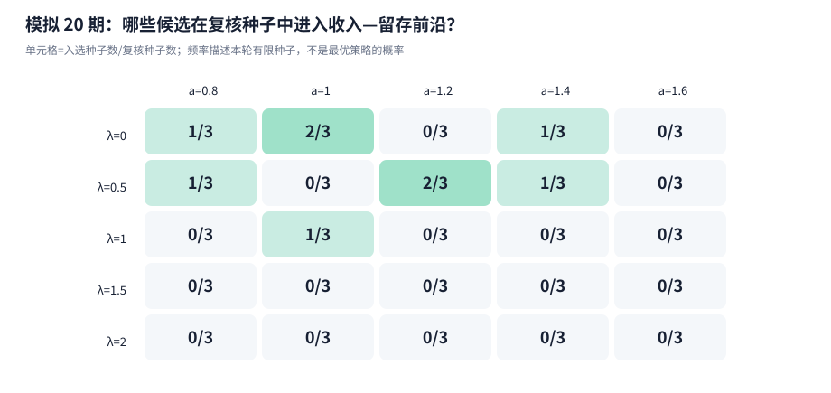

# 机制锁与售后支援：跨种子配对复核

每次 200 名初始玩家；5 组筛选 + 3 组独立复核种子；25 个 P0 候选，观察 10 / 20 期。

## 核心发现

- **种子数从 1+1 扩至 5+3 后的总现金排序**：10 期 ρ 从 0.052 变为 0.171；20 期 ρ 从 0.645 变为 0.842。
- **机制锁 λ从 0 到 2**：20 期复核样本的现金相对变化为 -9.11% [-12.43, -5.80]%，核心留存变化为 -18.73pp [-23.20, -14.25]pp。方括号为种子配对的逐项 95% 区间。
- **专拐净增益 a从 0.8 到 1.6**：20 期复核样本的现金相对变化为 -0.50% [-3.39, +2.38]%，核心留存变化为 +4.09pp [+0.54, +7.63]pp。方括号为种子配对的逐项 95% 区间。
- **细分名次的边界**：专拐轴的现金区间仍跨零，尚不能据此排出稳定的细分名次；结合留存与现金结构判断取舍。
- **专拐增益的现金结构**：三项点估计存在抵消：专拐直购、月卡续订增加，新主 C 池直购减少。新主 C 池直购、专拐直购的区间覆盖零或尚未估计，方向仍有不确定性。

## 1. 总现金和三类现金分别有多稳？

Spearman ρ 比较同一指标在 25 个候选中的筛选均值排序与独立复核均值排序。ρ 越接近 1，排序越一致；负值表示次序趋于相反。候选均值完全相同时，相关系数未定义。[1]



1+1 种子子样本固定使用配置中的首个筛选种子 1101 与首个复核种子 9101；与完整 5+3 组采用相同人口 N、候选与模型。两组共享种子，ρ 变化用于描述扩样后的结果，不构成独立显著性检验。[1]

| 指标 | 观察期 | 1+1 种子子样本 ρ | 完整 5+3 组 ρ |
|---|---:|---:|---:|
| 总现金 | 10 | 0.052 | 0.171 |
| 总现金 | 20 | 0.645 | 0.842 |
| 新主 C 池直购 | 10 | 0.726 | 0.780 |
| 新主 C 池直购 | 20 | 0.126 | 0.453 |
| 专拐直购 | 10 | 未定义（候选均值为常数） | 0.032 |
| 专拐直购 | 20 | -0.171 | 0.469 |
| 月卡续订 | 10 | 0.927 | 0.959 |
| 月卡续订 | 20 | 0.916 | 0.927 |
| 核心层留存 | 10 | 0.828 | 0.948 |
| 核心层留存 | 20 | 0.890 | 0.813 |
| 全队列留存 | 10 | 0.751 | 0.983 |
| 全队列留存 | 20 | 0.923 | 0.911 |

新主 C 池直购包含其本体、影画与专武目标；专拐直购对应支援商品池，当前目标为支援本体。月卡按实际续订现金记账，免费囤抽和已购月卡权益的消耗不再计作现金。三类现金合计等于总现金。[2]

## 2. 调参效应有多大，区间有多宽？

先在每个种子内对同一批玩家配对，再对种子差值求均值、标准误和 Student-t 近似 95% 区间。留存先按各种子固定的初始核心层或总体人数计算，再对种子等权平均。λ 的端点对照在同一种子内等权平均五档 a；a 的端点对照同理。10/20 期分别计算，保留现金百分比与留存百分点两种单位。[3]





| 观察期 | 种子组 | 调参对照 | 配对种子数 | 现金相对变化 [95%区间] | 核心留存变化 [95%区间] |
|---:|---|---|---:|---:|---:|
| 10 | 筛选 | λ 0→2 | 5 | +4.34% [+1.02, +7.66]% | -25.62pp [-33.36, -17.87]pp |
| 10 | 筛选 | a 0.8→1.6 | 5 | +0.19% [-1.19, +1.57]% | +3.52pp [+2.51, +4.52]pp |
| 10 | 复核 | λ 0→2 | 3 | +0.52% [-8.53, +9.57]% | -19.83pp [-27.40, -12.27]pp |
| 10 | 复核 | a 0.8→1.6 | 3 | -0.87% [-1.39, -0.35]% | +4.29pp [+1.02, +7.56]pp |
| 20 | 筛选 | λ 0→2 | 5 | -4.83% [-11.01, +1.35]% | -26.65pp [-34.24, -19.06]pp |
| 20 | 筛选 | a 0.8→1.6 | 5 | -0.94% [-4.18, +2.30]% | +3.45pp [+2.00, +4.89]pp |
| 20 | 复核 | λ 0→2 | 3 | -9.11% [-12.43, -5.80]% | -18.73pp [-23.20, -14.25]pp |
| 20 | 复核 | a 0.8→1.6 | 3 | -0.50% [-3.39, +2.38]% | +4.09pp [+0.54, +7.63]pp |

各候选相对基准 λ=1、a=1 的差值见[基准配对表](tables/paired_baseline.csv)；完整候选两两对照见[全候选配对表](tables/paired_all_candidates.csv)。标准误反映种子间差值的波动，不把同一种子中的五档支援或 200 名玩家当作独立种子。

### 专拐增益 a 0.8→1.6：总现金由什么组成？

20 期复核样本中，每个种子先对五档 λ 等权平均，再分别计算三类现金的高档减低档。下表使用同一种子 a=0.8 的**总现金**作为统一分母；各分项的贡献百分点可相加。



| 现金项 | 配对种子数 | 现金差 [95%区间，元] | 基期总现金贡献 [95%区间，百分点] |
|---|---:|---:|---:|
| 新主 C 池直购 | 3 | -5,936 [-17,277, +5,405] | -2.44 [-7.10, +2.22] |
| 专拐直购 | 3 | +84 [-278, +447] | +0.04 [-0.12, +0.19] |
| 月卡续订 | 3 | +4,678 [+342, +9,013] | +1.90 [+0.11, +3.69] |
| 总现金 | 3 | -1,174 [-8,346, +5,998] | -0.50 [-3.39, +2.38] |

三项点估计存在抵消：专拐直购、月卡续订增加，新主 C 池直购减少。新主 C 池直购、专拐直购的区间覆盖零或尚未估计，方向仍有不确定性。

总现金的均值与区间由每个种子的三项变化求和后单独估计，保留分项之间的协方差；不把三个区间端点相加。金额均值和贡献均值的未四舍五入值严格可加。贡献使用共同的总现金分母，不是各分项自身的增长率。

<details>
<summary>展开其他观察窗口和筛选样本的三类现金配对拆解</summary>

| 观察期 | 种子组 | 现金项 | 现金差 [95%区间，元] | 基期总现金贡献 [95%区间，百分点] |
|---:|---|---|---:|---:|
| 10 | 筛选 | 新主 C 池直购 | -1,270 [-2,854, +314] | -0.75 [-1.70, +0.19] |
| 10 | 筛选 | 专拐直购 | +598 [-510, +1,706] | +0.36 [-0.34, +1.06] |
| 10 | 筛选 | 月卡续订 | +988 [+767, +1,209] | +0.58 [+0.48, +0.69] |
| 10 | 筛选 | 总现金 | +315 [-1,874, +2,504] | +0.19 [-1.19, +1.57] |
| 10 | 复核 | 新主 C 池直购 | -2,438 [-3,468, -1,408] | -1.62 [-2.59, -0.66] |
| 10 | 复核 | 专拐直购 | -6 [-34, +21] | -0.00 [-0.02, +0.02] |
| 10 | 复核 | 月卡续订 | +1,137 [+335, +1,938] | +0.76 [+0.15, +1.36] |
| 10 | 复核 | 总现金 | -1,308 [-1,855, -761] | -0.87 [-1.39, -0.35] |
| 20 | 筛选 | 新主 C 池直购 | -6,951 [-15,395, +1,493] | -2.45 [-5.35, +0.45] |
| 20 | 筛选 | 专拐直购 | +489 [-837, +1,815] | +0.18 [-0.31, +0.68] |
| 20 | 筛选 | 月卡续订 | +3,704 [+2,738, +4,671] | +1.33 [+0.96, +1.69] |
| 20 | 筛选 | 总现金 | -2,758 [-11,926, +6,411] | -0.94 [-4.18, +2.30] |

</details>

全部端点、相邻档位和 λ 轴的拆解保存在[现金配对拆解表](tables/axis_cash_decomposition.csv)，[种子级分项记录](tables/cash_decomposition_seed.csv)可核对每一项的分母、现金差和贡献。

## 3. 复核种子里的非支配集合

收入与核心留存是两个独立目标。每个复核种子分别求 25 个候选的非支配集合，再记录入选次数；种子均值上的前沿另列。表中的前沿频率使用独立复核结果，方便识别只在少数种子中占优的候选。[4]



<details>
<summary>25 个候选的长期复核成绩、相对基准区间与入选次数</summary>

| λ | a | 复核总现金均值 | 核心留存 | 相对基准现金差 [95%区间，元] | 前沿入选 |
|---:|---:|---:|---:|---:|---:|
| 0 | 0.8 | ¥261,885 | 70.3% | +11,571 [+5,969, +17,173] | 1/3 |
| 0 | 1 | ¥259,833 | 70.7% | +9,519 [-3,703, +22,740] | 2/3 |
| 0 | 1.2 | ¥251,575 | 70.0% | +1,261 [-4,301, +6,823] | 0/3 |
| 0 | 1.4 | ¥251,595 | 71.1% | +1,281 [-5,325, +7,888] | 1/3 |
| 0 | 1.6 | ¥249,977 | 72.0% | -337 [-2,410, +1,737] | 0/3 |
| 0.5 | 0.8 | ¥255,804 | 70.9% | +5,490 [-14,397, +25,377] | 1/3 |
| 0.5 | 1 | ¥255,060 | 72.2% | +4,746 [-7,164, +16,656] | 0/3 |
| 0.5 | 1.2 | ¥251,873 | 72.6% | +1,559 [-9,850, +12,969] | 2/3 |
| 0.5 | 1.4 | ¥250,367 | 73.0% | +53 [-10,401, +10,507] | 1/3 |
| 0.5 | 1.6 | ¥249,432 | 73.4% | -882 [-2,742, +978] | 0/3 |
| 1 | 0.8 | ¥248,732 | 67.7% | -1,582 [-9,784, +6,620] | 0/3 |
| 1 | 1 | ¥250,314 | 71.8% | 基准 | 1/3 |
| 1 | 1.2 | ¥251,067 | 71.4% | +753 [-5,855, +7,360] | 0/3 |
| 1 | 1.4 | ¥254,602 | 72.2% | +4,288 [-2,508, +11,084] | 0/3 |
| 1 | 1.6 | ¥251,683 | 74.1% | +1,369 [-13,781, +16,519] | 0/3 |
| 1.5 | 0.8 | ¥236,391 | 59.9% | -13,923 [-29,318, +1,473] | 0/3 |
| 1.5 | 1 | ¥238,027 | 60.8% | -12,287 [-25,761, +1,187] | 0/3 |
| 1.5 | 1.2 | ¥235,715 | 62.0% | -14,599 [-26,791, -2,407] | 0/3 |
| 1.5 | 1.4 | ¥240,963 | 62.9% | -9,351 [-25,306, +6,604] | 0/3 |
| 1.5 | 1.6 | ¥244,461 | 66.5% | -5,853 [-20,796, +9,089] | 0/3 |
| 2 | 0.8 | ¥233,508 | 52.2% | -16,806 [-37,541, +3,929] | 0/3 |
| 2 | 1 | ¥230,946 | 51.4% | -19,368 [-30,963, -7,773] | 0/3 |
| 2 | 1.2 | ¥228,423 | 50.5% | -21,891 [-29,629, -14,154] | 0/3 |
| 2 | 1.4 | ¥230,437 | 50.7% | -19,877 [-31,661, -8,093] | 0/3 |
| 2 | 1.6 | ¥234,897 | 55.6% | -15,417 [-30,969, +135] | 0/3 |

</details>

## 4. 每个种子实际抽到了怎样的人群？

每次 200 人下，Budget_160 与 Budget_500 的合计人数期望为 40，实际人数按种子记录。同一种子内所有候选共用初始人群；跨种子的误差同时包含人群构成、抽卡、付费意愿与流失随机性。人数表展示人群波动，但不单独识别各误差来源的方差贡献。核心层分母始终是初始 Budget_40 人数，停氪但仍活跃者仍计留存。[5]

| 种子 | 用途 | 初始人数 | Budget_40 | Budget_160 | Budget_500 | 高预算合计 |
|---:|---|---:|---:|---:|---:|---:|
| 1101 | 筛选 | 200 | 73 | 36 | 8 | 44 |
| 1102 | 筛选 | 200 | 74 | 33 | 13 | 46 |
| 1103 | 筛选 | 200 | 83 | 32 | 6 | 38 |
| 1104 | 筛选 | 200 | 77 | 26 | 14 | 40 |
| 1105 | 筛选 | 200 | 78 | 24 | 11 | 35 |
| 9101 | 复核 | 200 | 90 | 28 | 7 | 35 |
| 9102 | 复核 | 200 | 82 | 24 | 11 | 35 |
| 9103 | 复核 | 200 | 73 | 31 | 10 | 41 |

## 5. 实验成本与复现

本次主网格为 25 个候选 × 8 个种子，共 200 个 20 期运行，包含 50 个既有实验运行和 150 个扩样运行。10 期结果从同一数据库的前 10 期截取，两个观察窗口不作为两份独立重复。

模型公式与商品目录保持一致，每个候选的不同种子共用相同科学配置。人口规模属于科学配置身份，不同 N 使用独立目录。模块消融对照保留在[已有中等规模实验](../research_v2/REPORT.md)，心理参数敏感性按所属科学配置单独解释。逐期三类现金、囤抽、订阅库存和留存保留在[逐期结果](tables/period_outcomes.csv)。

```powershell
.\.venv\Scripts\python.exe tools\run_research_v2_stability.py --players 200 --workers 4 --out outputs\research_v2_stability
```

人口扩至 1000 或 3000 时使用独立目录：

```powershell
.\.venv\Scripts\python.exe tools\run_research_v2_stability.py --players 1000 --workers 4 --out outputs\research_v2_stability_n1000
```

## 6. 适用范围

置信区间描述指定模型下的随机误差，参数设定的不确定性另行检验。三组复核种子的尾部估计仍较粗；候选点估计第一或多次进入前沿，不等于已确定唯一最优策略。全候选两两比较采用逐项 95% 区间，没有整组同时覆盖保证，不能把筛选后最有利的区间当作经过多重比较控制的结论。

独立多项抽样下，初始预算层比例的标准差随 N 约按 1/√N 缩放，绝对人数的标准差则随 √N 增长。收入还经过抽卡、消费门控和流失等非线性状态转移，配对现金区间不保证按同一比例缩小；复核种子仍为三组时自由度仍为 2。跨人口规模比较使用相对或人均现金区间，不能把绝对元区间变宽直接判为精度下降。三项现金分解是模型内的收入归属，不单凭点估计的正负证明现实中的替代或续订因果机制。

Layer 1 的[机制条件成绩](../final_release/empirical_knob1_boss_lock.csv)和[专拐条件成绩](../final_release/empirical_knob2_support_lift.csv)提供业务参照，机制映射与付费心理系数仍是情景假设。订阅价格与权益沿用情景配置，不代表官方月卡商品的真实规格。模型只规划当前卡池的部分获取结果，不预知未来排期或求解跨期最优囤抽。固定初始队列不含获客、回流和运营成本，累计现金不等于游戏全盘流水或完整 LTV。

## 数据与方法索引

| 来源 | 内容 |
|---|---|
| [1] [排序复核](tables/rank_stability.csv) | 10/20 期总现金、三类现金与留存的秩相关 |
| [1] [1+1 种子子样本](tables/rank_stability_pilot.csv) | 同人口与模型下预设种子子样本的排名复核 |
| [2] [独立运行](tables/run_summary.csv) | 每种子每候选的现金、留存与运行身份 |
| [3] [调参配对](tables/axis_effects.csv) | 端点与相邻档位的种子配对差、标准误与 t 区间 |
| [现金分项配对](tables/axis_cash_decomposition.csv) | 三类现金变化及统一基期总现金分母下的贡献 |
| [分项种子记录](tables/cash_decomposition_seed.csv) | 每个种子的基期、变化和可加贡献 |
| [4] [前沿入选频率](tables/inclusion_frequency.csv) | 各候选按种子分别计算的非支配入选次数 |
| [5] [初始人群](tables/population_by_seed.csv) | 每个种子的实际固定预算层人数 |
| [候选汇总](tables/grid_summary.csv) | 各分组均值、标准误和种子均值前沿 |
| [实验清单](experiment_manifest.json) | 科学配置、物理运行、种子分组、缓存来源和观察窗定义 |
| [统计实现](../../tools/research_v2_stability_stats.py) | CRN 配对、Student-t 区间与秩相关计算 |
| [研究协议](../../docs/development/research_v2_stability_protocol.md) | 预算、观察窗口、收入分拆与扩样规则 |
