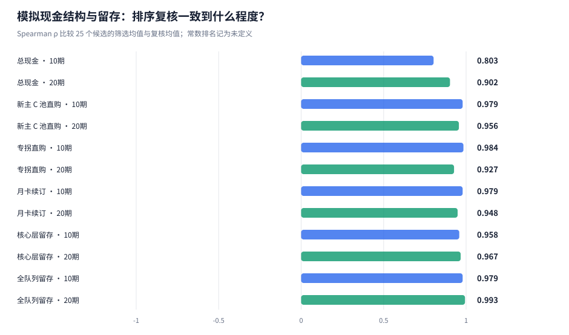
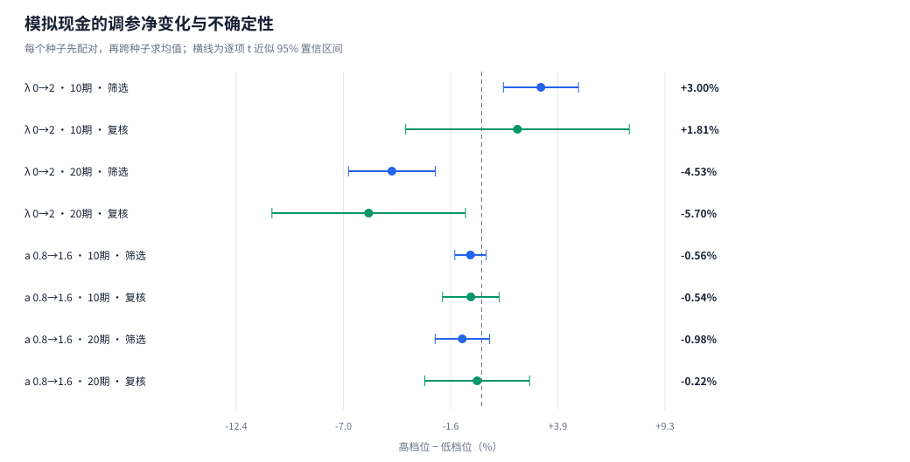
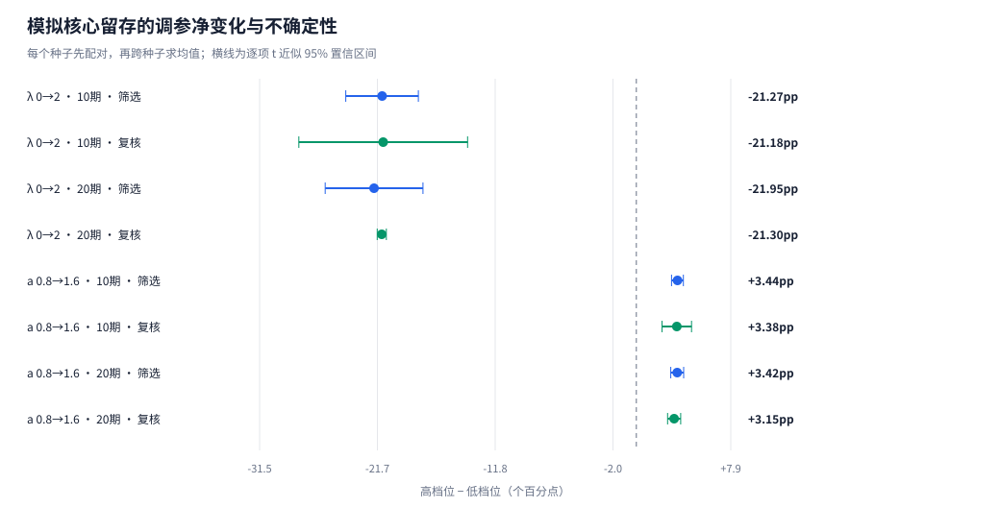
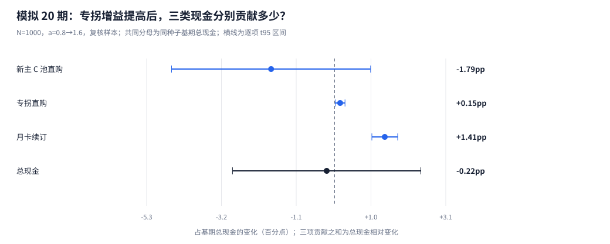
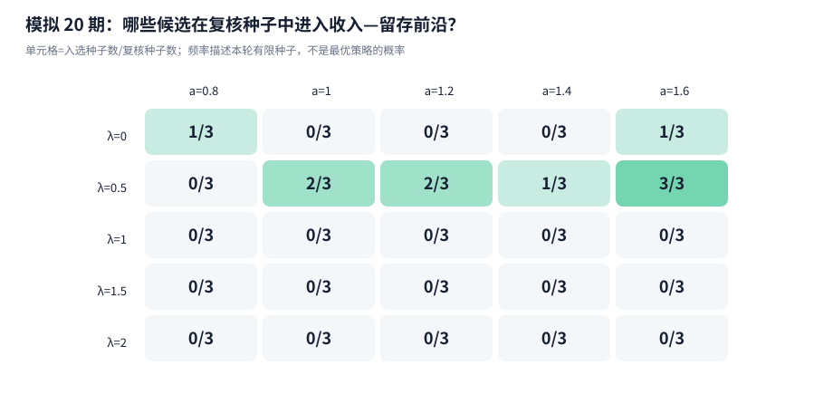

# 机制锁与售后支援：跨种子配对复核

每次 1000 名初始玩家；5 组筛选 + 3 组独立复核种子；25 个 P0 候选，观察 10 / 20 期。

## 核心发现

- **人口从 N=200 扩至 N=1000 后的总现金排序**：保持相同 5+3 组种子，10 期 ρ 从 0.171 变为 0.803；20 期 ρ 从 0.842 变为 0.902。
- **机制锁 λ从 0 到 2**：20 期复核样本的现金相对变化为 -5.70% [-10.60, -0.81]%，核心留存变化为 -21.30pp [-21.68, -20.92]pp。方括号为种子配对的逐项 95% 区间。
- **专拐净增益 a从 0.8 到 1.6**：20 期复核样本的现金相对变化为 -0.22% [-2.87, +2.42]%，核心留存变化为 +3.15pp [+2.61, +3.70]pp。方括号为种子配对的逐项 95% 区间。
- **细分名次的边界**：专拐轴的现金区间仍跨零，保留现金尚不可区分的候选，结合留存与现金结构判断取舍；只有现金精度会改变决策时，再预先增加独立复核种子。
- **专拐增益的现金结构**：三项点估计存在抵消：专拐直购、月卡续订增加，新主 C 池直购减少。按绝对现金差口径，新主 C 池直购、专拐直购的区间覆盖零或尚未估计，方向仍有不确定性。

## 1. 总现金和三类现金分别有多稳？

Spearman ρ 比较同一指标在 25 个候选中的筛选均值排序与独立复核均值排序。ρ 越接近 1，排序越一致；负值表示次序趋于相反。候选均值完全相同时，相关系数未定义。[1]



1+1 种子子样本固定使用配置中的首个筛选种子 1101 与首个复核种子 9101；与完整 5+3 组采用相同人口 N、候选与模型。两组共享种子，ρ 变化用于描述扩样后的结果，不构成独立显著性检验。[1]

人口扩样的主对照是相同 5+3 组种子下 N=200 与 N=1000 的完整结果；当前 N 的 1+1 子样本另列。人口规模以外的模型参数、候选和种子分组相同。[人口排序比较表](tables/population_rank_comparison.csv)保留差值。

| 指标 | 观察期 | N=200 完整 5+3 组 ρ | N=1000 的 1+1 子样本 ρ | N=1000 完整 5+3 组 ρ |
|---|---:|---:|---:|---:|
| 总现金 | 10 | 0.171 | 0.537 | 0.803 |
| 总现金 | 20 | 0.842 | 0.811 | 0.902 |
| 新主 C 池直购 | 10 | 0.780 | 0.851 | 0.979 |
| 新主 C 池直购 | 20 | 0.453 | 0.882 | 0.956 |
| 专拐直购 | 10 | 0.032 | 0.951 | 0.984 |
| 专拐直购 | 20 | 0.469 | 0.910 | 0.927 |
| 月卡续订 | 10 | 0.959 | 0.995 | 0.979 |
| 月卡续订 | 20 | 0.927 | 0.922 | 0.948 |
| 核心层留存 | 10 | 0.948 | 0.951 | 0.958 |
| 核心层留存 | 20 | 0.813 | 0.926 | 0.967 |
| 全队列留存 | 10 | 0.983 | 0.992 | 0.979 |
| 全队列留存 | 20 | 0.911 | 0.987 | 0.993 |

新主 C 池直购包含其本体、影画与专武目标；专拐直购对应支援商品池，当前目标为支援本体。月卡按实际续订现金记账，免费囤抽和已购月卡权益的消耗不再计作现金。三类现金合计等于总现金。[2]

## 2. 调参效应有多大，区间有多宽？

先在每个种子内对同一批玩家配对，再对种子差值求均值、标准误和 Student-t 近似 95% 区间。留存先按各种子固定的初始核心层或总体人数计算，再对种子等权平均。λ 的端点对照在同一种子内等权平均五档 a；a 的端点对照同理。10/20 期分别计算，保留现金百分比与留存百分点两种单位。[3]





| 观察期 | 种子组 | 调参对照 | 配对种子数 | 现金相对变化 [95%区间] | 核心留存变化 [95%区间] |
|---:|---|---|---:|---:|---:|
| 10 | 筛选 | λ 0→2 | 5 | +3.00% [+1.10, +4.90]% | -21.27pp [-24.31, -18.24]pp |
| 10 | 筛选 | a 0.8→1.6 | 5 | -0.56% [-1.35, +0.23]% | +3.44pp [+2.94, +3.93]pp |
| 10 | 复核 | λ 0→2 | 3 | +1.81% [-3.84, +7.47]% | -21.18pp [-28.24, -14.12]pp |
| 10 | 复核 | a 0.8→1.6 | 3 | -0.54% [-1.98, +0.89]% | +3.38pp [+2.15, +4.61]pp |
| 20 | 筛选 | λ 0→2 | 5 | -4.53% [-6.73, -2.34]% | -21.95pp [-26.04, -17.86]pp |
| 20 | 筛选 | a 0.8→1.6 | 5 | -0.98% [-2.35, +0.40]% | +3.42pp [+2.88, +3.96]pp |
| 20 | 复核 | λ 0→2 | 3 | -5.70% [-10.60, -0.81]% | -21.30pp [-21.68, -20.92]pp |
| 20 | 复核 | a 0.8→1.6 | 3 | -0.22% [-2.87, +2.42]% | +3.15pp [+2.61, +3.70]pp |

各候选相对基准 λ=1、a=1 的差值见[基准配对表](tables/paired_baseline.csv)；完整候选两两对照见[全候选配对表](tables/paired_all_candidates.csv)。标准误反映种子间差值的波动，不把同一种子中的五档支援或 1000 名玩家当作独立种子。

### 专拐增益 a 0.8→1.6：总现金由什么组成？

20 期复核样本中，每个种子先对五档 λ 等权平均，再分别计算三类现金的高档减低档。下表使用同一种子 a=0.8 的**总现金**作为统一分母；各分项的贡献百分点可相加。



| 现金项 | 配对种子数 | 现金差 [95%区间，元] | 基期总现金贡献 [95%区间，百分点] |
|---|---:|---:|---:|
| 新主 C 池直购 | 3 | -24,662 [-65,037, +15,712] | -1.79 [-4.58, +1.01] |
| 专拐直购 | 3 | +2,117 [-87, +4,321] | +0.15 [+0.02, +0.29] |
| 月卡续订 | 3 | +19,012 [+14,407, +23,617] | +1.41 [+1.05, +1.77] |
| 总现金 | 3 | -3,533 [-39,446, +32,379] | -0.22 [-2.87, +2.42] |

三项点估计存在抵消：专拐直购、月卡续订增加，新主 C 池直购减少。按绝对现金差口径，新主 C 池直购、专拐直购的区间覆盖零或尚未估计，方向仍有不确定性。

总现金的均值与区间由每个种子的三项变化求和后单独估计，保留分项之间的协方差；不把三个区间端点相加。金额均值和贡献均值的未四舍五入值严格可加。贡献使用共同的总现金分母，不是各分项自身的增长率。

绝对现金差先对各个种子的金额差等权平均；归一化贡献先除以各个种子的基期总现金，再等权平均。基期现金随种子变化，因此二者的区间是否跨零可能不同，解释时使用相应口径。

<details>
<summary>展开其他观察窗口和筛选样本的三类现金配对拆解</summary>

| 观察期 | 种子组 | 现金项 | 现金差 [95%区间，元] | 基期总现金贡献 [95%区间，百分点] |
|---:|---|---|---:|---:|
| 10 | 筛选 | 新主 C 池直购 | -12,504 [-20,034, -4,974] | -1.47 [-2.28, -0.65] |
| 10 | 筛选 | 专拐直购 | +2,561 [+35, +5,087] | +0.30 [-0.00, +0.61] |
| 10 | 筛选 | 月卡续订 | +5,104 [+4,362, +5,845] | +0.60 [+0.53, +0.68] |
| 10 | 筛选 | 总现金 | -4,840 [-11,908, +2,228] | -0.56 [-1.35, +0.23] |
| 10 | 复核 | 新主 C 池直购 | -11,537 [-27,747, +4,672] | -1.37 [-3.16, +0.43] |
| 10 | 复核 | 专拐直购 | +1,981 [-744, +4,706] | +0.23 [-0.07, +0.54] |
| 10 | 复核 | 月卡续订 | +4,913 [+3,656, +6,170] | +0.59 [+0.49, +0.68] |
| 10 | 复核 | 总现金 | -4,643 [-17,168, +7,882] | -0.54 [-1.98, +0.89] |
| 20 | 筛选 | 新主 C 池直购 | -36,234 [-55,317, -17,151] | -2.63 [-3.91, -1.36] |
| 20 | 筛选 | 专拐直购 | +2,928 [-155, +6,011] | +0.22 [-0.02, +0.45] |
| 20 | 筛选 | 月卡续订 | +19,604 [+16,686, +22,521] | +1.44 [+1.23, +1.65] |
| 20 | 筛选 | 总现金 | -13,702 [-32,907, +5,503] | -0.98 [-2.35, +0.40] |

</details>

全部端点、相邻档位和 λ 轴的拆解保存在[现金配对拆解表](tables/axis_cash_decomposition.csv)，[种子级分项记录](tables/cash_decomposition_seed.csv)可核对每一项的分母、现金差和贡献。

### 扩大人口后，配对误差是否缩小？

在相同种子、模型和候选下，比较 N=200 与 N=1000 的 20 期复核结果。金额随人数扩大而增加，跨规模使用现金相对变化区间和人均现金差区间衡量精度。

| 调参对照 | 每次人数 | 总现金相对变化 [95%区间] | 相对区间宽度（百分点） | 人均现金差 [95%区间，元/初始玩家] | 人均区间宽度（元） |
|---|---:|---:|---:|---:|---:|
| λ 0→2 | 200 | -9.11% [-12.43, -5.80]% | 6.63 | -116.65 [-171.43, -61.88] | 109.55 |
| λ 0→2 | 1000 | -5.70% [-10.60, -0.81]% | 9.78 | -77.27 [-136.79, -17.76] | 119.02 |
| a 0.8→1.6 | 200 | -0.50% [-3.39, +2.38]% | 5.77 | -5.87 [-41.73, +29.99] | 71.72 |
| a 0.8→1.6 | 1000 | -0.22% [-2.87, +2.42]% | 5.29 | -3.53 [-39.45, +32.38] | 71.83 |

[N=200 对照报告](../research_v2_stability/REPORT.md)与[精度比较表](tables/population_precision_comparison.csv)保留完整数值。两种人口规模共用种子与前段玩家，表中宽度变化是描述性比较。初始层级人数波动只是随机误差的一项，不能仅凭人数表确定配对差方差的主要来源。

## 3. 复核种子里的非支配集合

收入与核心留存是两个独立目标。每个复核种子分别求 25 个候选的非支配集合，再记录入选次数；种子均值上的前沿另列。表中的前沿频率使用独立复核结果，方便识别只在少数种子中占优的候选。[4]



### 预先指定的两项候选：λ=1，a=1.4 / 1.6

以下两项在扩样前由研究问题指定，统一比较 20 期复核样本。现金差以 λ=1、a=1 为基准，并除以各自初始人数；前沿入选按同一批 25 个候选的收入与核心留存共同计算。

| 每次人数 | 候选 | 人均累计现金（元） | 核心留存 | 相对基准人均现金差 [95%区间，元] | 相对基准现金变化 [95%区间] | 前沿入选 |
|---:|---|---:|---:|---:|---:|---:|
| 200 | λ=1, a=1.4 | 1,273.01 | 72.2% | +21.44 [-12.54, +55.42] | +1.75% [-1.22, +4.71]% | 0/3 |
| 200 | λ=1, a=1.6 | 1,258.42 | 74.1% | +6.85 [-68.90, +82.60] | +0.62% [-5.66, +6.90]% | 0/3 |
| 1000 | λ=1, a=1.4 | 1,359.95 | 71.8% | -7.31 [-19.74, +5.12] | -0.53% [-1.43, +0.37]% | 0/3 |
| 1000 | λ=1, a=1.6 | 1,360.00 | 73.3% | -7.26 [-36.79, +22.28] | -0.51% [-2.66, +1.64]% | 0/3 |

入选次数描述本轮复核结果；即使三次全部入选，也不等于已证明它是总体最优策略。未入选也不等于已排除其全部合理取舍。[关注候选比较表](tables/focus_candidates_comparison.csv)保留数值。

<details>
<summary>25 个候选的长期复核成绩、相对基准区间与入选次数</summary>

| λ | a | 复核总现金均值 | 核心留存 | 相对基准现金差 [95%区间，元] | 前沿入选 |
|---:|---:|---:|---:|---:|---:|
| 0 | 0.8 | ¥1,383,599 | 74.5% | +16,341 [-25,229, +57,910] | 1/3 |
| 0 | 1 | ¥1,376,352 | 74.6% | +9,094 [-25,224, +43,412] | 0/3 |
| 0 | 1.2 | ¥1,362,494 | 74.2% | -4,764 [-61,219, +51,691] | 0/3 |
| 0 | 1.4 | ¥1,361,591 | 74.9% | -5,667 [-61,486, +50,153] | 0/3 |
| 0 | 1.6 | ¥1,360,709 | 75.1% | -6,549 [-67,417, +54,319] | 1/3 |
| 0.5 | 0.8 | ¥1,388,407 | 73.7% | +21,149 [-4,994, +47,292] | 0/3 |
| 0.5 | 1 | ¥1,390,133 | 74.6% | +22,875 [-3,352, +49,101] | 2/3 |
| 0.5 | 1.2 | ¥1,375,592 | 74.8% | +8,334 [-23,448, +40,116] | 2/3 |
| 0.5 | 1.4 | ¥1,371,010 | 74.9% | +3,752 [-54,871, +62,375] | 1/3 |
| 0.5 | 1.6 | ¥1,370,073 | 76.0% | +2,815 [-71,546, +77,177] | 3/3 |
| 1 | 0.8 | ¥1,350,460 | 68.1% | -16,798 [-33,954, +358] | 0/3 |
| 1 | 1 | ¥1,367,258 | 72.3% | 基准 | 0/3 |
| 1 | 1.2 | ¥1,361,005 | 72.2% | -6,253 [-16,099, +3,593] | 0/3 |
| 1 | 1.4 | ¥1,359,945 | 71.8% | -7,313 [-19,742, +5,116] | 0/3 |
| 1 | 1.6 | ¥1,360,001 | 73.3% | -7,257 [-36,792, +22,277] | 0/3 |
| 1.5 | 0.8 | ¥1,332,317 | 62.3% | -34,941 [-51,995, -17,887] | 0/3 |
| 1.5 | 1 | ¥1,340,095 | 64.1% | -27,163 [-43,922, -10,405] | 0/3 |
| 1.5 | 1.2 | ¥1,333,374 | 64.3% | -33,884 [-38,130, -29,638] | 0/3 |
| 1.5 | 1.4 | ¥1,330,550 | 64.4% | -36,708 [-61,411, -12,005] | 0/3 |
| 1.5 | 1.6 | ¥1,354,311 | 68.8% | -12,947 [-46,545, +20,652] | 0/3 |
| 2 | 0.8 | ¥1,303,233 | 54.3% | -64,025 [-86,100, -41,950] | 0/3 |
| 2 | 1 | ¥1,299,645 | 53.7% | -67,613 [-91,440, -43,787] | 0/3 |
| 2 | 1.2 | ¥1,286,165 | 52.2% | -81,093 [-105,721, -56,465] | 0/3 |
| 2 | 1.4 | ¥1,274,077 | 51.2% | -93,181 [-100,792, -85,571] | 0/3 |
| 2 | 1.6 | ¥1,295,256 | 55.4% | -72,002 [-75,205, -68,799] | 0/3 |

</details>

## 4. 每个种子实际抽到了怎样的人群？

每次 1000 人下，Budget_160 与 Budget_500 的合计人数期望为 200，实际人数按种子记录。同一种子内所有候选共用初始人群；跨种子的误差同时包含人群构成、抽卡、付费意愿与流失随机性。人数表展示人群波动，但不单独识别各误差来源的方差贡献。核心层分母始终是初始 Budget_40 人数，停氪但仍活跃者仍计留存。[5]

| 种子 | 用途 | 初始人数 | Budget_40 | Budget_160 | Budget_500 | 高预算合计 |
|---:|---|---:|---:|---:|---:|---:|
| 1101 | 筛选 | 1000 | 387 | 151 | 55 | 206 |
| 1102 | 筛选 | 1000 | 382 | 149 | 56 | 205 |
| 1103 | 筛选 | 1000 | 399 | 160 | 40 | 200 |
| 1104 | 筛选 | 1000 | 413 | 141 | 47 | 188 |
| 1105 | 筛选 | 1000 | 403 | 139 | 54 | 193 |
| 9101 | 复核 | 1000 | 413 | 140 | 53 | 193 |
| 9102 | 复核 | 1000 | 427 | 127 | 44 | 171 |
| 9103 | 复核 | 1000 | 392 | 152 | 59 | 211 |

## 5. 实验成本与复现

本次主网格为 25 个候选 × 8 个种子，共 200 个 20 期运行，包含 0 个既有实验运行和 200 个扩样运行。10 期结果从同一数据库的前 10 期截取，两个观察窗口不作为两份独立重复。

模型公式与商品目录保持一致，每个候选的不同种子共用相同科学配置。人口规模属于科学配置身份，不同 N 使用独立目录。模块消融对照保留在[已有中等规模实验](../research_v2/REPORT.md)，心理参数敏感性按所属科学配置单独解释。逐期三类现金、囤抽、订阅库存和留存保留在[逐期结果](tables/period_outcomes.csv)。

```powershell
.\.venv\Scripts\python.exe tools\run_research_v2_stability.py --players 1000 --workers 4 --out outputs\research_v2_stability_n1000
```

人口扩至 1000 或 3000 时使用独立目录：

```powershell
.\.venv\Scripts\python.exe tools\run_research_v2_stability.py --players 1000 --workers 4 --out outputs\research_v2_stability_n1000
```

## 6. 适用范围

置信区间描述指定模型下的随机误差，参数设定的不确定性另行检验。三组复核种子的尾部估计仍较粗；候选点估计第一或多次进入前沿，不等于已确定唯一最优策略。全候选两两比较采用逐项 95% 区间，没有整组同时覆盖保证，不能把筛选后最有利的区间当作经过多重比较控制的结论。

玩家相互独立、个体分布稳定且配对现金差方差有限时，人均现金配对标准误理论上按 1/√N 缩放，总现金差的绝对元标准误则按 √N 增长；个体内部的非线性状态转移本身不改变这一结论。仅三组复核种子估计出的区间宽度仍有抽样波动，相对现金变化还使用随机的基期现金作分母，因此实际宽度比不必恰好等于理论缩放比。种子数不变时自由度仍为 2，参数设定的不确定性也未因此消除。跨人口规模比较使用相对或人均现金区间。三项现金分解是模型内的收入归属，不单凭点估计的正负证明现实中的替代或续订因果机制。

Layer 1 的[机制条件成绩](../final_release/empirical_knob1_boss_lock.csv)和[专拐条件成绩](../final_release/empirical_knob2_support_lift.csv)提供业务参照，机制映射与付费心理系数仍是情景假设。订阅价格与权益沿用情景配置，不代表官方月卡商品的真实规格。模型只规划当前卡池的部分获取结果，不预知未来排期或求解跨期最优囤抽。固定初始队列不含获客、回流和运营成本，累计现金不等于游戏全盘流水或完整 LTV。

## 数据与方法索引

| 来源 | 内容 |
|---|---|
| [1] [排序复核](tables/rank_stability.csv) | 10/20 期总现金、三类现金与留存的秩相关 |
| [1] [1+1 种子子样本](tables/rank_stability_pilot.csv) | 同人口与模型下预设种子子样本的排名复核 |
| [2] [独立运行](tables/run_summary.csv) | 每种子每候选的现金、留存与运行身份 |
| [3] [调参配对](tables/axis_effects.csv) | 端点与相邻档位的种子配对差、标准误与 t 区间 |
| [现金分项配对](tables/axis_cash_decomposition.csv) | 三类现金变化及统一基期总现金分母下的贡献 |
| [分项种子记录](tables/cash_decomposition_seed.csv) | 每个种子的基期、变化和可加贡献 |
| [4] [前沿入选频率](tables/inclusion_frequency.csv) | 各候选按种子分别计算的非支配入选次数 |
| [指定候选](tables/focus_candidates_comparison.csv) | λ=1、a=1.4/1.6 的人均现金配对差、核心留存与复核入选次数 |
| [5] [初始人群](tables/population_by_seed.csv) | 每个种子的实际固定预算层人数 |
| [候选汇总](tables/grid_summary.csv) | 各分组均值、标准误和种子均值前沿 |
| [实验清单](experiment_manifest.json) | 科学配置、物理运行、种子分组、缓存来源和观察窗定义 |
| [统计实现](../../tools/research_v2_stability_stats.py) | CRN 配对、Student-t 区间与秩相关计算 |
| [研究协议](../../docs/development/research_v2_stability_protocol.md) | 预算、观察窗口、收入分拆与扩样规则 |

| [人口排序对照](tables/population_rank_comparison.csv) | 相同 5+3 种子下 N=200 与当前人口的完整样本排序比较 |